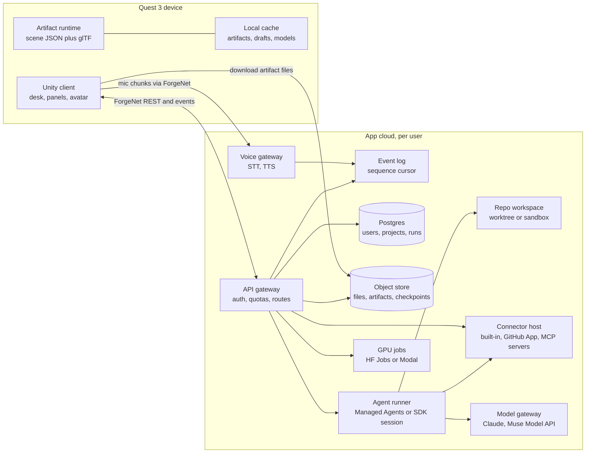

# Albie (next): PROJECT_CONTEXT

> **Albie** keeps its name (D-01). This plan turns the Gator Hack Albie into the next Albie. It is a mixed-reality workspace for engineers on Meta Quest 3 (and later Meta's VR Glasses). An AI agent walks on your desk, or floats on a small cloud around the room when you're away from it. You talk to it to plan, build and test any engineering project: software, hardware plus software, or hardware.
>
> In this file, **"Muse" always means Meta's Muse models** (Muse Spark, Muse Voice Transcribe and the rest of the family). It never means our product.
>
> This file is the single source of truth for the next Albie. Every human and every coding agent reads it first. The hackathon-era file (`docs/PROJECT_CONTEXT.md`) stays as the record of what exists today.
>
> **Draft 1, 2026-10-29.** A team of 52 Claude Haiku 5.5 agents researched it, fact-checked it and drafted it. 20 researchers worked on the web, 8 mapped the existing repo, 14 skeptics checked the claims about Meta, 9 wrote the sections and 1 critic reviewed the draft. The lead session then merged the drafts and resolved the conflicts. Treat every contract here as a **proposal** until its owner accepts it.
>
> **Revised 2026-11-01:** artifacts work with any connected service (D-36), messages run on a Meta service and are in the demo (D-37), Meta services come first (D-38), and the work is split across five people (sections 2.2 and 16, D-39).

**How to read this file**
- Sections 1 and 2 are authoritative. When a later section disagrees with them, sections 1 and 2 win.
- Sections 5 to 11 are the specs for each part of the product. Section 15 (build anything: the Thing runtime, notebook, code mode as cockpit, competition cut) supersedes the drone-only demo in sections 4 and 8.4.
- Section 12 lists gaps the plan still has to cover. Section 13 lists every proposed contract in one place. Section 14 is the migration from Albie. Section 16 says who builds what, and when.
- Labels on facts:
  - **(verified)**: confirmed by a primary or reputable source and a fact-check pass.
  - **(secondary)**: reported only by third parties.
  - **(unverified)**: claimed somewhere, not confirmed.
  - **(not found)**: we looked and found nothing. That is an absence of evidence, not proof.

---

## 0. Status (2026-10-29)

### 0.1 What exists today (Albie, on `main`)

- **Headset app.** Unity 6000.6.7f1, URP, Meta XR SDK 207.0.1, OpenXR 1.18.0, IL2CPP ARM64. MRUK finds the real desk, and a gator pet walks on it.
  - A neon dock on the desk opens four modes: ML, CAD, CODE and MSG.
  - Desk extras: focus timers, notes and a movie screen. **The movie screen is cut (D-29, PR-00).**
- **Standalone on the headset** (PR #1, `feat/on-device-port`). With no laptop:
  - Grok realtime voice runs from the device (`AlbieVoice.cs`).
  - 59 tools run on the device through `AlbieTools.cs` and per-module `Resources/AlbieTools/*.json`.
  - CAD and ML run on a per-device Hugging Face Space (`cloud-py/app.py`).
  - Vercel functions (`cloud/`) mint voice tokens and proxy Claude.
- **Laptop hub (optional).** `hub/` is FastAPI plus one `/ws`. It runs:
  - Grok voice and a shared registry of about 60 tools.
  - A Claude Agent SDK runner with git worktrees, and the gator crew.
  - Slack and iMessage, the VS Code screen bridge, the ML setup and improve pipeline, and the build123d CAD service.
- **Real today:**
  - CAD: versioned build123d designs, analysis, flight sim, GLB, drawings.
  - ML: open repo, classify, adapter, train, live metrics, improve.
  - Neural Net Lab sim.
  - Messages with draft-then-send.
  - Desk-walking pet with arrival and greeting.
- **Partly real:**
  - CODE on the headset: a sample project only.
  - Agent crew: hub worktrees, or one Claude call per task on the device.
- **Not built:**
  - GitHub integration, PR or CI visuals, a Playwright browser panel.
  - Projects and artifacts.
  - Any Muse or Meta AI integration.
  - The floating "cloud" behaviour.
  - Per-user cloud storage and auth.

### 0.2 Known gaps carried forward

- Grok is the only voice. "Albie", "Bit", "gator" and "crew" are hard-coded in many files.
- `Workspace` allows one open mode at a time, and `Workspace.Open` refuses unless you are at a desk. Both block projects and artifacts.
- The hub uses process-wide singletons, so it isn't safe for several users or projects.
- Agent-written code isn't sandboxed. CAD part scripts run with full filesystem and network access. `CODE_DENY` is a string blocklist.
- The cloud app key ships inside the APK, so it's effectively public. The rate limit lives in memory on each server instance.
- The cloud `/events` log is a 400-entry deque. HF Space `/data` isn't persistent without attached storage.
- Correctness bugs to fix early:
  - `cloud-py/app.py` `DEVICES.popitem()` doesn't close the evicted device's CAD service.
  - `hub/agent/runner.py` `create_task_worktree` snapshots with `git stash create`, which skips untracked files.

### 0.3 What is planned (next Albie)

- **Three top-level modes replace ML, CAD, CODE and MSG** (section 2, D-07):
  - **CODE MODE**: day-to-day software engineering with an agent team and GitHub.
  - **PROJECT MODE**: start-to-finish projects that combine code, ML, NN visualization and simulation, CAD and future tools.
  - **ARTIFACTS**: generated tools, visuals and simulations that you keep and rerun.
- **Meta's Muse becomes the brain and voice.** Meta exposes it to developers as a text and tool model plus speech-to-text, not as a voice agent, so the voice runs as a pipeline (section 1).
- **The agent gets its own 3D body.** Meta ships no developer 3D Muse avatar, so we generate one from an image (section 5.5).
- **The tools in this repo become "core tools"** any project or artifact can call (section 10).

### 0.4 Target: Meta VR Start Developer Competition 2026 (official rules, read 2026-10-29)

- **Deadline: 2026-11-18, 12:00 PM PT.** The submission is frozen at the deadline. Judging runs until about Dec 9, and winners are announced about Dec 11.
- **Eligibility.** The person submitting must be a **Meta VR Start member** by the time they submit. Each person can submit one Entry, as a solo entrant or as one Team's Representative. **Status: done.** Start membership is in place, and the whole Albie team enters together as one Team.
- **What to submit:**
  - An APK in a release channel named **"Competition"** on the Meta VR Developer Dashboard.
  - A video under 3 minutes, public on YouTube or Vimeo, showing real Quest or simulator footage (not AI-generated video).
  - A text description with a target launch date.
  - The app must be free and keep working for the judges until the winners are announced.
- **Stage 1 (pass/fail): hands-first.** The judges ask: "Can someone complete the entire experience without ever pairing a controller?"
- **Guidelines:**
  - Seated, with every interaction within a 2 ft radius.
  - Fast cold start and clean pause/resume.
  - "Satisfying in ≤10 minutes".
  - "Original, not a wrapper": take away the third-party service, and there should still be a Project.
- **Judging (25% each):**
  - Innovation & Creativity.
  - Experience Design: purposeful passthrough and FoV-aware layout.
  - Technical Implementation: hands, gaze (ISDK v207+), MRUK, at least 60 fps, robust in rooms we never tested.
  - Polish & Presentation.
- **Judge access to GitHub (D-30).**
  - A dedicated demo GitHub account (a machine account, owning a demo org with sample repos) is signed in automatically for judges. Its login details go in the Devpost testing instructions.
  - The account's token lives **only in the cloud**, never in the APK. Use a fine-grained token scoped to the demo org, with an expiry after Dec 11.
  - Judges never see a sign-in step. The device-flow sign-in (section 7.5) stays for real users.
  - Every push, PR or merge still needs a confirm step.
  - Reset the demo repos nightly.
- **Testing.** Prototype on Quest 3 with controllers, then do a full pass with hands only before every build that goes to the Competition channel. Stage 1 is pass/fail on hands-first.
- **Our prizes:**
  - Best New, or Best Adapted, Productivity Experience: $70k winner, $35k runner-up, in each division.
  - Special award "Best Agentic Interaction" ($25k): "spatial agents, voice-first AI interaction, context-aware assistance".
  - One prize per Entry.
- **Tools.**
  - Only Meta tools released to the public or to Start members may be used. The Muse Model API and Voice Transcribe public previews qualify.
  - Unreleased features don't, for example Muse Realtime Avatar.
  - Third-party tools (Claude, Grok, Meshy) are fine if their terms allow the use.
- **Name and brands.** The Project must not "create or imply any association between Sponsor and any individual, entity...", and must not contain "brand names... recognizable branded products", or infringe a trademark.
  - **So the app can't be called "Muse" or show "Muse", "Claude" or other brand names in its UI.** Name the technologies in the Devpost description instead. This covers connectors too: the UI says "source control", not the vendor's name.
  - Resolved: the app stays **Albie** (D-01).
- **People.** "Projects may not mention or depict any identifiable person other than Entrants." Sample data, including the sample connector's, must be fictional or use Entrants. The movie screen streamed a public-domain film showing real actors; it is removed (D-29).
- **Originality.** The Project must be "ORIGINAL to each Entrant". Covered: the whole Albie team is the Team. Third-party assets still need licences that allow the use. Albie stays the Quirky Series gator for the competition (D-03). It is a paid Unity Asset Store pack, so confirm its licence covers every Team member who builds with it (Asset Store art packs are licensed per seat or per entity) and use in a free app. It stays out of git, as today.
- **Division:**
  - *New Experience*: "conceived of and built within the competition window (starting September 24, 2026). No pre-existing codebases, no shipped titles, no early access builds repurposed."
  - This repo's first commit is 2026-10-23, inside the window, and it was never shipped. So New Experience is arguable, but it was a Gator Hack V entry first.
  - Meta can move an Entry to another division. Say plainly in the description what was built for Gator Hack V and what was built for this competition, or ask the organizers first.

---

## 1. What Meta's Muse actually gives us (verified facts, 2026-10-29)

These facts shape the whole plan. Re-check them on `dev.meta.ai` and `developers.meta.com` before design lock, and every month after that: the Muse family is moving fast.

### 1.1 The facts

| Item | What we know | Confidence |
|---|---|---|
| **Muse** (the brand) | Meta Superintelligence Labs' (MSL) family of models and agents. Separate from Llama (Meta's Muse pages don't mention Llama). Unrelated namesakes: the Interaxon Muse headband and Microsoft's Muse game model. | verified (the brand); the Llama link is unverified |
| **Muse Spark** | Launched 2026-04-08 as MSL's first model, closed, with a private API preview for partners. Powers the Meta AI app and meta.ai. | verified |
| **Muse Spark 1.1** | 2026-07-09. Multimodal reasoning model with a 1M-token context. Launched as a **public preview of the Meta Model API** (`api.meta.ai/v1`). US-only with a waitlist and $20 of credits at launch. | verified (model and preview); US-only and credits are secondary |
| **Muse Spark 1.2 / 1.3** | 1.2 about 2026-08-05; 1.3 on 2026-09-02 (Axios), with stronger agentic and coding performance. Both appear on Meta's models page, along with `-contributor` variants. | 1.3 verified by Axios and Meta's models page; 1.2 secondary |
| **Model API pricing** | Spark 1.1 to 1.3: about $1.25 per M input and $4.25 per M output. **Contributor** variants cost about $0.10 / $0.20 and let Meta train on your prompts and outputs. Wonder: $4 / $20 per M, $0.20 cached, $2.50 per 1,000 web searches. | medium: one checker fetched Meta's pricing page; other figures are secondary |
| **Rate limits** | 3,000 RPM and 4M TPM are listed for Wonder and Spark. | medium |
| **Muse Wonder** (`muse-wonder-1.0`) | Larger closed model on the Model API. "Wonder Full" is only in Muse Code subscriptions ($50 and $200 a month). | secondary |
| **Tool / function calling** | Reported for Spark 1.1 (LiteLLM) and parallel calls for 1.2 (OpenRouter). **Not confirmed in Meta's own docs.** | unverified: **test it first** |
| **OpenAI / Anthropic-compatible endpoints** | Reported by third-party guides. | unverified |
| **Muse Voice Transcribe** (`muse-voice-transcribe-1.0`) | 2026-09-01. **Realtime speech-to-text only**, with diarization and end-of-turn detection. Streaming WebSocket with Meta's own protocol (JSON handshake with `authorization.accessToken`, `audioEncoding` PCM_24KHZ, an `endStream` frame); **not** OpenAI-Realtime compatible. About $3 per 1,000 audio minutes ($0.18 an hour). | verified (STT only, protocol shape); price secondary; rate limits conflict (8 vs 128 concurrent streams) |
| **Speech-to-speech or TTS from Meta for developers** | **Not found.** Meta's STT docs say the model doesn't synthesize speech. | not found (several searches) |
| **Muse Realtime Avatar** | Announced at Connect, 2026-09-23. A live **video** avatar: it animates a character from reference media with lip sync and gestures, about 870 ms latency. No developer API, SDK, 3D model, price or date. Sources disagree on what "Jolly" names. | verified (announcement); no developer access |
| **3D model of a Muse avatar for developers** | **Not found.** | not found |
| **Meta Avatars SDK** | End-of-feature; 40.0.1 is final. No glTF or FBX export, eye tracking not supported, NPC use allowed, about 32 free sample avatars (2021 blog). | verified (status) |
| **Lip sync** | OVRLipSync is end-of-life. The Movement SDK's audio-to-visemes path is Meta's stated replacement. | medium-high: confirm on a Quest 3 |
| **Muse Glimmer** | 2026-08-10. 30B open weights, Apache 2.0, text and image input, distilled from Spark outputs. Needs a 24 or 32 GB memory budget when quantized, so **not Quest-class hardware**. | verified |
| **Muse Spark Open** | Reported 2026-10-15 as an open-weight MoE (816B total, 42B active). Meta's docs reportedly list it. | unverified (single source) |
| **Muse Code** | Meta's terminal coding agent (beta, Spark-powered). Meta's **Device Readiness Check lists it as a supported AI provider** (needs Meta XR Core SDK v207.0.1+), and the Meta VR CLI can scaffold projects with agents such as Muse Code. | verified (Meta pages) |
| **Calling Meta AI or Muse from a Quest app** | No Horizon OS or Meta XR SDK API found that lets an app call the system assistant. | not found |
| **Meta Voice SDK** (Unity, v85, Feb 2026) | Maintained. Wit.ai intent matching, public dictation classes (`DictationListener`, `AppDictationExperience`), and Wit-backed TTS. Not an LLM. | verified (package version and classes); Wit.ai's 2026 status unconfirmed |
| **Wearables Device Access Toolkit 1.0** | For the **AI glasses**, not Quest. Apps can be launched with "Hey Meta". Meta AI connectors are in early access. | verified (Connect recap) |
| **Muse Connectors** | Meta's Help Center describes them only as links between the **consumer Muse app** and other services. Submitting one means Meta's functional, security and legal review, then a directory listing. | verified (Help Center; platform text quoted by a third party) |
| **Connector list** | Gmail, Google Calendar, Outlook, Google Docs, Plaid, OpenTable, Spotify and others at launch. Asana, Box, Canva, Dropbox, Figma, Granola, Notion, Shopify, Slack, Stripe, Zoom and others added on Sep 29. Meta publishes no full list; it lives in the app's settings. | secondary (Meta posts quoted by a third-party tracker) |
| **Using a user's connectors from the Model API** | **Not found.** Nothing says a third-party app can reach them. | not found |
| **MCP with Muse** | Sources conflict. One says Muse has no "add MCP server" setting and builds its own client; another quotes MCP onboarding in a developer program. | unverified |
| **Muse Connectors developer portal** | Drew 1,500+ applications in under a week (TechCrunch). Third parties report business verification and onboarding in waves. No review timeline found. | verified (it exists); terms secondary |
| **Meta messaging APIs** | WhatsApp Cloud API and the Messenger Platform send from a **business number or a Page**, never from a person's account. The recipient must message first, which opens a 24-hour window; outside it, only approved templates or opt-ins. WhatsApp has a test number with registered recipients. | verified (Meta developer docs, 2026-11-01) |
| **WhatsApp ban on general-purpose assistants** | From 2026-01-15 the Business API bars AI assistants as a main service; support and booking bots stay allowed. An open-ended assistant like Albie would likely fall under the ban. | secondary (Meta's policy text not read) |
| **Muse's own messaging** | Messenger and Instagram are reported as connectors "only available to Muse". WhatsApp is a place to talk to Muse, not a connector. No developer access. | secondary |
| **Messenger files and access** | Files can be sent by URL. **In development mode, only people with a role on the app** trigger webhooks and receive; anyone else needs Advanced Access through App Review, with no timeline found. The recipient ID comes from a `messages` webhook on an HTTPS endpoint. Size limits and rules for .glb, .stl or .zip: not found, so test them. | verified (Meta docs, 2026-11-01); limits not found |
| **Muse Gadgets SDK** | Open-source hardware SDK (ESP32 and Linux, Apache 2.0). Not for Quest. | verified |
| **Meta VR Glasses** | Announced at Connect 2026. $1,299, ships spring 2027, tethers to PC or Mac. Same OS and SDK family as Quest. Device Readiness Check, Meta VR CLI. Unity 6000.0.66f2 or later. About 70° horizontal FOV. Muse comes to Meta's glasses with a wake word "in the coming months". | verified (core facts); "Project Phoenix" name, weight, RAM and vertical FOV unverified |

### 1.2 What this means

1. **Muse is not a drop-in replacement for Grok.**
   - Meta gives developers a text, vision and tool model (Spark) and speech-to-text (Voice Transcribe). It gives no speech-to-speech session and no TTS.
   - Muse's voice is therefore a **pipeline**: Muse Voice Transcribe, then Muse Spark with tools, then a TTS engine, then audio and visemes on the headset.
   - Expect more latency than one realtime session; target under 1.5 s from end of speech to first audio.
   - Keep Grok behind the same interface as a fallback until the Muse pipeline passes on-device tests.
2. **Muse can't be called from the headset with our key in the APK.**
   - All Meta Model API calls go through our cloud gateway, as Claude does today through `cloud/api/claude.ts`.
   - Voice Transcribe uses its own WebSocket protocol, so audio goes through a cloud relay. A direct device socket is allowed only if Meta issues short-lived tokens, and only with Core owner sign-off.
3. **The avatar is ours.**
   - For the competition, Albie stays the gator.
   - Roadmap: an original bean-style avatar, generated as a rigged glTF from a concept image (section 5.5).
   - Keep the avatar behind an interface, so the gator, the bean or a future Meta asset can be swapped in.
4. **Apply for early access now.**
   - Meta realtime voice and Muse Realtime Avatar developer access.
   - Connector access from the Model API, if it's ever offered. Publishing Albie as a Muse connector is a roadmap idea, since review needs business verification and has no stated timeline.
   - The Meta Data Use Checkup is needed before any production platform API (user ID, entitlements).
5. **Muse Code is a candidate for CODE MODE**, next to Claude: Meta already ties it to Quest and glasses tooling. Evaluate it (D-16) rather than assume either.
6. **Glasses-ready from day one.** Keep passing the Device Readiness Check.
   - Assume tethered PC or Mac use and the glasses' narrower FOV: panels must fit about 70° horizontally.
   - Input is hands, a virtual keyboard and a trackpad.
7. **Naming.** "Muse" is Meta's own brand family, so it is never our product name or shown in the UI. The product stays **Albie** (D-01).
8. **We can't inherit a user's Muse connectors.** As far as we can find, they work only inside Meta's app. Albie's "works with whatever is connected" runs on its own connector host, with a slot for Muse connectors if Meta opens them (section 9.6).
9. **Meta messaging can't send as you, but it can send to you.** A Page can message anyone who messaged it first, so "send me the updated model" fits. "Tell a teammate yes" as you doesn't (D-37).

### 1.3 Meta first: which service does which job (D-38)

A non-Meta row needs a reason. Person 3 owns the Brain rows and records test results here. Person 2 owns the headset rows.

| Job | Service | Why not Meta, if not |
|---|---|---|
| Voice turns, planning, Thing specs, artifact generation, notebook lessons | Muse Spark through the gateway | |
| Small code edits, explaining a diff | Muse Spark | |
| Hard planning only, if Spark falls short | Muse Wonder (about 3 to 5 times the price, so not the default) | |
| Long agentic coding, agent-team runs, ML repo adapters | **Claude** | Not yet proven on Spark. Muse Code is evaluated after the competition (D-16). |
| Speech to text | Muse Voice Transcribe | |
| Text to speech | Meta Voice SDK TTS first (Wit.ai's 2026 status is unconfirmed) | A third-party streaming TTS only if Meta's fails the latency test. Meta has no other TTS. |
| Fallback voice | **Grok** | Only until the Muse pipeline passes on a Quest 3 (D-02). |
| Hands, gaze, poke, grab | Interaction SDK | |
| Room, floor, walls, furniture, anchors | MRUK and spatial anchors | |
| Mouth movement | Movement SDK audio-to-visemes, if confirmed on a Quest 3 | Falls back to TTS timings or audio level, with no other vendor. |
| User ID and entitlements | Platform SDK (needs the Data Use Checkup) | |
| Readiness, scaffolding, release | Device Readiness Check, Meta VR CLI, Developer Dashboard | |
| On-device training and physics | Our own trainer and Unity PhysX | Meta has no such service. |
| Sending the user a file or update | Messenger Platform, through a Page (D-37) | |
| Repo hosting | **GitHub** | Meta has no such service. |

All Spark and Claude calls go through one gateway with one routing table (task type to model), so a task can move between models by changing config.

---

## 2. Decisions

Section 2.1 is the one list of decisions. Section 2.2 gives each person the decisions they own and what they must decide next. Section 2.3 lists what needs the whole team.

- **Decided**: the product direction. Change it only as a team.
- **Proposed**: the plan's recommendation. It stands unless its owner changes it. The owner records the change here in the same PR.

### 2.1 Overall decisions

| ID | Decision | Status | Owner |
|---|---|---|---|
| D-01 | Product name stays **Albie**. "Muse" is never the product name or in the UI. | Decided | Person 1 |
| D-02 | **Voice = `VoiceBackend` interface.**<br>- Muse pipeline: Voice Transcribe, then Spark, then TTS.<br>- Grok adapter kept as the fallback and current default until the Muse path passes latency and quality tests on a Quest 3.<br>- TTS candidates: Meta Voice SDK TTS (Wit-backed) first, then a third-party streaming TTS with under 300 ms to first audio and word timings.<br>*Why:* No Meta speech-to-speech exists (section 1.1). | Decided | Person 3 |
| D-03 | **Avatar (decided 2026-10-30):** **keep the gator for the competition.** A new avatar is on the roadmap: an original, soft, rounded **bean-shaped** character with stubby limbs and a big expressive face, in the playful toy-like style of party-game beans. It must be our own design: no copying Fall Guys' or Meta's Muse character designs, since copyrighted and sponsor-associated looks are both out (section 0.4).<br>**Roadmap pipeline** (section 5.5):<br>- Concept image, then image-to-3D (Meshy API for mesh, rig and animations; or TRELLIS.2, MIT, self-hosted on a 24 GB+ GPU), then a custom non-biped rig (the cloud form isn't a biped, so Mixamo is out), then glTF at under about 30k triangles and 2048 textures.<br>- Visemes come from the Movement SDK if confirmed on a Quest 3, else from TTS word timings, else from audio amplitude.<br>- No Hunyuan3D (it excludes the EU, UK and South Korea).<br>*Why:* No Meta 3D asset. Licence-safe options. | Decided | Person 1 |
| D-04 | **Git runs only in the cloud workspace.** The headset uses REST through the cloud. No LibGit2Sharp in the APK.<br>*Why:* No verified Android build. Tokens stay off the device. | Proposed | Person 3 |
| D-05 | Contract changes go through a proposal PR and need Core owner acceptance. | Decided | Person 2 |
| D-06 | Keep the `Forge*` code prefix, the `_Forge/` folder and the `Albie*` class names. Rename only "Bit", "gator" and "crew" strings and ids.<br>*Why:* Renaming `Forge` touches every file, and the product is still Albie. | Proposed | Person 2 |
| D-07 | Three top-level modes: **CODE MODE**, **PROJECT MODE**, **ARTIFACTS**. ML, CAD, the NN Lab and simulation become core tools used inside projects and artifacts. Timers and notes stay as desk extras in any mode. Messages is no longer a mode. Sending is a tool available in any mode (D-37). | Decided | Person 1 |
| D-08 | **Agent team** = our own orchestrator running one session per role (Lead, Builder×N, Tester, Reviewer, optional Docs). Builders get their own worktrees from a named base commit. Each file has one writer at a time. Concurrency starts at 3. Claude Code's experimental Agent Teams aren't used: they are interactive-only.<br>*Why:* Section 7.6. | Proposed | Person 3 |
| D-09 | **Agent host:** start with the Agent SDK in our own containers (it extends `hub/agent/runner.py`). Evaluate Claude Managed Agents with a self-hosted sandbox for private repos.<br>*Why:* Managed Agents is beta and not ZDR-eligible. | Proposed | Person 3 |
| D-10 | Agent-written code (CAD parts, CODE MODE commands, artifact build checks) runs **only in a sandbox**: no network by default, an import or command allowlist, CPU, memory and time caps. Nothing agent-written runs in the hub or worker process.<br>*Why:* `worker.py` and `CODE_DENY` aren't sandboxes. | Proposed | Person 3 |
| D-11 | **3D model sources:**<br>- **Sketchfab is the primary browse source** (the user's ask). The user signs in with OAuth, and the cloud holds the token.<br>- **Poly Haven** (CC0, no account) is the no-login fallback.<br>- A licence gate allows CC0 and CC-BY by default; NC, ND and SA need confirmation; attribution is stored and shown.<br>- Get a legal read on shipping CC-BY assets before launch.<br>*Why:* Follows the vision; keeps a no-login path. | Proposed | Person 2 |
| D-12 | **Cloud:**<br>- Identity: the Horizon OS per-app user ID, linked to our `User` record.<br>- Blobs: Cloudflare R2. Metadata: Postgres.<br>- Per-user or per-install tokens replace the shared APK key.<br>- Meta Cloud Backup isn't used for project data.<br>*Why:* Section 6.4. | Proposed | Person 3 |
| D-13 | **Brain, Meta first (D-38).** Muse Spark (pinned in config: 1.3 if Meta's page confirms it, else 1.1) handles voice turns, planning, Thing specs, artifacts, notebook lessons and small code edits. **Claude handles long agentic coding** (multi-file changes, agent-team runs, ML repo adapters) through the existing proxy and Agent SDK, until Muse Code is evaluated (D-16). If Spark fails the tool-calling test on 2026-11-04, Claude takes the failed task types too, and the fallback is written down, not silent.<br>*Why:* the user's direction is to get the most from Meta's services while being realistic about code work. Spark's tool calling isn't confirmed in Meta's own docs. Claude's is proven in this repo. | Proposed | Person 3 |
| D-14 | **Mesh to parameters is tiered, with a human in the loop:**<br>- Tier 0 (transform only) and Tier 1 (PartField regions) are committed.<br>- Tier 2 (primitive fits) is for mechanical parts.<br>- Tier 3 (an LLM-written build123d script checked by rendering) is best-effort and sandboxed.<br>- Fully automatic, faithful parameters (Tier 4) aren't promised.<br>*Why:* Research says Tier 4 isn't solved. | Proposed | Person 2 |
| D-15 | Drop LibGit2Sharp on device. It has no verified Android build. | Proposed | Person 3 |
| D-16 | Evaluate **Muse Code** as a CODE MODE agent runtime, next to the Claude Agent SDK. Pick per task type after a bake-off.<br>*Why:* Meta lists Muse Code in its VR tooling. | Proposed | Person 3 |
| D-17 | **Data policy.** Never send user code, voice or integration data to a `-contributor` model tier (those train on content). Use standard tiers only. Say so in the privacy notice.<br>*Why:* Contributor tiers train on prompts and outputs. | Proposed | Person 3 |
| D-18 | **Artifact runtime:**<br>- **Phase 1** is a data-driven scene (`manifest.json` + `scene.json` + glTF, with declared rules for animation, input and metrics). No script engine ships.<br>- **Phase 2** adds sandboxed QuickJS (directly or through PuerTS's QuickJS backend) only after a Quest IL2CPP spike passes.<br>- WebView or three.js panels are unproven on Quest and stay a later experiment.<br>*Why:* Avoids the IL2CPP and JIT risk. Ships sooner. | Proposed | Person 5 |
| D-19 | **One REST namespace:** `/v1/{code,projects,jobs,artifacts,integrations,voice,model,events}`. Existing `/cad`, `/ml`, `/tools`, `/events` and `ui.mode`, `stt.*`, `tts.*`, `pet.state` stay as they are until a contract PR replaces them (section 13).<br>*Why:* The drafts used three namespaces. | Proposed | Person 3 |
| D-20 | The agent's brain and voice come from **Meta's Muse**, replacing Grok. In practice that means the pipeline in section 1.2. | Decided | Person 3 |
| D-21 | Avatar: a Meta Muse avatar if Meta ships a developer 3D model. **It doesn't, so Albie stays the gator for now, and an original avatar of our own is on the roadmap** (D-03, section 5.5). | Decided | Person 1 |
| D-22 | Behaviour: at a desk the agent walks on the desk (reuse the gator's desk-walk, `GatorNavSurface` and `GatorController.Surfaces`). Away from a desk it floats around the room on a small cloud. | Decided | Person 1 |
| D-23 | On device where possible, with an app cloud for files that aren't on the device. | Decided | Person 3 |
| D-24 | Repos: clone the user's GitHub repo into their cloud workspace. Switching repos clears it only when the work is safe (D-25). A project can start with no integrations and be pushed to GitHub later. | Decided | Person 3 |
| D-25 | **Repo switch rule (canonical):**<br>1. If the workspace has uncommitted or untracked changes, the switch stops and lists them, with one-tap **Commit** or **Stash (with untracked files)**.<br>2. Before any clear, the cloud always saves a `git bundle` of all refs plus the stash, so it's recoverable from the repo list.<br>3. Then it clears.<br>Workspaces are keyed **per user per repo** (`workspaces/{userId}/{repoId}`). A project references zero or more repos.<br>*Why:* Merges three conflicting draft rules. | Proposed | Person 3 |
| D-26 | CAD: browse Sketchfab (or similar) and turn a downloaded model into parts and parameters in the existing CAD part, parameter and version system. | Decided | Person 2 |
| D-27 | Core tools: everything built here becomes a reusable tool set for any engineering project, used to build the exact visuals and tooling the user needs. | Decided | Person 2 |
| D-28 | **Versions:**<br>- A project has a version counter (`v14`, `v15`).<br>- Each project version pins: the repo commit for each repo, the CAD design version for each design, the dataset and checkpoint IDs, and the artifact versions.<br>- Artifact run records store the project version they ran against.<br>- Git commits, CAD versions and artifact versions keep their own histories. The project version is the manifest that ties them together.<br>*Why:* Reconciles four version systems. | Proposed | Person 5 |
| D-29 | **Cut the movie screen** (movie tools, panel, hub module, mocks). It is outside the three modes, and the archive.org film shows identifiable people (rule 4).<br>*Why:* Removal plan: section 14.11. | Decided | Person 2 |
| D-30 | **Judge GitHub access:** an auto-signed-in demo GitHub account whose token stays in the cloud and is scoped to a demo org (section 0.4).<br>*Why:* Judges must be able to use CODE MODE with no setup. | Decided | Person 3 |
| D-31 | **No Meta Muse avatar.** Meta ships none to developers, Muse Realtime Avatar is unreleased (banned by the "released tools only" rule), and a Meta likeness would imply sponsor association. The Meta Avatars SDK is released, but it gives user avatars, not a Muse character. Our own generated avatar stays (D-03).<br>*Why:* Section 1.1, section 0.4. | Decided | Person 1 |
| D-32 | **Build anything:**<br>- Projects are about any object, made from an on-device parts kit (the Thing runtime) that the agent composes and the user edits.<br>- The rocket, quadcopter, droid, gearbox and ML template are starters on that same runtime, and the demo's RC truck is composed live.<br>- Play physics runs on the device; engineering physics runs in the cloud. | Decided | Person 2 |
| D-33 | **On device first, cloud as "Albie Pro".** Design, play physics, small-model training, artifacts and the notebook work on the Quest. Exact CAD, GPU training, cloud agents and integrations are the future subscription. Judges get everything free. | Decided | Person 1 |
| D-34 | **Every project keeps a lab notebook.** Attempts, outcomes and lessons are logged; "that didn't work" triggers a lesson and a revised plan, and lessons carry into new projects. | Decided | Person 5 |
| D-35 | Electrical, PCB, firmware export and BOM are roadmap items, after the competition. | Decided | Person 1 |
| D-36 | **Artifacts work with whatever is connected.** No artifact, tool or demo names a vendor in its design. The agent lists the connected tools, picks the ones that fit the user's idea, and builds from them (section 9.6). AWS and Datadog are no longer planned tools; they are examples of what a connector could provide. A user's connectors inside Meta's Muse app can't be reached from the Model API as far as we can find (section 1.1), so Albie runs its own connector host and keeps a backend slot for Muse connectors.<br>*Why:* the user's direction, and the rules discourage integration-heavy wrappers. | Decided | Person 3 |
| D-37 | **Messages are in the demo, on a Meta service.** "Can you send me the updated model?" Albie drafts it, you confirm, and the file reaches your phone through a Messenger Page. The spike is due Nov 6. Slack and iMessage are removed once Messenger works on a Quest (PR-00b, section 14.12). If Messenger fails, try the WhatsApp test number, and then the existing Slack path through the laptop hub, for the video only.<br>*Why:* the user's direction. Sending to yourself is what these APIs allow: the recipient has already messaged the Page. Replying as you to other people isn't possible, so that goes. | Decided | Person 1 |
| D-38 | **Meta first.** Use a Meta service for each job where a released one exists (section 1.3). A non-Meta service needs a written reason in that table. Today's reasons: Claude for long coding, a third-party TTS only if Meta's doesn't pass, and Grok as the voice fallback until the Muse pipeline passes.<br>*Why:* the user's direction, and the app is built for Meta's competition. | Decided | Person 3 |
| D-39 | **Five chunks, one lead each, numbered and not named** (section 16). The team decides who takes which. Most people work across chunks; the lead is accountable and reviews.<br>*Why:* the competition cut has to run in parallel over 17 days. | Decided | Person 1 |
| D-40 | **Controllers.** Every Thing takes three swappable controller types: manual, code (a rule and PID graph) and learned. For the competition, learning is behaviour cloning on the device, with no cloud needed and no ONNX unless Person 4 asks for it (section 15.4).<br>*Why:* it keeps the brain beat working with no network, which passes the take-it-away test. | Proposed | Person 4 |

### 2.2 Decisions by person

Dates are in 2026 and are proposals. If a decision misses its date, the stated default applies, so nobody waits.

#### Person 1 (product, Albie's presence, hands, code mode, submission)

Owns D-01, D-03, D-07, D-21, D-22, D-31, D-33, D-35, D-37, D-39.

| By | Decide | Default if undecided |
|---|---|---|
| Nov 3 | The team picks who takes which chunk (D-39). | No default: this one has to happen. |
| Nov 5 | Does the Quirky Series licence cover every team member who builds with it, and a free app (section 0.4)? | Only licensed seats build with the pack. Others use a placeholder. |
| Nov 7 | Division: New or Adapted. Ask the organizers, and say plainly what came from Gator Hack V (section 0.4). | Enter Adapted. |
| Nov 7 | If the Messenger spike failed, which fallback (D-37). | The WhatsApp test number. |
| Nov 12 | Final video script. Does the connector beat (15.6, step 7b) stay? | Left out of the video. It's in the live demo only. |
| Nov 12 | How the phone appears in the video, since brand names and logos are a risk (section 0.4). | Show only the received file, with no app name or logo in frame. |
| Nov 14 | What to cut at feature freeze. Cut from the bottom of 15.10, not the middle. | Anything not hands-only by this date is cut. |
| After Nov 18 | Bean avatar: who draws the concept art, and when. Albie Pro pricing. | Not started. |

#### Person 2 (Core, Thing runtime)

Owns D-05, D-06, D-11, D-14, D-26, D-27, D-29, D-32. As Core owner, accepts or rejects every contract proposal.

| By | Decide | Default if undecided |
|---|---|---|
| Nov 3 | Accept or change C-16 (Thing spec), C-01 (mode ids) and C-04 (open away from the desk). | Build against the proposals as written. |
| Nov 4 | Accept or change C-12, C-17, C-18 and C-19, within a day of each owner's proposal. | Same. |
| Nov 5 | Wheels: `WheelCollider` or `ArticulationBody`, after a feel test on a Quest with hands. | `WheelCollider`. |
| Nov 8 | Does the Inference Engine package go in `Packages/manifest.json` (15.4)? | No. Use our own C# MLP. |
| Nov 12 | Do the droid and gearbox move to the Thing runtime, or keep today's demos? | Keep today's demos. |
| After Nov 18 | How far hardware-only projects go: BOM, sourcing, fab handoff (section 12). The binary channel for browser frames (C-08). | Not started. |

#### Person 3 (brain, voice, cloud, connectors, messaging backend)

Owns D-02, D-04, D-08, D-09, D-10, D-12, D-13, D-15, D-16, D-17, D-19, D-20, D-23, D-24, D-25, D-30, D-36, D-38.

| By | Decide | Default if undecided |
|---|---|---|
| Nov 4 | Does Spark pass the tool-calling test? Record the routing table result in section 1.3. | Claude takes the task types that failed. |
| Nov 5 | Who pays for tokens and GPU minutes, and the daily spend cap for judges (the APK key is public until PR-18). | The team pays, with a hard daily cap in the gateway. |
| Nov 7 | Demo voice path: the Muse pipeline or Grok. Which TTS. Needs a measured latency on a Quest 3. | Grok, if the Muse path is over 1.5 s to first audio. |
| Nov 6 | Does the Messenger spike pass: a file from the cloud to a team member's phone (D-37)? | Tell Person 1 the same day, for the fallback call. |
| Nov 10 | Judges' messages path: try App Review, or use the demo recipient (section 14.12). | Demo recipient. |
| Nov 8 | Which connectors ship: the demo source-control account and the sample connector, or more? | Those two. |
| Nov 8 | Repo home (section 6.8). | This repo. |
| Nov 10 | Is the gateway's US-only preview a problem for judges? Read Meta's terms, and ask if unclear. | Host in the US. Claude takes over for a build where Spark is refused. |
| After Nov 18 | Sandbox provider for cloud agents (D-10). Muse Code bake-off (D-16). Claude as the brain outside the US. | Not started. |

#### Person 4 (controllers, ML)

Owns D-40.

| By | Decide | Default if undecided |
|---|---|---|
| Nov 4 | Propose C-19: the controller file format and the tick interface, agreed with Person 2. | A JSON rule and PID graph (15.4). |
| Nov 8 | Behaviour cloning: network size, inputs, mirrored-lap augmentation. Needs a timed run on a Quest 3. | Small MLP, about 10 s to train on the headset. |
| Nov 8 | Tell Person 2 whether ONNX is needed for the competition. | Not needed. Use our own C# forward pass. |
| Nov 12 | Is the pretrained fallback needed on the day? If it's used in the video, the Devpost text says so. | Keep it ready. Use live training if it works 5 times in a row. |
| Nov 14 | Which ML template repos work with no network. | One bundled on-device template. Repo import needs the cloud. |

#### Person 5 (artifacts, notebook)

Owns D-18, D-28, D-34.

| By | Decide | Default if undecided |
|---|---|---|
| Nov 4 | Propose C-12 and C-17: freeze the Phase 1 `scene.json` node kinds and rules, and the notebook record. | Section 9.3 and section 15.8 as written. |
| Nov 6 | Where the notebook and project versions live on the device, and the sync rule. | JSON in `persistentDataPath`. The device is the source until a cloud copy exists. |
| Nov 8 | Arena generation in small rooms and rooms with missing labels: how it shrinks and what it says. | Shrink to free floor space and say so. Never fail silently. |
| Nov 10 | The snapshot table format that connects connector data to scenes, agreed with Person 3 (C-18). | Rows of named numbers and strings, with a fetched-at time. |
| Nov 12 | Which starter artifacts ship: slalom, hoop course, launch range, push test, load test. | Slalom and hoop course. |

### 2.3 Decisions for the whole team

| By | Decision | Who runs it |
|---|---|---|
| Nov 3 | Daily 15-minute check-in time, and who holds the Quest when there are fewer headsets than people. | Person 1 |
| Nov 10 | Is the end-to-end truck demo good enough to keep building on, or do we cut scope now? | Person 1, with all owners |
| Nov 14 | Feature freeze. After this, only fixes. | Person 1 and Person 2 |
| Nov 16 | Is the Competition build the one we submit? Everyone does a hands-only pass first. | Everyone |

---

## 3. Pitch

**One-liner:** Albie puts an AI engineer on your desk. It writes, tests and reviews your code, plans your projects with you, and builds the tools you need. You keep those tools and rerun them.

**Pitch (short):** Engineers switch between a terminal, a browser, a notebook, a CAD tool and a pile of dashboards. Albie is one workspace in mixed reality. An agent sits on your real desk. It walks along the desk when you are working and floats on a small cloud when you are away. You talk to it. It works in three modes: CODE for daily engineering, PROJECT for planning and building something from start to finish, and ARTIFACTS for tools and simulations it generates and that you can rerun or take out of the workspace.

**Why it is different:**
- The agent lives in the space where the work happens. The browser, CI status, ML curves and CAD parts float in the air around it.
- Artifacts persist. A drone obstacle course or a 3D cloud map is a saved, rerunnable thing, not a one-off chat answer.
- One workspace covers software, ML and CAD, so hardware plus software projects stay in one place.
- Work runs on the device where possible. Files that do not fit on the device go to the app cloud.

**Who it is for:** a single engineer with a Quest 3 and a desk. Team features come later.

**Caveat for this pitch:** the next Albie is a plan, not a product yet. The demo uses prepared data for any step marked "fallback" below. Do not claim live training or live CI unless the step has been run on the headset.

## 4. Demo spine (4 minutes)

**Setup before the demo:** a headset on a real desk, cloud on. A repo with one failing test and a CI run that failed. A drone project pre-opened with a precomputed training run. A saved obstacle-course artifact.

| Time | Beat | What the viewer sees | Real today | Fallback if not ready |
|---|---|---|---|---|
| 0:00-0:20 | Desk | Albie walks onto the desk from a floating cloud. One-liner said aloud. | Desk detection (exists). | Static placeholder avatar. |
| 0:20-1:25 | CODE MODE | "Fix the failing test and open a PR." A small agent team (planner, coder, tester) takes a branch. A Playwright browser floats above the desk while the tester clicks through a page. A CI strip shows jobs as stacked tiles, red then green. A PR card shows the diff. | Per-task git branches and worktrees in the hub (exists). Browser streaming on Quest (unverified). CI view and PR card (planned). | Replay a recorded Playwright trace in the panel. Feed the CI view from a saved run. |
| 1:25-3:10 | PROJECT MODE (drone) | "New project: a drone that flies through a hoop course." Albie sits down and asks two or three planning questions. It finds a drone model (a Sketchfab model under a checked license). The user rotates it and changes prop size. Muse proposes a flight brain (PPO, written in code) and starts training. Loss curve and rollout trails show in the ML panels. | Project open, classify, metrics streaming (exists for ML repos). Drone simulation training (planned, time unknown). | Do not train live. Play a precomputed run and its logs. Use a saved rollout. |
| 3:10-3:50 | ARTIFACTS | Albie builds an obstacle-course artifact (gates, a pass/fail metric, completion time). It reruns the course on the drone before and after a mass change, and shows a results table. The user pulls the course out into its own window. | Panels for 3D volumes and results (exist). Artifact runtime (planned). | Ship a fixed scene with fixed parameters. The rerun reads stored results. |
| 3:50-4:00 | Close | Albie says, "Your drone is ready to fly. Ask me what to change next." The artifact stays on the desk. | None needed. | None needed. |

**Safety beat, required in CODE MODE.** Albie never pushes or sends without an explicit confirm. The demo stops at "Ready to push? Say send it."

**Speaking points per mode:**
- CODE: the agents work in separate branches. Nothing merges until you say so.
- PROJECT: Albie plans with you before it builds. The drone brain is code you can read.
- ARTIFACTS: the course is a file you own. It reruns on any drone you make.

### 4.1 Unknowns and fallbacks

| Unknown | Fallback |
|---|---|
| Speech-to-speech Muse voice on the headset | STT (Muse Voice Transcribe) plus Muse Spark plus device TTS. Or keep Grok for the demo. |
| Wake word | Push-to-talk (current behavior). |
| Muse avatar 3D model | Generate a rigged model from an image (Meshy or TRELLIS.2 in the cloud). Use a placeholder for the demo. |
| Playwright stream latency on Quest | Measure on device first. Fall back to a recorded trace replay. |
| Drone training time | Precomputed run for the demo. Set the time budget after measuring on a cloud GPU. |
| GitHub sign-in on the headset | Device flow (code shown on screen, 15-minute window). Tokens stay in the cloud. |
| Muse Spark version and price | Pin the version in config. 1.3 is current per Axios and Meta's models page; check dev.meta.ai before the demo. |
| Naming and trademark | The product is Albie. "Muse" appears only in the Devpost text, as the models we build on. |

---

## 5. The assistant: brain, voice and body (proposal)

Status: proposal, not yet decided. Facts below come from team research and fact-check passes. Items marked **unverified** still need a check against Meta's developer docs before design lock.

### 5.1 Scope

Replace the Grok realtime voice (`AlbieVoice.cs`, `hub/agent/voice.py`) with a Muse-based assistant. The assistant is the brain (reasoning and tool calls) and the voice. It has one 3D avatar. It sits on the user's desk when seated, and floats on a small cloud in the room otherwise.

### 5.2 What Muse offers developers today

| Capability | Status | Confidence |
|---|---|---|
| Muse Spark text and reasoning model via Meta Model API (`muse-spark-1.1`, later 1.2 and 1.3 per secondary sources) | Public preview, US-only at launch, OpenAI-SDK-style endpoints at `api.meta.ai/v1` | High that it exists. Prices are secondary: about $1.25 in / $4.25 out per M tokens. 1.3 (2026-09-02) is current per Axios and Meta's models page. |
| Muse Wonder (`muse-wonder-1.0`) | Pay-as-you-go API. About $4 in / $20 out per M tokens. Closed weights. | Medium. Reported from a fetch of Meta's pricing page, with secondary sources for the figures. |
| Muse Voice Transcribe (`muse-voice-transcribe-1.0`) | Realtime **speech-to-text** over `wss://api.meta.ai/v1/asr/realtime`. PCM 24 kHz mono, 16-bit LE. About $3 per 1,000 audio minutes. Session cap about 60 min (close code 1011). | High for the endpoint and STT-only nature. Price and cap are secondary. |
| Muse speech-to-speech / realtime voice API for developers | **Not found.** Meta's docs describe STT only. | Medium (absence after several searches). |
| Muse Realtime Avatar | Announced at Connect, 2026-09-23. Live video avatar driven by Muse Realtime Voice, about 870 ms latency per Meta's post. No developer API, SDK, 3D model, price or date. | High for what is announced. |
| Meta-supplied 3D model or rig of the Muse avatar | **Not found.** | Medium. |
| Meta Avatars SDK | End-of-feature at 40.0.1. No export to glTF/FBX. No license terms for custom use. Not a path for a Muse avatar. | High. |
| Muse Glimmer | Apache-2.0 open weights, 30B, distilled from Spark outputs. Text and image input. Not a voice model. Quest 3 fit unverified (needs a 24 GB+ class GPU at quantized sizes). | Medium. |
| Horizon OS / Meta XR SDK call into Meta AI or Muse | **Not found.** No public API for a Quest app to trigger Meta AI or Muse. | Medium (absence). |
| Wit.ai Voice SDK (Unity) | Speech-to-intent and TTS, cloud-processed. Unity package v85 (Feb 2026); public dictation classes exist. Wit.ai service status in 2026 unconfirmed. | Medium. |

Two open corrections:
- "Muse Spark is closed" may be stale. One secondary source mentions an open-weight "Muse Spark Open" (unverified). Do not state it as fact either way.
- Naming: the assistant is **Albie**. "Muse" here means Meta's models only.

**Recommendation (D-02, D-13):** The brain is a Muse Spark model called through the cloud. The voice is a pipeline (STT, LLM, TTS). No single Meta call gives a Grok-style speech-to-speech session. Use the Muse Spark API for reasoning and tools, Muse Voice Transcribe for input, and a TTS engine still to be chosen (see 5.4).

### 5.3 Brain and tool calling

- The device never holds the Meta key. A cloud route (new file next to `cloud/api/claude.ts`, proposed name `cloud/api/muse.ts`) forwards chat requests. It keeps the key server-side, allowlists models, and caps `max_tokens`.
- Tool calling: LiteLLM and a third-party guide report that `muse-spark-1.1` supports function calling, parallel calls, and structured outputs. Meta's own docs were not confirmed for this. **Unverified until tested against Meta's endpoint.**
- Tool bus: reuse `AlbieTools` (`unity/.../Core/Scripts/AlbieTools.cs`) and `hub/agent/tools.py`. Tools are JSON-schema definitions with handlers. Errors come back as data. Tools are grouped by the new modes (CODE, PROJECT, ARTIFACTS), not by pet or product names.
- Keep Claude for coding and ML work (`claude.ts`, runner). Do not move coding agents to Muse without a separate decision.
- Cost: Wonder at $4/$20 per M tokens is expensive for always-on voice turns. Default to a Spark tier with prompt caching. Put a per-session token budget in the cloud route.

### 5.4 Voice loop

Target pipeline, one turn:

1. Mic capture on device (Quest audio input, push-to-talk or wake word).
2. Stream audio to Muse Voice Transcribe through the cloud. Partial and final transcripts come back.
3. On final transcript, call Muse Spark with the conversation and tool definitions. Stream tokens back.
4. Run any tool calls on device or in the cloud, then feed results back.
5. Speak the reply with TTS. Stream audio to the headset as it is produced.
6. Drive the avatar mouth and gestures from the TTS audio.

Points to decide:
- **TTS engine: open.** The only Meta option found is the Voice SDK's Wit-backed TTS (cloud). Alternatives to evaluate: a cloud TTS with streaming, or Meta's own speech synthesis if it appears in the Model API. Choose one with streaming output and a latency under about 300 ms to first audio.
- **Socket rule.** `CLAUDE.md` says the device does not open its own sockets. Today `AlbieVoice.cs` opens a realtime socket to xAI with an ephemeral token. Proposal: the device talks to a cloud relay through `ForgeNet` for audio up and audio down. A direct device socket to Meta is allowed only if Meta issues an ephemeral token for it, and only with the Core owner's approval (contract change).
- **Latency budget (target, not measured):** end of user speech to first audio under 1.5 s. Meta's own avatar post quotes about 870 ms for its system. Measure on device before committing.
- **Privacy.** Voice collection needs a published privacy policy and explicit user consent. Do not record without a visible on state.
- **Wake word.** Not documented in the Meta Voice SDK. Use a push-to-talk button first. Wake word is a later step (on-device keyword spotter or the Voice SDK activation handler, unverified).
- **Speech-to-visemes.** Meta's OVRLipSync page names the Movement SDK as the migration path for audio-driven visemes (medium-high confidence). **Confirm on a Quest 3.** Fallback: generate viseme timings from the TTS output (phoneme alignment from the TTS provider, or an amplitude-only jaw if no alignment). OVRLipSync is end-of-life. Do not start new work on it.

### 5.5 Avatar

**Now (competition):** Albie stays the gator (the Quirky Series alligator plus our own talk clips, mouth and behaviour). All the desk-walk, hop, caption and talk-animation code already runs on it. No Meta 3D model of Muse is available to developers, and Meta's Avatars SDK is end-of-feature and does not export.

**Roadmap: a new original avatar (after the competition).**
- **Look:** a soft, rounded **bean** character. A single capsule body, stubby arms and feet, a big face with eyes and mouth for clear expressions, bright toy-like materials. Inspired by the playful party-game bean style, but an **original design**: no copying Fall Guys' bean or Meta's Muse character. The contest bans infringing designs and anything that implies sponsor association, and it's better product identity anyway.
- **Why a bean fits:**
  - A capsule body needs only a simple rig (about 15 to 25 bones) and stays well under the Quest's polygon budget.
  - Squash and stretch reads well in passthrough.
  - A big face makes blendshape expressions and visemes easy to see.
  - It sits naturally on the small cloud when Albie is away from the desk.
- **Bridge:** keep the avatar behind one interface (expressions, visemes, talk level, locomotion hooks), so the gator and the bean are swappable prefabs. Start by moving `GatorExpressions` to that interface.

Roadmap pipeline (proposal):
1. Concept image of the assistant (original bean design, no Meta or Fall Guys likeness).
2. Image to textured mesh. Options: Meshy (API pricing published: about 15 to 35 credits for a textured mesh, rigging 5 credits, animation 3 credits per action), Tripo (auto-rig in its docs, pricing and rig quality unverified), or TRELLIS.2 (MIT license, needs 24 GB+ NVIDIA GPU, so run in the cloud Space, not on device).
3. Avoid Hunyuan3D 2.1 for a product sold in EU, UK or South Korea (license exclusion). Stable Fast 3D license unverified.
4. Rig. Mixamo is biped-only. The floating cloud form is not a biped, so use a Meshy or Tripo rig, or a custom rig.
5. Export glTF/GLB. Load at runtime with glTFast. Keep textures at 2048 max and instance repeated meshes (Quest rules).
6. Mouth: 15 viseme blendshapes (see 5.4).
7. Idle, walk, float, and talk animations.

Budget: Quest 3 polycount and bone limits could not be verified (Meta's page returned 404). Set a provisional cap (for example, under 30k triangles and under 60 bones for the avatar) and test on device.

### 5.6 Behaviour: desk and away

Two presence states, driven by the existing desk state:

- **Seated / at desk (`DeskPresence`: Near or Seated).** The assistant walks on the desk surface, the way the gator does. Reuse the existing desk-walk and navigation code: `Pet/Scripts/Core/GatorNavSurface.cs` (runtime desk NavMesh), `GatorController.Surfaces.cs` / `.Motion.cs` / `.KeepOut.cs`, `ArrivalDirector.cs` (the hop onto the desk), `DeskCorner.cs`. Desk layout comes from `Workspace` and `DeskDock`.
- **Away (`DeskPresence`: Away).** The assistant floats on a small cloud around the room. It follows the user at a comfortable distance and stays out of the passthrough path. This is new work.

Gaps in current code:
- `Workspace.Open` refuses unless the user is at the desk (around line 200 in `Workspace.cs`). The away state needs its own path, or the desk rule has to be relaxed for Artifacts.
- `Workspace` allows one open mode at a time (`FoldAll`). Projects and Artifacts need several open contexts.
- Movement between states: walk to the desk edge and step onto the desk. Float to the cloud when the user leaves. Tween both, with no per-frame allocation.

### 5.7 Swap points in the current code

| Current | Change |
|---|---|
| `Core/Scripts/AlbieVoice.cs` (Grok wss URL, persona, tool rules) | Replace with a `MuseVoice` adapter behind a `VoiceBackend` interface. Persona and rules become content files. |
| `Core/Scripts/AlbieVoiceToken.cs` (xAI client-secret endpoint, key read from `.env` in editor) | Replace with the Muse token or relay route. Never bundle a key. |
| `hub/agent/voice.py` `GrokVoiceSession` (turn logic plus xAI wire protocol) | Split turn logic from the wire protocol. Put the Grok or Muse wire code behind `VoiceBackend`. The seam is proposed in `docs/VOICE_TTS_PLAN.md`. |
| `PetId = "bit"` in `AlbieTips.cs`, `AlbieVoice.cs`, `WorkspaceRemote.cs` | Make the id a config value. |
| `hub/agent/addressed.py` (direct Anthropic call, Haiku model) | Route through the model gateway. |
| Fixed mode ids in `Workspace.DefaultModes` | Data-driven, see the Workspace section of this document. |

### 5.8 Decision table

| Question | Decision | Basis |
|---|---|---|
| Brain model | Muse Spark, version pinned in config (1.3 if confirmed), via the cloud route | Only Meta reasoning API with tools in preview |
| Brain fallback | Claude via existing proxy | Already built, already allowlisted |
| Speech-to-speech | No. Use STT + LLM + TTS pipeline | No Meta S2S API found |
| STT | Muse Voice Transcribe via cloud relay | Meta product, STT only |
| TTS | Open. Pick a streaming TTS with under 300 ms first audio | No Meta TTS confirmed |
| Avatar | Own rigged glTF from an image | No Meta 3D model or export |
| Avatar generator | Meshy or Tripo for mesh and rig. TRELLIS.2 in cloud if license is OK | Published API pricing, license fit |
| Lip sync | Movement SDK visemes if confirmed on Quest 3, else TTS word timings, else amplitude | Meta names Movement SDK as OVRLipSync's replacement |
| Wake word | Push-to-talk first | Not documented in Meta Voice SDK |
| Desk behaviour | Reuse gator desk-walk and nav | Existing code |
| Away behaviour | Float on cloud. New code. | Not in repo |
| Device key | Never on device. Cloud route only. | Security rule |
| Naming | The assistant is Albie; "Muse" is never in the UI | Contest rules (section 0.4) |

### 5.9 Contracts (proposals, not yet agreed)

Per `PROJECT_CONTEXT` section 7, these change shared contracts. Propose to the owners before implementing.

- `VoiceBackend` interface: `Start`, `Stop`, `SendAudio`, `OnTranscript`, `OnToolCall`, `OnAudioOut`, `OnVisemes`. Hub and Unity both implement it.
- New `pet.state` values: `desk`, `away`, `floating`.
- New `ui.mode` views for CODE, PROJECT, ARTIFACTS, replacing ml, cad, code, messages. Requires a coordinated Unity update.
- Cloud route `/muse/chat`, `/muse/stt`, `/muse/tts` (names proposed). Auth is per-install or per-user, not the shared app key that ships in the APK.

### 5.10 Open questions and fallbacks

| Open question | Fallback if the answer is no |
|---|---|
| Does Meta offer a speech-to-speech or TTS endpoint to developers? | Use a third-party streaming TTS. Keep Muse for STT and reasoning. |
| Does the Muse Spark endpoint support tool calling as Meta documents it? | Use Claude for tool turns. Keep Muse for chat. |
| Can a Quest app get an ephemeral token for Muse voice? | Relay all audio through the cloud via `ForgeNet`. Needs approval. |
| Does Meta publish a Muse avatar 3D model or SDK? | Keep the generated avatar. Revisit when Meta publishes docs. |
| Does the Movement SDK provide visemes on Quest 3? | Use TTS alignment, or amplitude-only jaw. |
| Is the Muse Spark API available outside the US? | Use the Claude route for non-US users until it opens. |

### 5.11 Risks

- Cost: Wonder at $20 per M output tokens. Always-on voice can add up fast. Set per-user daily budgets in the cloud route.
- Latency: a cloud relay adds round-trips. Measure end to end on device before committing.
- Turn-taking regressions: the Grok turn logic in `voice.py` encodes Grok quirks (auto-replies, force-message, item deletion). Those may not carry over. Keep the regression cases from the existing comments.
- Privacy: voice data goes to Meta through the cloud. Consent and a privacy policy are required before shipping.
- Single hub-wide state (`workspace.mode`, singletons in `tools.py`, `watcher.py`, `bus`) breaks multi-device hosting. Scope them per device or session first.
- Secondary-source pricing and model versions. Recheck all numbers on Meta's pricing page before any budget decision.

---

## 6. Architecture and tech stack (proposal)

Status: proposal. Nothing in this section is built. Contracts here are proposals until the Core owner and module owners accept them (PROJECT_CONTEXT section 7 rule: propose, never silently change).

Facts marked "(unverified)" came from secondary sources or were not confirmed by the vendor. Check them before a design lock.

### 6.1 Principles

- The headset runs what a user must see or touch with no latency: desk logic, UI, the avatar, locomotion, the artifact runtime, and a local cache.
- The app cloud runs anything that needs secrets, long jobs, git repos, GPUs, or always-on connections.
- The headset never holds a long-lived key. Connector credentials, Hugging Face, the Meta Model API and any voice key live in the cloud only.
- The headset never opens its own sockets. All hub and cloud traffic goes through ForgeNet (`ForgeNet.On`, `Send`, `Get`, `Post`). Any exception, such as a WebRTC or CDP stream, needs Core owner sign-off.
- One event envelope and one REST surface. Modules add payloads; they do not add transports.
- Mock first. Each module runs with the cloud off.

### 6.2 Device vs app cloud split

| Capability | Device (Quest 3) | App cloud | Notes |
|---|---|---|---|
| Desk detection, placement, panels | Yes | No | Existing DeskPresence, Workspace, PanelManipulator. |
| Avatar, walk on desk, float on cloud | Yes | No | Own rigged glTF avatar (see 6.4.7). |
| Mic capture and transcript display | Yes | No | Audio goes to the voice gateway through ForgeNet. |
| Speech-to-text | Default: cloud | Muse Voice Transcribe | The Voice SDK has public dictation classes (`DictationListener`, `AppDictationExperience`); whether they use the on-device engine is unverified. Offline fallback only, if quality is acceptable. |
| LLM reasoning and tool calls | No | Model gateway | Muse Spark via Meta Model API (US-only preview, unverified) or Claude proxy. |
| Text-to-speech | Unknown | TBD | No Meta speech-to-speech or TTS endpoint confirmed. See 6.9. |
| Artifact runtime (scripts, scene) | Yes | Stored in cloud, cached on device | Phase 1: data-driven scene, no script engine. Phase 2: sandboxed QuickJS after a device spike (D-18). |
| Simple charts and 3D views of cached data | Yes | Produces data | Render from cached JSON and glTF. |
| CAD build (OCCT), mesh-to-parametric, ML training | No | Yes | Too heavy for the headset. Results come back as glTF, JSON, or metrics. |
| Git clone, commit, test, CI | No | Yes | Repo lives in a per-user workspace. Device sees status and diffs. |
| Browser sessions (Playwright) | No | Yes | Frames are streamed to a panel. Exact transport is open (see 6.4.8). |
| Local files and drafts | Cache | Source of truth | Device cache has eviction. Cloud object store is the durable copy. |

Rule: if a feature works with the cloud off, it must have a mock or a local fallback.

### 6.3 Architecture diagram



### 6.4 Per-user cloud

#### 6.4.1 Auth and identity

- Horizon OS gives each app a stable user ID. No login screen is needed for the headset. Map that ID to our `User` record after account linking (reported 30-day OAuth token, verify).
- Production platform API access needs the Meta Data Use Checkup. Before approval, calls can fail or return placeholder IDs (for example 0). Plan test-user-only builds until then.
- Run the entitlement check within 10 seconds of launch. Handle failure in the app; nothing happens automatically.
- Optional User Verification uses `ovr_User_GetUserProof` plus a server nonce check. Use it before any action that spends money or touches integrations.
- GitHub: device flow for headset sign-in. Show the user code on screen. Codes last 15 minutes. Poll with `slow_down` handling. Enable device flow in the app settings. Prefer a GitHub App over an OAuth app, because permissions are per repo. User tokens last 8 hours. Store refresh tokens in the cloud only.
- Gateway auth: the current shared app key ships in the APK, so it is public. Replace it with per-install or per-user tokens before any launch.

#### 6.4.2 Storage

- Object store for files, artifacts, glTF, checkpoints, and repo snapshots. Cloudflare R2 is the leading option: zero egress, Standard storage about $0.015/GB-month (calculator figure, verify). Unverified.
- Postgres for metadata (users, projects, runs, events). Managed Postgres such as Supabase is an option, but its published limits are small: Pro is 100 GB file storage and 250 GB egress, and Free is 1 GB and 5 GB. Choose based on the metadata size, not bulk files.
- Meta Cloud Storage V2 is deprecated. Cloud Backup is not confirmed to cover `persistentDataPath`. Do not use Meta cloud for project sync.
- Device cache: `Application.persistentDataPath`, with eviction. Quest storage differs by SKU and sources conflict (about 480 GB on the 512 GB model is reported). Do not assume space. The cloud is the only durable copy of work that is not committed to git.

#### 6.4.3 Repo workspaces

- One workspace per user per repo (D-25); a project references zero or more repos. Clone the GitHub repo into the cloud on first open.
- Use `git worktree` per agent run (or a sandbox per run). Each agent owns its files. Do not let two agents edit the same file.
- Switching repos follows D-25: if dirty, stop and list the changes with one-tap commit or stash (with untracked files); always save a `git bundle` snapshot; then clear.
- Fix the existing `create_task_worktree` gap: it snapshots only tracked edits (`git stash create`). Use a commit-based snapshot or include untracked files.
- Keep deny-lists (push, checkout, reset) and a sandbox. The current string deny-list is easy to bypass. Push and merge need explicit user confirmation.
- Codespaces is a viable store (`POST /user/codespaces` needs `repository_id`; classic tokens need the `codespace` scope). Daytona and E2B are sandbox options. Daytona's license status conflicts across sources; verify before choosing.
- No LibGit2Sharp in the Quest build. Git runs in the cloud.

#### 6.4.4 Agent runners

- Candidate to evaluate (D-09): Claude Managed Agents (beta, header `managed-agents-2026-04-01`). Anthropic runs the loop. Tools run in a cloud sandbox or in a self-hosted sandbox (Cloudflare, Daytona, Modal, Vercel, as of May 19, 2026). Progress comes as typed SSE events. Sessions are not ZDR or HIPAA eligible, and history persists until deleted. Use a self-hosted sandbox for private repos.
- Starting point (D-09): Agent SDK, one `claude` process per session in our own containers (extends `hub/agent/runner.py`). Budget about 1 GiB RAM per agent. Session transcripts live on disk, so use a SessionStore or a volume.
- Agent Teams (`CLAUDE_CODE_EXPERIMENTAL_AGENT_TEAMS=1`) are interactive-only and cannot run headless. Do not depend on them for the cloud agent team. Our orchestrator runs N sessions, one per role, and passes results through our task list.
- Map events to visuals: `agent.tool_use` and `agent.mcp_tool_use` drive panels; `session.usage` drives cost; the app runs `git diff` in the sandbox to stream diffs (no native diff event found).
- Confirm before use: Muse-as-brain vs Claude-as-brain is an open product decision. Anthropic branding rules may restrict naming.

#### 6.4.5 GPU jobs

- Hugging Face Jobs: per-minute billing on the requested flavor (A10G-small $1.00/hr, A100-large $2.50/hr, per the HF pricing table). Jobs need a positive credit balance on the paying account.
- Always set `timeout` explicitly. The default is 30 minutes.
- Jobs write nothing durable. Push checkpoints and final weights to a Hub repo or a read-write bucket volume from inside the job.
- The HF token lives in the cloud. The cloud creates and polls jobs (`fetch_job_logs`, `fetch_job_metrics`). No native push stream: poll, or write metrics to a bucket.
- Cancel is a user action with a confirmation step (billing runs while the job runs).
- Modal (per-second GPU billing) is the alternative for custom Python. Replicate has webhooks but no log stream.
- Metrics dashboard: Trackio (API-compatible with wandb), logging to a Space or bucket.
- Mesh and CAD work runs in the CAD worker pool (process-isolated OCCT). Arbitrary part scripts need a real sandbox before agent-written code runs.

#### 6.4.6 Integrations broker

Every third-party credential sits behind the broker, which is the cloud half of the connector host (section 9.6). The headset gets results, never tokens.

- GitHub: GitHub App install per user. Logs from workflow run and job endpoints are 302 redirects that expire after 1 minute. Fetch and summarize server-side. Check-run annotations are capped at 50 per request.
- Any other service: an MCP server added to the host. The broker holds its credentials, caches its results, and respects its rate limits. No service gets its own built-in tool.
- Sketchfab: a download needs a signed-in Sketchfab user. Each download is a fresh GET; never cache the signed URL, only the file. License is per model. Filter for CC0 or CC-BY and store attribution. Sketchfab is the primary browse source; Poly Haven (CC0, no key, credit required when using the live API) is the no-login fallback (D-11).
- Thingiverse: developer API under a license agreement. Printables and GrabCAD: no verified API. Use manual file import.
- MCP servers run in the cloud. Headsets cannot run stdio MCP servers.

#### 6.4.7 Voice and avatar

Voice (what is confirmed, what is not):
- Muse Voice Transcribe is streaming speech-to-text only: `wss://api.meta.ai/v1/asr/realtime`, model `muse-voice-transcribe-1.0`, 16-bit mono PCM at 24 kHz, final-transcript flag. Session cap is 60 minutes per secondary sources (reconnect on close 1011). Pricing about $3 per 1,000 minutes (secondary). Rate limits conflict across sources.
- No Meta speech-to-speech API was found. A voice turn is therefore a pipeline: STT (Muse Voice Transcribe) → LLM with tools (Muse Spark via Model API, or Claude via proxy) → TTS (unknown; Voice SDK TTS is Wit.ai-backed and cloud-processed).
- Expect a slower loop than a single realtime session. Plan the end-to-end budget per turn, not per stage.
- Wake word: the Voice SDK docs do not document one. Build a small keyword spotter, or test the activation handler. Unverified.
- The voice gateway owns keys and sessions. The Grok code path (`AlbieVoice.cs`, `voice.py`) becomes one backend behind a `VoiceBackend` interface.

Avatar:
- No Meta-supplied Muse 3D model, SDK, or export was found. Muse Realtime Avatar (announced Sept 23, 2026) has no developer API, price, or date. The Meta Avatars SDK is end-of-feature (40.0.1). Do not build on either.
- Plan: generate a rigged glTF from an image in the cloud. Image-to-3D options: TRELLIS.2 (MIT, needs at least 24 GB NVIDIA VRAM, so run in the cloud), Meshy (rigging 5 credits, animation 3 credits, image-to-3D 5 to 35 credits, per docs.meshy.ai), Tripo (rig claims unverified). Avoid Hunyuan3D 2.1 for products sold in the EU, UK, or South Korea (license exclusion).
- Mixamo is biped-only. A floating cloud-form agent needs another rig.
- Lip sync: OVRLipSync is end-of-life. The Movement SDK's audio-to-viseme path is Meta's stated replacement (medium-high confidence). Confirm on a Quest 3.
- Locomotion: desk-walk uses the existing DeskPresence and DeskLocator states. Away from a desk the agent floats on a cloud. This needs a new mode in Workspace (see 6.5).

#### 6.4.8 Live browser and visual streams

- Cheapest path: CDP `Page.startScreencast` (or Playwright `page.screencast.start` with `onFrame`, added in 1.59) sends JPEG frames. Decode into a `Texture2D` on a ForgePanel quad. Keep it under the 2048 cap. Preallocate buffers.
- Hosted options: Steel (WebRTC H.264, 25 fps; debug URLs are unauthenticated), Browserless (`liveURL`, watch-only option), Browserbase (debug URL; transport unconfirmed).
- Quest latency is unmeasured. The only number is one developer's self-report (about 100 ms per frame over CDP push). Measure on device before committing.
- Interactive input is forwarded over CDP. This needs an approved transport and a confirmation step for irreversible browser actions.
- Unity WebRTC on Quest and Android WebView textures are unverified. Do not plan on them.

#### 6.4.9 Model gateway

- One server-side gateway for all LLM calls. It holds keys, allowlists models and fields, caps `max_tokens`, and returns structured output. Keep the existing `claude.ts` allowlist pattern. Move model IDs and the version header into config.
- Muse Model API pricing (secondary sources): Spark 1.1 about $1.25 per M input and $4.25 per M output; Wonder about $4 and $20. Rate limits reported as 3,000 RPM and 4M TPM. Verify on the Meta pricing page before budgeting.
- Muse Spark 1.3 (Sept 2, 2026, Axios and Meta's models page) is the current version. Check dev.meta.ai before naming a model ID in code.
- Function calling is reported for Spark 1.1 and parallel calls for later versions (secondary). Verify.

### 6.5 How the existing pieces evolve

| Piece (today) | Keep | Change | Drop |
|---|---|---|---|
| `Core/Net/ForgeNet.cs` | Event bus, REST, Auto/Live/Mock modes, `ILocalPeer` seam, mock REST | Make hub base URL and route prefixes configurable. Remove the 3 s silent fallback to mocks in live use, or show a banner. Remove static `Instance` for multi-scene use. | Nothing. This is the transport core. |
| `Core/Net/ForgeEvents.cs` | Typed event DTO pattern | Keep a generic envelope and dispatch. Move ML, CAD and messages DTOs into their modules. | Hard-coded ML/CAD/UI payloads in core. |
| `Core/Net/ForgeCloud.cs` | Mock-to-cloud routing idea | Replace the fixed `/cad /ml /tools /events` prefixes with a route table for CODE, PROJECT and ARTIFACTS services. | Hard-coded HF Space default URL. |
| `Scripts/AlbieTools.cs` | JSON-defined tool registry with sync and async handlers | Becomes the agent tool bus. | Nothing. |
| `Scripts/Workspace.cs` (about 900 lines) | Desk-frame layout math, saved poses, tween motion, `FoldAll` | Make modes data-driven (CODE, PROJECT, ARTIFACTS). Split into a session model, a layout engine, and a placement component. Add an away/floating mode. Allow several open contexts. | `DefaultModes` ml/cad/code/messages and the item-id hint switch. |
| `Scripts/DeskDock.cs`, `DockRing.cs` | Desk-anchored mode ring | Data-driven mode list. | Gator-specific comments and props. |
| `Scripts/AlbieVoice.cs`, `AlbieVoiceToken.cs` | Ephemeral-token pattern, turn state machine | Put Muse behind `VoiceBackend`. Persona and tool rules become content files. | Grok URL, `grok-voice-3.0`, `sirius`, XAI key path. |
| `AlbieTips.cs`, `BitUiDirector.cs` | Queued tips with busy gate | Generic event source and panel-id highlights. | `PetId = "bit"` constants (use config). |
| `Panel/Volume/Screen` kits | ForgePanel, PanelOrb, ForgeVolume, ScreenSurface | Keep for Artifacts and streamed browsers. | Gator whistle and crew egg naming. |
| `hub/agent/tools.py`, `events.py` | Registry, sticky event replay | Scope to a session or device, not process globals. | Nothing yet; these are contract values. |
| `hub/agent/workspace.py` | Request-ack view open with timeout | Generalize VIEWS and ALIASES. | Changing the `ui.mode` enum is a contract change: propose it. |
| `hub/agent/voice.py` | Commit ordering, cancel, echo guard, FakeVoiceSession | Split turn logic from Grok wire protocol. | Grok-specific quirks (auto-reply, `force_message`) until a backend needs them. |
| `hub/cad/*` | `part_api` contract, versioned service, worker, analysis, export, drawing | Move into a CAD plugin. Per-design locks. Real sandbox for part scripts. Neutral tool names. | Bit-named tools and "Changed by Albie" source. |
| `hub/ml/*` | Project-open pipeline, propose-apply-undo loop, archetypes, forge-sdk | Make the sink pluggable (hub, file, cloud). Archetypes become a registry. Model calls go through the gateway. | CIFAR-only demo path inside core. |
| `hub/agent/runner.py`, `crew.py` | Git task worktrees, role allow-lists, Crew roster, event model | Split generic runner from Albie-specific event adapter. One registry of agent types (currently duplicated in Python and C#). | Hard-coded `pet/` branch prefix and `rocket-lab` project. |
| `hub/messaging`, `hub/desk` | Draft-then-confirm send gate, floating panel host, timers, notes | Replace Slack and iMessage with a Messenger send (PR-00b); keep the confirm gate. Generic floating-panel host. Persist timers. | Slack and iMessage. |
| `hub/vscode`, `vscode-bit/` | Localhost bridge, allowlisted commands | Generic editor bridge. Add CI and terminal status events. | Hackathon installer, port 8770 hard-code. |
| `cloud/api/voice-token.ts` | Short-lived token pattern | Re-point to the voice gateway. Fix the `Bearer undefined` case when the key is missing. | xAI endpoint. |
| `cloud/api/claude.ts` | Field allowlist, token cap, model allowlist | Becomes the model gateway. | Hard-coded model IDs. |
| `cloud/lib/guard.ts` | App key check, per-IP limit | Per-user auth and a shared rate-limit store (KV). | Public app key. |
| `cloud-py/app.py` | Per-device sub-app isolation, LRU, seq-numbered event log, `POST /tools/{name}`, worker pool, internal ingest token | Becomes per-project workspace (not per device). Close devices on eviction (`DEVICES.popitem()` leaks workers). Replace path blocklist with a real sandbox. Make `/events` a cursor or stream (400-entry deque loses events). | Scripted text-classifier patch and AG News baked into the image. |
| `cloud-py/deploy.sh`, `Dockerfile` | `git archive` staging, secrets upload, `/health` check | Env-driven proxy URL. Real secret store, not a file in `Resources/`. Persistent `/data` with attached storage. | Demo training run in the image. |
| `quest-run.sh`, `run-demo.sh`, `docs/SETUP.md` | adb install/launch/logcat, health wait | Read package name and Unity path from config. Split hub-only steps out of setup. Add cloud deploy and env steps. | Hub-only steps for Slack, iMessage, VS Code bridge. |

### 6.6 Data model (proposal)

All records carry `id` (UUID), `created_at`, `updated_at`, and `owner_user_id`. Postgres is the source of truth for metadata. Blobs live in the object store and are referenced by URI.

- **User**: `horizon_user_id` (unique, stable per app), `linked_at`, `plan`, `hf_namespace` (optional), `github_installation_ids` (list), `dud_status` (test or production access).
- **Device**: `user_id`, `device_label`, `last_seen`, `capabilities` (for example `stt_local`, `dictation`, `storage_bytes`).
- **Project**: `name`, `kind` (`code`, `ml`, `cad`, `hardware`, `mixed`), `state` (`planning`, `active`, `archived`), `repo_id` (nullable), `plan_doc_uri`, `visual_profile` (which panels to show, per archetype).
- **CodeProject / Repo**: `project_id`, `provider` (`github`), `owner`, `name`, `default_branch`, `workspace_ref`, `last_snapshot_ref`, `dirty_policy` (`commit`, `stash`, or `snapshot`), `clone_status`.
- **Artifact**: `project_id` (nullable for standalone), `kind` (`viz`, `tool`, `sim`, `map`, `trace`), `title`, `manifest_uri` (JSON manifest, script, glTF refs), `schema_version`, `parameter_schema`, `created_by_run_id`, `source_hash`, `license` (for imported third-party assets).
- **Integration**: `user_id`, `provider` (`github`, `sketchfab`, `hf`, or an MCP server id), `auth_kind` (`github_app`, `api_key_ref`, `oauth`), `scopes`, `secret_ref` (pointer into the secret store, never the secret), `status`.
- **AgentRun**: `project_id`, `parent_run_id` (nullable), `role` (planner, coder, tester, reviewer, and so on), `runtime` (`managed`, `sdk_session`), `workspace_ref`, `status`, `event_cursor`, `tokens_in`, `tokens_out`, `cost_usd`, `error`.
- **GpuJob**: `run_id` or `project_id`, `provider` (`hf_jobs`, `modal`), `flavor`, `timeout_s` (required), `spend_cap_usd`, `status`, `checkpoint_uri`, `metrics_uri`.

### 6.7 Contracts (proposals, not yet accepted)

- Event envelope: `{seq, type, project_id?, run_id?, ts, payload}`. Device reads `GET /v1/events?after=<seq>`. Reset flag on server restart. Keep the existing `ui.mode`, `stt.*`, `tts.*`, `pet.state` names until a proposal to rename them is accepted.
- REST (under `/v1`):
  - `POST /v1/auth/link` (horizon proof)
  - `GET /v1/projects`, `POST /v1/projects`, `GET /v1/projects/{id}`
  - `POST /v1/projects/{id}/repo` (bind or clone), `POST /v1/projects/{id}/repo/switch` (commit or stash check first)
  - `POST /v1/runs`, `GET /v1/runs/{id}`, `POST /v1/runs/{id}/cancel`
  - `POST /v1/gpu-jobs`, `POST /v1/gpu-jobs/{id}/cancel` (user confirmation required)
  - `GET /v1/artifacts`, `GET /v1/artifacts/{id}`, `POST /v1/artifacts`
  - `POST /v1/integrations/{provider}/connect` (device-code flow for GitHub)
  - `POST /v1/voice/stt-session`, `POST /v1/voice/tts` (names pending the Muse API check)
  - `POST /v1/model/complete` (gateway)
- Artifact manifest: `{schema_version, entry, parameters, scene_api_version, assets[], license[]}`. Scripts use only the allowlisted scene API.
- Scene API: spawn primitives or glTF instances, set transform, read and write parameters, emit events. No file, network, or reflection access.

Each contract is also written as a schema in `contracts/`. Python models mirror it (pydantic). C# DTOs are generated from the same schema.

### 6.8 Repo layout (proposal)

Whether this is a new repo or a new top-level tree in `albie-vr` is an open decision (see 6.10). The layout below works either way.

```
muse/
  docs/                    PROJECT_CONTEXT.md, ADRs, runbooks
  contracts/               JSON schemas: events, manifest, DTOs; OpenAPI for /v1
  unity/                   Unity 6 client (URP, Meta XR SDK 207, Interaction SDK)
    Assets/_Forge/Core/      ForgeNet-style transport, tool registry, desk, panels, mocks
    Assets/_Forge/Agent/     VoiceBackend interface, avatar, locomotion, tips
    Assets/_Forge/Code/      CODE MODE panels and views
    Assets/_Forge/Project/   PROJECT MODE and project planning view
    Assets/_Forge/Artifacts/ artifact host, scene runtime (QuickJS in phase 2)
    Assets/_Forge/Mocks/     mock payloads per module
  cloud/                   edge functions: auth, token minting, model gateway
  services/
    api/                   FastAPI: projects, repos, integrations, events, artifacts
    runner/                agent runner, sandbox orchestration, worktrees
    gpu/                   job wrappers (HF Jobs, Modal), training templates
    voice/                 STT and TTS adapters
    plugins/cad/           moved from hub/cad (part_api contract kept)
    plugins/ml/            moved from hub/ml
    plugins/rocket/        rocket and robot plugins (from parts/)
  packages/
    forge-sdk/             training telemetry, sink pluggable
    artifact-sdk/          scene API types for artifact authors
  infra/                   deploy scripts, env schema, secret names (no values)
  tools/offline/           dev-only tools, mock generators
```

Rules carried over from CLAUDE.md: work only inside your module folder, Unity features ship as prefabs, Python uses FastAPI routers per module with type hints and pydantic models mirroring `contracts/`.

### 6.9 Unknowns and fallbacks

| Unknown | Fallback in this plan |
|---|---|
| Muse speech-to-speech or TTS API | STT (Muse Voice Transcribe) + LLM + TTS (choose one; Voice SDK TTS is an option). Re-check dev.meta.ai before design lock. |
| Muse 3D avatar for developers | Generate and rig our own avatar from an image in the cloud. Keep the avatar behind an interface so a Meta asset can replace it. |
| Muse Model API regions and rate limits | Use Claude via the existing proxy for coding and ML. Muse for reasoning only where verified. |
| Lip sync path on Quest 3 | Movement SDK visemes (planned, unverified) or amplitude-driven mouth from TTS audio. |
| Cloud Backup coverage for `persistentDataPath` | Do not rely on it. App-owned sync to the object store. |
| Managed Agents pricing and GitHub mount | Assume per-session cost from `session.usage`. Clone repos ourselves into the workspace. |
| Daytona license | Use Managed Agents self-hosted sandboxes or Modal first. Decide Daytona after license check. |
| Access to a user's Muse connectors | Not available as far as we can find. Use Albie's own connector host. |
| Quest latency for streamed browser frames | Measure on device. If too slow, show a snapshot or a hosted live view in a web panel (needs review). |
| IL2CPP support for QuickJS on Android | Test early on a Quest IL2CPP build. Fallback: a fixed set of parametric artifact types with no script (data only). |
| Sketchfab search filters | Verify `license` and `downloadable` filters against the v3 reference. Fallback: Poly Haven only. |

### 6.10 Open decisions

- New repo, or new tree in `albie-vr`?
- Managed Agents or SDK sessions as the default agent runtime?
- Which GPU provider first: HF Jobs (fits the Hugging Face flow) or Modal (custom Python)?
- Postgres host and object store (R2 proposed).
- Which model answers voice turns: Muse Spark, Claude, or a choice per project?
- Naming: decided. The product is Albie, and "Muse" never appears in the UI (D-01).
- Who owns the Core files that change (ForgeNet, ForgeEvents, Workspace)? These need Core owner sign-off per the rules.

---

## 7. CODE MODE

Status: draft, 2026-10-29. Contracts in this section are proposals. They are not law under PROJECT_CONTEXT section 7 until the Core owner agrees.

### 7.1 What it is

CODE MODE is where the user does software work with Albie. The user picks a GitHub repo (or starts a local project). An agent team edits code in the cloud. The user reviews pull requests and CI runs as visuals in the room. An agent's browser test floats in the air as a live panel.

It works from the headset alone. No laptop is needed.

### 7.2 Principles

- Git runs in the cloud, never on the headset. The device holds no GitHub token and no git engine.
- One owner per file at a time. Two agents never edit the same file.
- Nothing leaves the cloud (push, open PR, comment, review, merge, delete branch) without a confirm step on the device. This follows the CLAUDE.md rule on irreversible actions.
- The device renders state. The cloud does the work.
- Mock first. CODE MODE runs in its own sandbox scene with hub off, using `Resources/Mocks` and `ForgeMockPlayer` scripted events, before any real cloud call.

### 7.3 Where things run

| Concern | Where | Notes |
|---|---|---|
| Clone, worktrees, git ops | Per-user cloud workspace | Sandbox provider is open (section 7.12). LibGit2Sharp has no verified Android build. isomorphic-git needs a CORS proxy for GitHub. Neither is planned on device. |
| Agent loop | Cloud | Candidate: Claude Managed Agents (beta) with a cloud or self-hosted sandbox. Fallback: Agent SDK, one container per session. |
| GitHub tokens and refresh | Cloud only | Device sees "connected" or "not connected" only. |
| Playwright browser | Cloud sandbox | Frames pushed to the headset through ForgeNet (section 7.9). |
| Repo files and artifacts | Cloud blob store plus device cache | Proposal: Cloudflare R2 (zero egress). Metadata in a small database. Device caches what it views. |
| Visuals (agent nodes, diffs, CI, browser panel) | Headset | Built on ForgePanel and the Interaction SDK ray and poke, with mouse fallback on DesktopRig. |

### 7.4 Repos

Rules:

1. **Connect.** The user signs in to GitHub (section 7.5). The app lists the user's repos. Picking one clones it into the cloud workspace, for example `workspaces/{userId}/{repoId}`.
2. **No GitHub needed.** A local project lives in the cloud workspace with its own git history. Later, the user can push it to GitHub. Push creates the repo, adds the remote and pushes. Push needs confirm.
3. **Switching repos.** A switch clears the current workspace only when everything is safe:
   - no uncommitted changes,
   - no untracked files,
   - everything committed, or stashed with `git stash push --include-untracked`.
   If any of these fail, the switch stops and lists the blockers, with one-tap **Commit** or **Stash (with untracked files)** (D-25).
4. **Recovery.** Before a workspace is cleared, the cloud saves a snapshot: a `git bundle` of all refs plus the stash. The user can restore it from the repo list. (Proposal. Storage path and retention are open.)
5. **Known gap in existing code.** `hub/agent/runner.py` `create_task_worktree` builds its base with `git stash create`. That snapshot skips untracked files. Fix this before reuse.

### 7.5 GitHub integration

**Auth.**
- Prefer a GitHub App over an OAuth App. Its permissions are per repo and its tokens are short-lived.
- Sign-in uses the device flow, because the headset cannot type comfortably. The headset shows a `user_code` and the URL `https://github.com/login/device`. The user enters the code on a phone or computer.
- Codes last 15 minutes. The cloud polls at the given interval. On `slow_down`, add 5 seconds. The app must have device flow enabled, or the request fails with `device_flow_disabled`.
- User access tokens last 8 hours. A refresh token (6 months) is issued only when `offline_access` is requested or expiring user tokens are enabled. Store refresh tokens in the cloud only.
- Remote GitHub MCP reportedly uses the same device flow. This is secondhand and not verified.

**Scopes and actions.** Read: repos, contents, pulls, reviews, Actions runs and jobs, check runs. Write (each needs confirm): push a branch, open a PR, post a review or comment, merge, delete a branch.

**Not yet researched.** PR review endpoints in detail, GraphQL, check-run write side, webhooks (`workflow_run`, `check_run`), GitHub REST rate limits. Use polling until webhooks are checked.

### 7.6 Agent team (replaces the gator crew)

**Roles (proposal).** Existing kits in `hub/agent/crew.py` (read, review, code, docs) map onto these.

- **Lead.** Read-only on code. Breaks the goal into tasks, assigns files, merges results, asks the user when blocked.
- **Builder** (one or more). Code kit. Edits only the files assigned to it, in its own worktree.
- **Tester.** Runs tests and Playwright. Owns the browser. Does not edit product code.
- **Reviewer.** Read-only. Checks a diff against the goal and the repo's rules. Writes pins (section 7.7).
- **Docs** (optional). Docs kit.

**Mechanics.**
- Each Builder gets its own worktree on branch `muse/{taskId}/{agentId}`. Create worktrees ourselves from a named base commit. Claude Code's built-in subagent worktrees branch from the default branch, not from the task base, so they are not used for this.
- The Lead holds a file-ownership map in the cloud. A file has at most one writer at a time.
- Flat team. No agent spawns agents. Start with a cap of 3 concurrent agents. Cost rises with each agent.
- Land a Builder's work as a patch into the task branch, all or nothing (the existing `land_task_worktree` pattern). On conflict, keep the worktree and report it.
- Agent Teams (Claude Code, experimental) are not used. They are interactive-only and cannot run under the Agent SDK. Our orchestrator runs one session per role.

**Safety.**
- `CODE_DENY` in the current runner is a string deny list. It can be bypassed. Before agents run arbitrary commands, run them in a sandbox with an allowlist.
- No push, force push, reset or branch delete without confirm.

**Progress visuals.**
- One node per agent, floating over the desk. Color shows state: queued, working, blocked, done, failed. Label shows role and current task.
- Each tool call is a small card: "read `rocket.py`", "run tests". Test cards show pass and fail counts.
- Each changed file is a tile with `+` and `-` counts. Tap to open the diff on a panel.
- The Lead shows the plan as a task list with owners.
- Cost badge per agent, from usage events.

Event mapping (proposal):
- `agent.tool_use` becomes a tool card.
- `agent.tool_result` updates that card.
- `session.status_*` sets the node state.
- `span.model_request_end` and `session.usage` update the cost badge.
- `agent.thinking` is a busy pulse only. Its content is not shown.

### 7.7 PR review visuals

Goal: review a PR faster by seeing it in space.

- **Level 1 (MVP).** Changed files as tiles, sized by lines changed and colored by change type. Tap a tile to open its diff on a ForgePanel. Review comments appear as pins on the matching line.
- **Level 2.** A directory city, CodeCity style: buildings are files, height is lines changed, districts are directories. Prior art: a VISSOFT 2021 study (24 participants) found the VR version faster, with similar correctness. Prior art for PR review in XR is thin, so the design is largely ours.
- **Reviewer output.** The Reviewer agent's findings appear as pins with a severity tag. Posting them to GitHub needs confirm.
- **Data.** PR file list, review comments, check runs. Check-run annotations come 50 per request.
- **Quest rules.** Pool tile objects. Instance repeated tile meshes. No allocations or LINQ in `Update`. Textures at 2048 max.

### 7.8 CI/CD visuals

- **Data.** Build the view from the jobs and steps endpoints, not from logs. Each job has `name`, `status`, `conclusion`, `steps[]` (`name`, `number`, `status`, `conclusion`, `started_at`, `completed_at`).
- **View.** Jobs are nodes. `needs` edges connect them. Steps are tiles stacked inside each job. Colors follow the conclusion.
- **Logs.** Fetched on select, never up front. The log endpoints answer with a 302 to a link that expires after one minute. The cloud fetches the log, keeps the last 50 lines and any error lines, and sends that summary. Never cache the redirect link.
- **Live status.** Poll active runs every few seconds (interval to set). Webhooks are the better path, but unverified here.
- **Failure view.** The failing step shows its log tail and any annotation pins.
- **Prior art.** No shipping 3D CI/CD visualizer was found. Buildkite, Jenkins and GitLab show 2D DAGs. The 3D design is original.

### 7.9 Playwright floating browser

Goal: when the Tester runs Playwright, the browser appears as a floating panel above its agent node.

**Pipeline (proposal).**
1. The cloud sandbox runs headless Chromium under Playwright.
2. Frames come from `page.screencast.start({ onFrame })` (Playwright 1.59 or later). The equivalent is CDP `Page.startScreencast`. Frame handlers are registered before the screencast starts.
3. The cloud sends JPEG frames to the headset through ForgeNet. The device never opens its own socket.
4. The device decodes each frame into a preallocated `Texture2D` on a ForgePanel surface. `ScreenSurface.cs` already does a similar job.
5. Target 5 to 10 frames per second at a modest size. Tune after measuring.

**Transport open question.** Sending JPEG bytes as base64 in a JSON event is heavy. A binary channel through ForgeNet is likely needed. The Core owner must decide this. It is a contract change.

**Unknowns.**
- Quest decode cost, latency and bandwidth over the hotspot are unmeasured.
- The only latency figure is one self-reported ~100 ms per CDP push frame. Measure on device before committing.

**Fallbacks.**
- Hosted live view: Steel (WebRTC, 25 fps), Browserless (`liveURL`), Browserbase (debug URL). Steel's debug URLs are unauthenticated, so they need access control before use. Hosted views are a fallback, not the default.
- Android WebView texture (Vuplex or similar): reported render problems on Quest. Not the first choice.

**Interaction.** Read-only by default. Clicks from the headset are a later step. Any click that submits, pays or sends needs confirm.

**Replay.** Save the Playwright `trace.zip` after each run. It holds the screencast, network and console timeline.

### 7.10 Contracts (PROPOSALS)

REST, called through `ForgeNet.Get` and `ForgeNet.Post`:

- `POST /code/auth/github/device` returns `{ userCode, verificationUri, expiresIn, interval }`.
- `POST /code/auth/github/poll` returns `{ state: pending | connected | expired }`.
- `GET /code/repos` lists the user's repos and workspace state.
- `POST /code/repos` with `{ owner, name }` clones into the workspace.
- `POST /code/repos/{id}/switch` with `{ confirm: true }`. Returns 409 with blockers if the workspace is not clean.
- `POST /code/repos/{id}/snapshot` returns a bundle id for recovery.
- `POST /code/projects/{id}/push` with `{ remote, visibility, confirm }`.
- `POST /code/tasks` with `{ repoId, baseRef, goal, roles[] }` returns `taskId`.
- `POST /code/tasks/{id}/cancel`.
- `POST /code/tasks/{id}/actions` with `{ type: push | open_pr | post_review | merge, payload, confirm }`. Refused unless `confirm` is true.
- `GET /code/runs/{runId}/jobs` returns jobs and steps.
- `GET /code/runs/{runId}/jobs/{jobId}/log?tail=50` returns the summary.
- `GET /code/prs/{number}/files` and `/comments`.

Events, using the ForgeEvents envelope:

- `code.agent.state` `{ taskId, agentId, role, state, task }`
- `code.agent.tool` `{ taskId, agentId, tool, summary, status }`
- `code.diff.updated` `{ taskId, agentId, files: [{ path, added, removed }] }`
- `code.ci.updated` `{ repoId, runId, status, jobs[] }`
- `code.frame` `{ sessionId, seq, w, h, data }`. Transport depends on the binary-channel decision.
- `code.confirm.request` `{ actionId, kind, summary }`
- `code.confirm.result` `{ actionId, approved }`

Error shapes: 401 (GitHub not connected), 409 (workspace dirty), 429 (rate limited).

Contract changes go to the Core owner under CLAUDE.md section 12.

### 7.11 Reuse from the existing repo

**Keep.**
- `hub/agent/runner.py`: branch and worktree isolation, the `land_task_worktree` patch-land pattern, task event stream.
- `hub/agent/crew.py`: roster, `Member` cancel, role kits.
- `unity/.../Code/Scripts/CodeProject.cs`: `Write`, `Undo` ring, `Numbered`.
- `unity/.../Screens/ScreenSurface.cs`: stream surface for the Playwright panel.
- `cloud-py/app.py`: event log with a seq cursor, `POST /tools/{name}` dispatch, device sub-app pattern.
- `cloud/api/claude.ts`: model gateway with field allowlist and token cap.

**Change.**
- Crew types are duplicated in Python (`crew.py`), JSON (`crew.json`) and C# (`GatorAgentTypes`). Make one registry.
- `runner.py` mixes git work with Albie events (`pet_id`, `albie.say`, `vscode_live`). Split a generic runner core from a UI event adapter.
- `CodeProject.cs` hard-codes `rocket-lab` and a Python-only check.
- Branch prefix `pet/` is Albie-specific.
- `BLOCKED` path list in `cloud-py/app.py` is not a sandbox.
- `/events` keeps 400 entries. A slow poller loses events.
- The cloud app key ships inside the APK, so it is public. Use per-install or per-user auth.

**Drop.** `CodeSample.json`, `vscode-bit/install.js`, the Albie terminal wording.

### 7.12 Open questions and risks

1. **Agent brain.** This spec assumes Claude (existing proxy and SDK). Muse Spark is the other option. Its tool calling is reported only by third parties. Decide before design lock.
2. **Sandbox provider.**
   - Codespaces: REST create needs `repository_id` and the `codespace` scope.
   - Daytona: sources disagree on its license (AGPL vs closed source from June 2026). Unresolved.
   - Managed Agents self-hosted sandboxes: Cloudflare, Daytona, Modal or Vercel.
   - Pricing for all of these is unverified.
3. **Managed Agents.** Beta. Not eligible for Zero Data Retention or HIPAA. Sessions persist until deleted. Private repo code needs a delete path, or a self-hosted sandbox. Rate limits: 300 create and 1,200 read requests per minute per org.
4. **Agent SDK fallback.** One `claude` subprocess per session. Needs a SessionStore or volume so projects survive a container restart. Budget about 1 GiB RAM per agent.
5. **Cost.** Each agent adds token spend. The team mode multiplies it. Show cost on the device and cap per task.
6. **GitHub.** PR review endpoints, webhooks and rate limits are not researched.
7. **Playwright on Quest.** Latency and bandwidth unmeasured.
8. **Naming.** "Muse Code" is Meta's terminal coding agent (beta, August 2026). Check the name before public copy.
9. **Brand.** Anthropic's branding rules may restrict naming Claude in product copy. Reported by a secondary source. Verify before shipping. "Powered by Claude" may be required.
10. **Security.** Sandboxing for agent-run commands is required before agents run unreviewed code.

### 7.13 Milestones (each demo-able, mock first)

- **M1.** Sign in with GitHub on the device. List repos. Clone to the cloud. Show the file tree on the device.
- **M2.** One Builder in a worktree. Diff tiles. Confirm-gated push.
- **M3.** Lead, Builder, Tester and Reviewer. Progress visuals.
- **M4.** PR review visuals (Level 1), then pins from the Reviewer.
- **M5.** CI/CD view with polling and log summaries.
- **M6.** Floating Playwright browser with frames. Measure latency on device first.

---

## 8. PROJECT MODE

Status: draft, 2026-10-29. Every contract here is a proposal.

### 8.1 What PROJECT MODE is

PROJECT MODE holds the work that is more than code. A project is one unit of work. It can contain code, ML training, neural-net visualization and simulation, CAD, and future tools. You start a project with Albie. Albie sits down with you and plans it. The plan is a living document that changes as you work. Milestones track progress.

PROJECT MODE is where the three modes meet:
- CODE MODE supplies repos, agents, PRs and CI.
- The ML and NN tools supply datasets, training, metrics and visuals.
- The CAD tools supply parametric parts and simulations.
- ARTIFACTS supply the reusable tools and visuals a project produces.

### 8.2 Project lifecycle

1. **Start.** You say what you want to build. Albie asks a few questions. It creates a project with a name, a goal, and an empty plan.
2. **Plan.** Albie and you write the plan together. The plan has goals, open questions, modules needed, and milestones. Albie proposes; you accept or edit. Nothing is built before you accept the plan.
3. **Build.** Albie works through milestones. Each milestone runs one or more jobs: code changes in CODE MODE, a training run, a CAD build, a sim run. Albie updates the plan as jobs finish.
4. **Review.** You look at results in the project's panels. You can open an artifact, compare runs, or change a parameter.
5. **Iterate.** You change something (a drone arm length, a dataset, a constraint). Albie re-runs the affected jobs and keeps the old results as versions.
6. **Hand off or pause.** A project can be exported to GitHub, or left in the cloud. Switching away from a project follows the repo switch rule (D-25).

The plan is a document. It is stored with the project, not in the chat. Albie reads the plan at the start of each session so it keeps context.

### 8.3 What a project is made of

A project is a set of modules bound together. Each module keeps its own data.

| Part | Source of truth | Existing code to reuse |
|---|---|---|
| Code | A git repo (GitHub or local) | `hub/agent/runner.py` branch and worktree isolation |
| ML | A repo with a train script, plus run store | `hub/ml/` project-open pipeline, `forge-sdk/`, `MLSession.cs` |
| NN viz/sim | Run artifacts (metrics, rollouts, checkpoints) | `hub/ml/archetypes.py`, `VizCard`, `NeuralLabSim` |
| CAD | A build123d part script plus version tree | `hub/cad/part_api.py`, `hub/cad/service.py` |
| Sim (flight, motion) | Part-script hooks `simulate_flight`, `simulate_motion` | `hub/cad/flight.py` (RocketPy pattern) |
| Artifacts | JSON spec plus script plus assets | See section 9 |

Rules:
- A project can have zero or more repos. A repo is one part of a project, not the whole project.
- Nothing in a project depends on the headset holding the only copy.
- Each module is optional. A project that is only CAD has no repo.

### 8.4 Walkthrough: the drone

This is the reference end-to-end example. Each step names what runs where.

**Step 1. Decide.** You say: "I want a small quadrotor that flies an obstacle course on its own." Albie plans with you. The plan lists: a drone design, a flight controller (learned), a simulator, an obstacle course, and milestones.

**Step 2. Find a model.** Albie looks for a drone model.
- Primary: a Sketchfab search. Downloads need you to sign in to Sketchfab. The download link is short-lived, so the app fetches it fresh each time and never caches the link. Filter for CC0 or CC-BY per model before import. Show the creator and license in the panel.
- Fallback A: Poly Haven. All assets are CC0 and need no key. A credit line is required.
- Fallback B (recommended for control): Albie writes a parametric quad frame as a build123d part. You get dimensions you can change (arm length, motor spacing, mass). A mesh from Sketchfab has no volume, so it cannot give mass or inertia without an added wrapper.

Mesh-to-parameters is not solved. Automatic part segmentation works (PartField, ICCV 2025). Automatic, dimensioned, faithful parameters from an arbitrary mesh do not. Expect a human step to name parts and set ranges. Use a mesh for looks and a parametric part for physics.

**Step 3. Tweak.** You change arm length or mass in the params panel.
- The CAD build runs in the cloud worker (`hub/cad/worker.py`), not on the headset. Build time is not measured on the target. Do not promise live editing until it is measured.
- The new mass and inertia feed the simulator.
- Each change makes a new version in the tree, so you can undo.

**Step 4. Build the flight brain.** Albie builds an ML project in code.
- The ML open pipeline runs: prescan, classify, adapter in `.forge/`, and a proposed patch to the train script. You approve the patch before it applies. This is the existing guardrail (writes only inside `.forge/`, sha check).
- Simulator: start with `gym-pybullet-drones` (PyBullet, Stable-Baselines3 PPO). Last main-branch push was 2025-08-29. Check maintenance before adopting.
- Algorithm: PPO on a low-level command (RPM or thrust). Imitation learning is an option. The published evidence for imitation-then-RL is from CoRL 2024 (Bootstrapping RL with Imitation). Imitation is capped by demonstration quality. We found no 2025 comparison of MPC-expert distillation against RL for quadrotors. Treat the choice as a design decision, not a settled result.
- Training speed is not verified for our setup. "Learning to Fly in Seconds" reports 18 s of training on a laptop for a hover-type control task. That number is from an abstract and a repo description, and it was not reproduced. Isaac Lab reports about 8 h on an RTX 5080 for an FPV racing expert (one 2026 paper, one data point). Measure on the target before promising times.
- Training runs in the cloud. The headset cannot run torch. The device sends the job and reads metrics back.

**Step 5. Test in the obstacle course.** Albie builds the course as an artifact, not as scene code.
- The course is a versioned spec: obstacle layout, random seeds, gates, goal, and pass/fail metrics (completion time, collisions, path length).
- Rerunning the course after a drone change is the same spec against a new drone version. Results stay comparable because the course is fixed.
- AvoidBench (2023, Flightmare-based) is the closest reproducible benchmark with configurable obstacles. No 2025-2026 standard obstacle benchmark with a reproducibility protocol was found.

**Step 6. Validate before hardware.** Before any real drone, the policy runs in a flight stack simulator (PX4 SITL or Betaflight/Crazyflie firmware) as a check. Do not use the flight stack as the training loop. Community reports say RL struggles to converge directly against SITL. Hardware is out of scope for this plan.

**Step 7. Visualize.**
- Training curves and run comparison in the ML panels.
- Rollouts (the drone flying the course) as a replay in the obstacle course artifact.
- The NN view (`NeuralLabSim`) is a visual aid. It runs without the hub and does not show real weights unless it is wired to them. Do not claim it shows the real network.

### 8.5 Train any model

Two entry points: build a model, or pull one and fine-tune it.

**Flow A: build.** You describe the model. Albie writes the code in the project repo. Then it follows the same job flow as the drone.

**Flow B: pull and fine-tune.**
1. Search Hugging Face for a model and a dataset. Check each license. Both must allow your use. Record the license in the project.
2. Choose a fine-tune method (for example LoRA). Albie proposes the settings. You approve them.
3. Create a job on Hugging Face Jobs. The app cloud creates it, not the device.
   - Set `timeout` explicitly. The default is 30 minutes. A run that needs more will be stopped.
   - Set a spend cap in the cloud proxy before the job starts.
   - Jobs bill per minute while running. Cancel needs your confirmation.
4. Save results. Jobs write nothing durable by default. Push checkpoints and final weights to a Hub model repo or a read-write bucket volume from inside the job. Otherwise a failed job loses everything.
5. Visualize. Metrics come from the job logs and resource metrics, polled by the cloud. HF Jobs does not stream metrics natively. Trackio is the Hugging Face tracker (it can log to a Space or a self-hosted server). Its persistence has moved to Buckets. Confirm the dashboard can be shown in a panel before depending on it.

Hardware and cost (HF Jobs list prices, to verify live before a budget is set):
- A10G-small $1.00/hr, L40S $1.80/hr, A100-large $2.50/hr, H200 $5.00/hr.
- No H100 flavor appears in the price table we read.
- Alternatives: Modal (per-second; H100 about $3.95/hr, not verified live), Replicate (training API with a webhook, but no log stream), Together (per-token fine-tune pricing, minimum $4 per job, per-model rates not readable).

Billing owner is open. HF Jobs needs a positive credit balance. Decide whether the app org pays or each user connects a Hugging Face account.

### 8.6 Repos, storage and the cloud

- **Repo binding.** A project can bind one or more GitHub repos. Repos are cloned to the cloud workspace, and to the device only when needed.
- **Repo switch rule (D-25).** If anything is uncommitted or untracked, the switch stops and offers one-tap commit or stash. The cloud always saves a `git bundle` snapshot before it clears a workspace, so work is recoverable.
- **Storage.** Project files that are not in a repo (artifacts, run outputs, checkpoints) go to an app-owned store. Cloudflare R2 is the candidate: zero egress fees, $0.015/GB-month standard storage (as published by Cloudflare, not verified live). Metadata goes in a database.
- **Meta cloud is not the sync layer.** Meta Cloud Backup is not confirmed to cover `persistentDataPath`. Do not rely on it.
- **Hosting limits.** The cloud Space keeps state in `/data`, which is not persistent unless storage is attached. Per-device state in the current cloud code resets on restart. Fix this before storing project files there.
- **Device space.** On a 512 GB headset, assume tens of GB free. A 128 GB model has far less. Cache models and artifacts with eviction. The device is never the only copy.
- **Git push.** Pushing to GitHub needs your confirmation. Albie never pushes on its own.

### 8.7 Contracts (proposals only, not yet agreed)

Indexed in section 13 as C-01 (P-2), C-06 (P-7), C-09 (P-1), C-10 (P-3, P-4), C-11 (P-5), C-12 (P-6). Do not implement any of these until the owner approves. Each one changes a shared contract (PROJECT_CONTEXT section 7).

- **P-1 Project.** `{id, name, goal, plan_doc_id, repos: [{provider, owner, name, branch}], version, modules: [code|ml|cad|sim|hardware|artifact], state, created_at}`.
- **P-2 Mode ids.** `ui.mode` values change from `ml | cad | code | messages` to `code | project | artifacts`. This touches `hub/events.py` `UiMode` and `workspace.py` views. It needs a coordinated Unity update.
- **P-3 Jobs.** `POST /projects/{id}/jobs` with body `{kind: train | cad_build | sim | ci, spec_ref, timeout_s, max_cost_usd}`. Returns `{job_id}`. `GET /jobs/{id}` returns status. Logs and metrics are read with a cursor.
- **P-4 Job events.** `job.status {job_id, state, started_at, ended_at}`, `job.metrics {job_id, step, values}`. `ml.metrics` already exists and can be reused for training.
- **P-5 Plan.** `plan.updated {project_id, version}`. The plan document is versioned.
- **P-6 Artifact link.** An artifact has `{id, kind, spec_version, project_id?, inputs}`. A project lists the artifacts it uses.
- **P-7 Cloud route table.** Replace the fixed `{/cad/, /ml/, /tools/, /events}` prefixes in `ForgeCloud` with a route table per project.

### 8.8 Unknowns and fallbacks

| Unknown | Fallback |
|---|---|
| Muse speech-to-speech for a planning voice session. Only speech-to-text (Muse Voice Transcribe) is confirmed. | Speech-to-text, then a text model (Muse Spark via the Meta Model API, or the existing Claude proxy), then TTS. TTS source is unconfirmed (the Voice SDK offers Wit-backed TTS). |
| Muse Spark current model ID. 1.3 is current per Axios and Meta's models page. | Pin a version in config. Verify on dev.meta.ai before design lock. |
| A Meta 3D model of the Muse avatar. None found. | Image-to-3D (a generated and rigged model). Not part of this section. |
| Muse Spark API access outside the US. Preview was US-only. | Use the Claude proxy for planning and coding. |
| Whether Albie can drive Sketchfab or other tool APIs. | Albie calls our own tool registry, not third-party sites directly. |
| Training speed and cost on our setup. | Measure with the drone case first. Do not promise times. |
| Whether a drone model on Sketchfab has usable physics. | Use the parametric frame (Step 2, fallback B). |
| Agent-written CAD parts run arbitrary Python. | Run each part in a restricted sandbox (container or isolated worker) before agent-written parts execute. Required before shipping. |
| Sketchfab search filters (`license`, `downloadable`). Only third-party sources mention them. | Check the official v3 reference. Filter on the license field in results if the parameters are not supported. |
| Whether HF Jobs can stream metrics. | Poll logs and metrics. Accept latency. |

### 8.9 Risks

- **Scope.** Project mode touches every module. Build it one vertical slice at a time: the drone case, with one training run and one artifact.
- **Desk gating.** Today, Workspace opens only at a desk and folds other items. Projects need several open contexts at once. This needs a design change in the core.
- **One place for state.** The current CAD service has one global lock for all designs. Split it per design before running several projects.
- **Cost.** Training jobs bill while running. Every job needs a timeout and a cap. Cancel needs confirmation.
- **Licenses.** Hunyuan3D 2.1 excludes the EU, UK and South Korea, and needs a separate license above 1M MAU. Do not use it for this product. TRELLIS.2 is MIT but needs 24 GB of GPU memory, so it runs in the cloud. Mixamo is biped-only.
- **Naming.** Meta has "Muse Code," a terminal coding agent. Check naming before any public copy.

### 8.10 Next actions (for the owner)

1. Approve or change contracts P-1 to P-7.
2. Pick the first slice: the drone case, from step 3 onward, with a parametric frame.
3. Measure training time for the drone policy on one cloud GPU (A10G-small) and on a laptop.
4. Decide the billing owner for Hugging Face Jobs.
5. Verify the Muse API (model ID, speech path, region) on dev.meta.ai.

---

## 9. ARTIFACTS

Status: proposal. Nothing here is built. Contracts marked **(contract proposal)** are indexed in section 13 and need an owner decision before code relies on them.

### 9.1 Definition

An artifact is a generated tool, visual or simulation. The agent makes it. The user runs it on the headset. It can work inside a project or code project, or on its own.

Three kinds:

- **Project artifact.** Bound to one project. Reads that project's data and models. Example: a drone flight-test obstacle course.
- **Code-project artifact.** Bound to a repo or code project. Example: a CI pipeline view, or a Playwright browser panel.
- **Standalone artifact.** No project. Example: an interactive Three-Body Problem visualizer that the user can pull out at any time.

Artifacts link tools and integrations together. They can be brought back into a project, where they stay linked to the project version that produced them.

### 9.2 Artifact manifest (contract proposal)

Each artifact is a folder, or one zip bundle, with a `manifest.json` at its root. The manifest is the only entry point the runtime reads first.

```json
{
  "format": "albie.artifact/1",
  "id": "drone-obstacle-course",
  "title": "Drone obstacle course",
  "version": "1.2.0",
  "kind": "project",
  "links": { "project": "proj_123", "project_version": "v14", "repo": null },
  "runtime": { "type": "scene", "min_runtime": 1 },
  "scene": "scene.json",
  "script": null,
  "inputs": [
    { "name": "drone_mass_g", "type": "number", "min": 50, "max": 2000, "default": 650 }
  ],
  "scenarios": [
    { "id": "course-a", "seed": 42, "params": { "gates": 12 } }
  ],
  "data": [
    { "name": "flight_logs", "source": "project:proj_123/runs", "snapshot": null },
    { "name": "repo_activity", "source": "connector:source_control/list_commits", "snapshot": "data/repo_activity.json" }
  ],
  "assets": [
    { "path": "assets/quad.glb", "sha256": "<hash>", "license": "CC0" }
  ],
  "permissions": {
    "network": [],
    "connectors": ["source_control:read"],
    "storage": "artifact-local",
    "write_project": "confirm"
  },
  "outputs": [
    { "name": "completion_time_s", "type": "number" },
    { "name": "collisions", "type": "integer" }
  ]
}
```

Rules:

- `format` is versioned. The runtime refuses a higher major version than it knows.
- `inputs` are the only values the user or agent may change without rebuilding. They map to the design's parameters.
- `scenarios` are fixed starting conditions (seed, layout, goal). Reruns use the same scenario.
- `assets` are content-hashed. The runtime loads only hashes listed here.
- `permissions` defaults to none. Anything else must be listed and shown to the user on first open.
- `data` sources name a connector's id and tool, never a vendor API. An artifact with a saved `snapshot` still opens with no network.

### 9.3 Runtime choice

Research found no runtime code in the repo yet. This is greenfield.

**Phase 1 (recommended): data-driven scene.** The artifact is `manifest.json` + `scene.json` + glTF assets. The agent writes JSON. A fixed Unity runtime reads it.

- `scene.json` lists nodes. Allowed kinds: `primitive`, `gltf`, `line`, `text`, `panel`, `camera_rig`, `timeline`.
- Behavior is a small set of declared rules: `animate` (keyframes), `on_input` (set a transform or value), `metric` (compute a value from positions or time).
- No code runs. No script engine ships. This avoids the IL2CPP risk.
- Load glTF with glTFast. Verify that shader variants are included in the build.

**Phase 2 (only after an on-device spike): sandboxed script.** Add QuickJS as an interpreted engine, optionally through PuerTS with the QuickJS backend. Research says QuickJS is interpreted, so it suits the IL2CPP/AOT Quest build. Constraints:

- Expose only an allowlisted scene API: spawn nodes, set transforms, read/write declared inputs, emit outputs.
- Never enable PuerTS's Node backend or any engine with file or network host APIs.
- Avoid reflection-based C# bindings unless their types are preserved. Never use Reflection.Emit or `dynamic`.
- Unverified: whether PuerTS QuickJS runs on Quest IL2CPP, and interop cost per frame. Jint and MoonSharp have no verified Quest or IL2CPP evidence. Do not choose them without a device test.

**WebView (three.js / WebXR)** is a secondary option for dashboards and charts only. No source shows it rendering inside a Unity panel on Quest. Treat it as unproven.

**Fallback.** If the phase 2 spike fails, stay with phase 1. Any behavior the scene rules cannot express becomes a cloud-computed data series that the scene only plays back.

The Quest performance rules (CLAUDE.md) apply: no allocations or LINQ in `Update`, instancing for repeated meshes, textures at 2048 max. The artifact loader pre-allocates buffers for per-frame data.

### 9.4 Generation by the agent

1. The user asks for an artifact, or the agent proposes one during a project.
2. The agent writes a manifest and a scene. It can also write a test scenario.
3. The cloud validator checks the manifest schema, node kinds, asset hashes and permissions. Invalid output is returned to the agent as data, not run.
4. A headless check builds the scene in the cloud and records a short run. If it fails, the agent gets the error and retries, with a cap on attempts.
5. The user opens the artifact on the headset. The first open shows the permissions list and asks for approval.

The agent never runs generated code on the device in phase 1. In phase 2, scripts pass the same validator first.

Model for the agent loop: Muse Spark, through the gateway (D-13, section 1.3). If it fails the tool-calling test, Claude takes this task. Muse Spark 1.3 is current per Axios and Meta's models page.

### 9.5 Running on device

- Standalone and project artifacts open as a floating panel or a volume. Use `VolumeManipulator` and `ForgeVolume` for 3D scenes, and `ForgePanel` for 2D and text. Both must work with mouse (DesktopRig) and Interaction SDK ray/poke.
- `WorkspaceExtras` and `PanelOrb` keep an artifact open after the user switches modes, and let them fold it to an orb.
- Artifacts must open with the desk absent. Today `Workspace.Open` refuses when the user is not at a desk. That rule must not block artifacts (C-04 in section 13).
- Data comes only through `ForgeNet` (`On` for events, `Get` for REST). No artifact opens its own socket.

### 9.6 Linking to projects, code projects and integrations

- **Projects.** An artifact stores the project id and the project version it was built from. It reads that version's models and run logs through the cloud.
- **Code projects.** The artifact can read repo state through the cloud: commits, CI status and PR data. It cannot push or change the repo without a user confirmation step (CLAUDE.md rule).
- **Integrations.** See below. Tokens never reach the device.
- **Bringing an artifact back into a project.** Copy the manifest and assets into the project folder. Keep the artifact id. The project records which artifact versions it uses.

**Any connector: the user suggests an idea, and Albie builds with what's already there (D-36).**

1. The user says what they want: "show me where this request slows down", "map my servers", "what shipped this week?"
2. The agent calls `connectors_list`. It gets every connected tool's name, description and input schema, whatever the service is.
3. It picks the tools that fit, reads a small sample, and writes a manifest, a scene and a mapping from the tool's output to scene values.
4. If nothing fits, it says what's missing and offers to connect a service or use sample data. It never invents data.
5. Reads run in the cloud and come back as a snapshot, which the artifact caches. Rerun fetches a new snapshot and keeps the old one for comparison.
6. Connectors are read-only by default. A write needs its own permission and a confirm step each time (section 9.10).

**Connector backends, all behind one interface (contract C-18):**

| Backend | Examples | Where it runs | Competition build |
|---|---|---|---|
| Built-in | Project, notebook, Thing telemetry, arena runs, the room | Device | Yes. Works with no network. |
| Broker | Source control (the judges' demo account, D-30), model sources | Cloud | Yes |
| MCP server | Any service that offers one | Cloud | One **sample connector** we host, with fictional data, labelled as sample data. It shows that a service Albie has never seen works with no new code. |
| Muse connectors | Whatever the user has connected in Meta's app | Slot only | No. Not reachable today (section 1.1). The interface keeps a place for it. |

**Take-it-away test.** Remove every external connector and the built-in backend still gives artifacts to build. So this adds to the product and isn't a wrapper.

**Future story (Albie Pro).** Connect any service, or everything your Muse can reach once Meta allows it, and Albie builds the view or tool you asked for.

### 9.7 Re-running after a design change (drone obstacle course)

This example shows the core loop.

1. The project has a drone design, `v14`. The flight-brain model is trained on it in the cloud (HF Jobs or a laptop). Results are stored with `project_version: v14`.
2. The obstacle course artifact has a fixed scenario set: seed 42, 12 gates, fixed layout. Its inputs include drone mass and motor thrust.
3. The user changes the drone (for example, heavier props). The project moves to `v15`.
4. The user taps Rerun. The artifact binds to `v15`, runs each scenario, and writes a run record: completion time, collisions, gates passed, and the parameters used.
5. The panel shows the new run next to the old one (`v14` vs `v15`). The user sees the change without changing the course.

Rules:

- The course layout is part of the artifact version. A design change does not change the course.
- A run record is stored with its inputs, scenario id, seed, project version and artifact version. Runs are never overwritten.
- The flight physics check runs where it can: in the cloud for heavy sims, on device for simple kinematics.
- Benchmark background: AvoidBench is the closest reproducible obstacle benchmark. No 2025–2026 standard course protocol was found, so this one is ours.

Compute note: RL training is cloud-side. Research gave a range of minutes (simple hover) to hours (agile policies) on one GPU. Measure before promising times to users.

### 9.8 Examples

**Infrastructure map (any connector that lists hosts or services).**
- Example request: "map my servers and colour them by load". AWS, a cloud host's API or a home lab would all work, if a connected tool returns them.
- Layout: regions or groups as positions on a grid. Hosts as markers. Colour by a metric the user picks.
- A metric the source doesn't report shows "no data", never zero.

**Request trace path (any connector that returns traces or logs).**
- Example request: "show me where this bug starts". Datadog or any other tracing service would work, if a connected tool returns traces.
- Layout: services as nodes, the path as a line through them. The user walks back from the error.
- The broker caches results, so the artifact doesn't spend the service's rate limit on every view.

**Repo activity (the source-control connector, competition build).**
- Commits as a growing city: size by lines changed, colour by author.
- Runs with the judges' demo account, and with no setup.

**Three-Body Problem visualizer (standalone).**
- No integrations and no network. Pure simulation in the scene runtime (phase 1 can support it with scripted rules; a full integrator needs phase 2).
- Inputs: three masses and starting positions. Outputs: close-approach distance, energy drift.
- Pulled out of a project as a standalone bundle at any time.

### 9.9 Library, gallery and storage

- Each user has a library of artifacts in the cloud. Metadata lives in a database. Bundles live in object storage (Cloudflare R2 is the leading candidate, with zero egress fees; not final).
- The device caches recently used artifacts and their assets, with eviction. Quest 3 storage may be limited (figures conflict, roughly 100 GB to 480 GB). The cache must never be the only copy.
- Meta Cloud Backup is not a sync layer for artifacts. Its coverage of `persistentDataPath` is unconfirmed.
- Artifacts are private by default. Sharing is a later decision.

Current gap: `Workspace.cs` has one open mode at a time and folds other items on `Open`. Artifacts need several open at once, or a separate host that ignores the fold. Also needed: an away mode, so artifacts can float off the desk.

### 9.10 Sandboxing and permissions

- **Default: nothing.** An artifact has no network, no connectors, no file access outside its own folder, and no write to a project.
- **Declared permissions only.** The manifest lists each permission. On first open the user approves the list. A changed list needs a new approval.
- **Writes to the user's project or repo** need an explicit confirmation step each time. The artifact cannot send messages, push, merge or deploy.
- **Cloud code execution** (any generated script or part) runs in an isolated sandbox. The existing CAD worker is process-isolated but is not a sandbox: part scripts run with full filesystem and network access (`hub/cad/worker.py`). Use a container or a provider sandbox (Managed Agents cloud sandbox, or a self-hosted sandbox on Daytona, Modal or Vercel). Egress is allowlisted per artifact. Credentials are injected by a proxy outside the sandbox.
- **Secrets** never go in a manifest, a scene or a bundle. Connector tokens stay in the cloud.
- **Validator** runs before any artifact is published or opened. It rejects unknown node kinds, unlisted assets and any permission not in the schema.
- **Licenses** travel with each asset. Sketchfab (licence-gated) is the primary model source and Poly Haven (CC0) the no-login fallback (D-11). Hunyuan3D is excluded from EU, UK and South Korea products. Objaverse needs per-object license checks.

### 9.11 Open questions

1. Does Quest 3 run QuickJS (PuerTS or direct) under IL2CPP? Needs a device spike. Phase 2 depends on it.
2. Frame cost of the scene runtime with several hundred nodes and live data. Not measured.
3. Does Spark's tool calling pass our test (D-13)? It decides whether Spark or Claude drives generation.
4. Can Albie ever reach a user's Muse connectors? Not as far as we can find. Re-check monthly.
5. How good is Spark at mapping an unknown tool's output to a scene? Test with the sample connector before promising it.
6. Whether a sandbox provider supports pause and restore for artifact builds on a budget.
7. How the CAD module's `drawing.py` and `flight.py` map onto artifact outputs. Likely a plugin, not core.
8. Whether `ForgeEvents.cs` needs an artifact event type, which would be a contract change.

### 9.12 Repo inventory relevant to artifacts

- Reusable now: `AlbieTools.cs` (tool registry), `ForgePanel`, `PanelManipulator`, `WorkspaceExtras`, `PanelOrb`, `VolumeManipulator`, `ForgeVolume`, `ScreenSurface` (for streamed windows), `ForgeNet` mock mode, `CodeProject.cs` undo ring.
- CAD: `hub/cad/part_api.py` (declarative part contract, `Motion` and `Explode` hooks), `hub/cad/drawing.py` (artifact candidate), `hub/cad/flight.py` (flight pattern).
- Cloud: `cloud-py/app.py` has the event log with seq cursor (`GET /events?after=N`) and the tool dispatch (`POST /tools/{name}`). Both fit artifact status and tool calls.
- Hub: `hub/agent/tools.py` registry and `hub/agent/workspace.py` view open with acknowledgement. Both need generalizing to artifact views.
- Greenfield: no JS, Lua, WebView, Jint, MoonSharp or PuerTS references exist in the repo.
- Risk: `Workspace.Open` refuses when not at a desk. `FoldAll` gives one open mode at a time. Both block artifacts as written.

---

## 10. Core tools

A core tool is a named, reusable capability that the agent (Albie) and Artifacts can call. Every tool below has a name, a job, a place where it runs, and a status.

**Status key**
- **exists**: code is in the repo now (path given).
- **port**: code exists under the old Albie names or in the wrong module. It must be moved, renamed, or split first.
- **new**: no code yet.

**Run key**
- **device**: runs on the Quest.
- **cloud**: runs in the app cloud (Vercel functions or the HF Space).
- **both**: a device path and a cloud path, with the same contract.

**Contract status**: every tool name, event, and schema in this section is a **proposal**. Changes to contracts (section 13) must be proposed first, not made silently.

### Rules that apply to every tool

- Tools return data (`{result, show}` or a typed error). They never throw into the agent loop. This matches `AlbieTools` and `cloud-py/app.py`.
- A tool that sends, posts, pushes, deletes, or spends money needs a confirm step. Use the two-step draft pattern (`confirm.request`, section 10.5). This is required by CLAUDE.md.
- Heavy work (CAD builds, ML training, mesh segmentation, sim sweeps) runs in the cloud. The headset calls it through ForgeNet and never holds keys.
- Keys (connector credentials, Hugging Face, Meta Model API) live only in the cloud. The headset never sees them.

### 10.1 Platform tools (shared runtime)

| Tool | What it does | Run | Status | Notes |
|---|---|---|---|---|
| `tool.registry` | JSON-schema tool registry. Register, list, call, and export tools as MCP or to the model. Errors come back as data. | device + cloud | exists (port) | `AlbieTools.cs` (device) and `hub/agent/tools.py` (hub, with allow-prefix filtering and MCP export). Merge into one contract. |
| `view.open` / `view.close` | Open a panel or volume in a mode, with request, ack, and timeout. | device | port | `hub/agent/workspace.py` and `Workspace.cs`. Mode list is hard-coded today. Must become data-driven. |
| `desk.presence` | Away, Near, or Seated state from MRUK tables. | device | exists | `DeskPresence.cs`, `DeskLocator.cs`. Needed for the walk-on-desk and float-on-cloud behavior. |
| `float.place` | Place the agent on a cloud when away from a desk. | device | new | Pairs with `desk.presence`. Away today means "fold everything" (`Workspace.Open` refuses off-desk). |
| `panel.host` | Floating panel kit for mouse (DesktopRig) and Interaction SDK ray/poke. | device | exists | `ForgePanel.cs`, `PanelManipulator.cs`, `PanelHandle.cs`, `ForgeTheme.cs`. |
| `panel.orb` | Minimize to orb. Persistent panels stay open across mode switches. | device | exists | `WorkspaceExtras.cs`, `PanelOrb.cs`. Good fit for Artifacts. |
| `volume.host` | 3D volume hosting. | device | exists | `ForgeVolume.cs`, `VolumeManipulator.cs`, `VolumeHandle.cs`. |
| `event.bus` | Typed envelope, sticky and sticky-fresh replay, `seq` cursor. | both | exists (port) | `hub/events.py` (`EventBus`) and `ForgeEvents.cs`. Module payloads (ML, CAD) must move out of the core file. |
| `net.route` | Mock or live REST and event routing with a route table (not hard-coded prefixes). | both | port | `ForgeNet.cs`, `ForgeCloud.cs`, `cloud-py/app.py`. Mock mode uses `Resources/Mocks/`. |
| `tips.queue` | Queued proactive captions with a busy gate. | device | port | `AlbieTips.cs`. Needs a generic event source. |
| `watch.notify` | Dedupe, gap timer, and cards for proactive alerts (CI, PR, test, training, CAD failures). | cloud | port | `hub/agent/watcher.py`. Keep the class. Replace the line table per product. |
| `voice.backend` | Interface for a speech backend. Turn logic (commit order, echo guard, cancel, tool round trip) is generic. | device | port | `hub/agent/voice.py` `_Base` and `GrokVoiceSession`. Grok is the only backend today. |
| `voice.token` | Short-lived client token for the realtime provider. | cloud | port | `cloud/api/voice-token.ts`. Grok-specific. Muse equivalent unverified. |
| `model.gateway` | Server-side LLM proxy with model allowlist, token cap, and JSON-schema output. | cloud | exists (port) | `cloud/api/claude.ts`, `ClaudeClient.cs`, `cloud-py/app.py` `proxy_llm`. Rename to provider-neutral. |
| `tool.http` | `POST /tools/{name}` returning `{result, show}`. | cloud | exists | `cloud-py/app.py`. Generic surface for CODE, PROJECT and ARTIFACTS. |
| `device.store` | Per-device and per-project file store with undo and save. | device | port | `CodeProject.cs` (Write, Undo with a 10-deep ring, persistentDataPath). |
| `store.sync` | App-owned sync of project files. Blobs go to an object store (R2 is the proposed choice); metadata goes to a database. Uses content hashes. | cloud | new | Meta Cloud Backup is not a sync layer for project files (unverified for persistentDataPath). |
| `identity` | Map the Horizon OS per-app user ID to an internal user. Entitlement check within 10 s of launch. | cloud + device | new | Needs the Data Use Checkup before production. |

**Voice path note (fact-checked)**: Meta has no speech-to-speech developer API that we could confirm. Muse Voice Transcribe is speech-to-text only (`wss://api.meta.ai/v1/asr/realtime`, model `muse-voice-transcribe-1.0`, 24 kHz PCM, 60-minute session cap per secondary sources). Muse Spark is a text and tool-use model (1.3 is the latest per secondary sources; 1.1 was the first public preview). So the voice loop is a pipeline: STT, then an LLM with tools (Muse Spark or the existing Claude proxy), then TTS. Fallback: keep `voice.backend` behind an interface and keep Grok or another realtime provider until Meta confirms a speech-to-speech API.

### 10.2 CAD tools

| Tool | What it does | Run | Status | Notes |
|---|---|---|---|---|
| `cad.design.list` / `cad.design.open` | Library index and open a design. | cloud | exists | `hub/cad/service.py` (`library.json`, `watch_script`). |
| `cad.regenerate` | Build a version from a part script in a killable worker, with timeout. | cloud | exists | `hub/cad/worker.py`, `service.py`. Measure time on the Space and on device before promising live edits (about 400 ms per edit is a desktop figure). |
| `cad.params.set` | Set PARAMS and rebuild. Records a version with a change label. | cloud | exists | `part_api.py` (`Param`), `service.py` `change_label()`. |
| `cad.version.undo` / `cad.presets` | Undo along the parent-linked version tree, and named presets. | cloud | exists | `service.py`. |
| `cad.analyze` | Mass properties, center of mass, metrics, verdicts. | cloud | exists | `analysis.py`, `part_api.py` (`Metric`, `Verdict`). |
| `cad.export` | GLB with metadata, STL, STEP, PDF, CSV bundle. | cloud | exists | `scene.py`, `export.py`, `package.py`. |
| `cad.drawing` | Engineering sheet (PNG or SVG). Good standalone Artifact candidate. | cloud | exists | `drawing.py`. |
| `cad.flight_sim` / `cad.motion_sim` | Flight or motion playback through the `simulate_flight` and `simulate_motion` hooks. Pattern kept; RocketPy stays a plugin. | cloud | exists (plugin) | `flight.py`, `part_api.Motion`. Use as the drone-brain hook pattern. |
| `cad.robot.kinematics` | URDF kinematics and static torque (Unitree G1 data, BSD-3). | cloud | exists (plugin) | `robot.py`, `meshes.py`, `data/unitree_g1`. |
| `cad.explode` / `cad.reveal` | Explode and take-apart views in the headset. | device | exists | `CadExploder.cs`, `CadTakeApart.cs`, `CadReveal.cs`. Move to ForgePanel and ForgeNet. |
| `cad.viewer` / `cad.params.panel` | Render GLB and show parameter panel. | device | exists (port) | `CadViewer.cs`, `CadParamsPanel.cs`. `CadSession.cs` hard-codes "Albie's cloud". |
| `cad.sketchfab.browse` | Search Sketchfab (or Poly Haven) and show results in a panel. | device | new | Sketchfab search filters (`license=`, `downloadable=`) are unverified. Check the v3 docs before design lock. Sketchfab is primary after the user signs in; Poly Haven is the no-login fallback (CC0, no key, attribution required for the live API) (D-11). |
| `cad.sketchfab.import` | Per-user OAuth login, then GET `/v3/models/{uid}/download` and cache the file on device. | cloud (download) + device (cache) | new | Download needs an authenticated Sketchfab user. The signed link expires; do not cache the link, cache the file. Check per-model license. Show creator, source, and license. |
| `cad.auto_parameterize` | Turn an imported mesh into a parametric part. Three stages: (1) segment with PartField; (2) LLM writes a build123d or CadQuery program per part (CADReasoner-style: render, compare, iterate); (3) human names and tunes parameters. | cloud | new | Segmentation is mature. Faithful, dimensioned, fully automatic extraction from an arbitrary mesh is **not solved** in 2026. Expect envelopes and main features, with a human step. Use a FixedMass or bounding-box scaled wrapper as the minimum. Add a license field to the part contract (none exists). |
| `cad.sandbox` | Run agent-written part scripts in a real sandbox. | cloud | new | Today's worker runs arbitrary Python with full FS and network access. Isolation protects against crashes, not malicious code. Required before agent-written parts run. |
| `cad.mesh.segment` | PartField class-agnostic segmentation of a mesh. | cloud | new | ICCV 2025, open weights. Check license, input format (glTF or STL vs points), and GPU need. |

### 10.3 ML tools

| Tool | What it does | Run | Status | Notes |
|---|---|---|---|---|
| `ml.project.open` | Open a repo or GitHub URL, prescan, classify, adapt (writes only inside `.forge/`), check, then wait for user approval. | cloud | exists | `hub/ml/prescan.py`, `setup/pipeline.py`, `setup/classify.py`, `setup/adapt.py`. |
| `ml.train.start` / `ml.train.stop` | Run the repo's train command with a run id and streamed metrics. | cloud | exists (port) | `hub/ml/service.py`, `training_worker.py`. Training runs on the cloud or a laptop, never the Quest. |
| `ml.train.status` / `ml.metrics` | Poll status, logs, and metrics. | cloud | exists | `logtail.py` (TensorBoard, Lightning CSV, HF trainer_state to `ml.metrics`). |
| `hf.job.start` / `hf.job.status` / `hf.job.cancel` | Run training on Hugging Face Jobs (Docker or UV script, GPU flavor). Poll logs and metrics. Cancel with confirm. | cloud | new | Default timeout is 30 min, so set `timeout` on every job. Jobs keep nothing by default; push checkpoints to the Hub or a bucket. Billing runs per minute while running. The H100 flavor was not in the pricing table read (A100-large $2.50/h, A10G-small $1.00/h). Token stays on the cloud. |
| `ml.results` / `ml.confusion` / `ml.summary` / `ml.viz` | Artifact store for runs: results, confusion matrix, summary, and VizCard JSON (line, bar, heatmap, scatter, table, image, text). | cloud | exists | `router.py`, `archetypes.py`, `forge-sdk/forge/viz.py`. |
| `ml.dataset.browse` | Atlas, thumbnails, sample detail. | cloud + device | exists | `atlas.py`, `DatasetItem`. Keep type-agnostic. |
| `ml.layout` | Map a project type to panels, so Albie shows the right visuals per project. | device | port | `archetypes.py` (four fixed types) and `MLLayoutController`. Make it a registry. |
| `ml.improve.propose` / `ml.improve.apply` / `ml.improve.undo` | Propose a code change, show the diff, apply it, undo with `.orig` backups. Generic "agent changes code" loop. | cloud | exists (port) | `hub/ml/improve.py`. Remove the CIFAR-specific demo path. |
| `ml.viz.card` / `ml.viz.neural` | VizCards and the Neural Net Lab sim. | device | exists | `VizCard.cs`, `NeuralLabSim.cs` (runs without the hub). `nn_lab.py` is the tool side. |
| `ml.train.mock` | Sandbox mock metrics for offline work. | device | exists | `Resources/MLMockAssets`. Confirm no sandbox uses the legacy assets before deleting. |

Note: the on-device ML path is limited to visualization and small classifiers. Quest cannot run torch. Training is cloud, or a laptop for development.

### 10.4 Code and agent tools

| Tool | What it does | Run | Status | Notes |
|---|---|---|---|---|
| `repo.bind` / `repo.switch` | Bind a GitHub repo to a project. Switching clears local state only after all work is committed or stashed. Cloud keeps the snapshot. | cloud | new | Product rule. Current code has no switch rule (`rocket-lab` is hard-coded in `CodeProject.cs`). |
| `git.task.create` / `git.task.land` | One branch or worktree per agent task. All-or-nothing patch landing. Keeps a conflicted worktree. | cloud | exists | `hub/agent/runner.py` `create_task_worktree`, `land_task_worktree`. Base uses `git stash create`, which misses untracked files. Use a commit-based snapshot. |
| `git.policy` | Deny-list for push, checkout, reset, and similar. Permission mode `dontAsk`. | cloud | exists | `CODE_DENY`, `CREW_DENY` in `runner.py`. It is a string deny-list and can be bypassed. Add a sandbox before agents run arbitrary commands. |
| `code.read` / `code.edit` / `code.undo` | Read, edit, and undo files on device. Numbered prompt and fuzzy path find. | device | exists | `CodeProject.cs` (Write, Undo, Numbered, Find), `CodeTools.cs`. Python-only check. |
| `code.check` | Syntax or lint results from the hub or cloud (ruff, pyflakes) and CI status. | cloud | port | Current check is a Python regex on device. |
| `agent.team.spawn` / `agent.team.assign` / `agent.team.status` | Named agent roles with per-role tool allowlists. Replaces the "gator crew". | cloud | port | `hub/agent/crew.py` (`Crew`, `AgentType`, roster), `_crew_tools` in `runner.py`. Nine crew types are duplicated in Python and C#. Make one registry. |
| `agent.session.run` | Run one agent turn (Claude Agent SDK or Managed Agents) with a role kit (read, review, code, docs, cad). | cloud | port | `runner.py` `_run_code`. Managed Agents (beta) runs the loop and cloud sandboxes. Self-hosted sandboxes exist (Vercel, Daytona, Modal). |
| `agent.progress.map` | Map tool and token events to visuals. | cloud + device | new | Events: `agent.tool_use`, `agent.tool_result`, `session.usage`. No native diff event; compute `git diff` in the sandbox. |
| Agent Teams (Claude Code) | Built-in team feature. | n/a | not used | Experimental, interactive only, not headless. Our orchestrator runs N sessions instead. |
| `editor.bridge` | Localhost bridge to an editor for open, highlight, errors, and allowlisted commands. | device-adjacent (Mac) | port | `hub/vscode/tools.py`, `vscode-bit/extension.js`. Not needed on a standalone Quest. |
| `screen.stream` | Show a streamed window or browser panel. | device + cloud | exists | `ScreenSurface.cs`, `ScreenReceiver.cs`, `JpegScreenReceiver.cs`, `screen-bridge/stream.py`. |

### 10.5 Confirm and desk tools

| Tool | What it does | Run | Status | Notes |
|---|---|---|---|---|
| `confirm.request` / `confirm.result` | Two-step action. Draft, then the user confirms, with an expiry. Used for pushes, merges, connector writes and spending. | device + cloud | port | Keep the pattern from `hub/messaging/tools.py` (`create_draft`, `send_draft`, `_expire`) and the `DraftCard` look. The messaging code itself goes (PR-00b). |
| `messages.link` | Link the user's Messenger account to Albie: they message the Page a short code, and the webhook stores their recipient ID. | cloud | new | Works for app role holders until App Review. |
| `messages.draft` / `messages.edit` / `messages.confirm` / `messages.cancel` | Draft a message with text and a file, then send after a confirm. Reports delivered or the reason it failed. | cloud | port | Keeps the two-step shape of `hub/messaging/tools.py`, on the Send API. The Page token stays in the cloud. Uses `confirm.request`. |
| `desk.timer` | Named focus timers (cap 5) with ring events. | cloud + device | exists (port) | `hub/desk/timer.py`. Timers are not persisted; decide the rule. |
| `desk.notes` | Undoable notes. | cloud + device | exists (port) | `hub/desk/notes.py`, `DeskApi.cs`. Two copies, no sync rule. |

### 10.6 Artifact runtime tools

| Tool | What it does | Run | Status | Notes |
|---|---|---|---|---|
| `artifact.create` | Save an artifact: JSON manifest (parameter schema, version), sandboxed script, glTF assets. Standalone or linked to a project. | device + cloud | new | Greenfield. No JS or Lua engine in the repo today. |
| `artifact.run` | Phase 1: play a data-driven scene (no script engine). Phase 2 (after a device spike, D-18): run the script in an embedded QuickJS engine (directly or via PuerTS QuickJS backend). Allowlisted scene API only: spawn primitives or glTF, transforms, read and write params, emit events. | device | new | QuickJS is interpreted, so it fits IL2CPP (no JIT). Do not enable the PuerTS Node backend for untrusted code. Jint and MoonSharp: no evidence they run on Quest IL2CPP. Benchmark on device. |
| `artifact.assets.load` | Load AI-generated glTF at runtime. | device | new | glTFast (`com.unity.cloud.gltfast`) supports Android. Include shader variants in the build. Load times on device are unverified. |
| `artifact.web` | Secondary path for dashboards or charts: three.js or WebXR in a web view. | device | new | Unverified inside a Unity panel on Quest. Not for in-scene sims until tested. |
| `artifact.bring_in` | Import an artifact into a project (format versioned, schema checked). | device + cloud | new | Requires a stable format version. |
| `artifact.pin` | Keep an artifact open across mode changes. | device | exists | `PanelOrb.cs`, `WorkspaceExtras.cs`. |

### 10.7 Integration tools (new)

Rule: all of these run in the cloud. Tokens never reach the device. The headset gets compact summaries through ForgeNet.

| Tool | What it does | Run | Status | Notes |
|---|---|---|---|---|
| `github.auth` | Sign-in for the headset: GitHub OAuth device flow. Code shown on screen, 15-minute window, poll with `slow_down` handling. Refresh token kept in the cloud only. | cloud (token) + device (code) | new | Device flow must be enabled in the app settings. User tokens last 8 h. Prefer a GitHub App (per-repo permissions). |
| `github.pr.review` | PR file list, diffs, comments, and check runs for a PR. Visual review (CodeCity-style city layout, optional). | cloud | new | PR review endpoints not researched in detail. Checks annotations capped at 50 per request. |
| `github.ci.jobs` | Workflow runs, jobs, and steps for a 3D pipeline view (jobs as nodes, `needs` as edges). Logs fetched on demand. | cloud | new | Jobs and steps endpoints give status without log scraping. Log redirect URLs expire in about 1 minute. |
| `github.codespace` | Per-user cloud workspace for repo state. | cloud | new | `POST /user/codespaces` (needs `repository_id`). Alternative: Daytona or E2B. Daytona's license status conflicts across sources. |
| `connectors.list` | Every connected tool, with name, description, input schema and read or write. | device + cloud | new | The agent's starting point for any artifact built on outside data. C-18. |
| `connector.call` | Call one tool through the host. Writes need `confirm.request`. | device (built-in) or cloud | new | Caching and rate limits live in the broker. MCP export already exists in `hub/agent/tools.py`; check whether it can be reused for clients. |
| `connector.snapshot` | Save a tool result as a versioned table for an artifact. | cloud + device | new | Makes artifacts work offline, and lets reruns compare. |
| `playwright.session` | Run a Playwright browser in the cloud and show frames as a floating panel. | cloud (run) + device (show) | new | Use `page.screencast` `onFrame` (Playwright 1.59+; verify signature) or CDP `Page.startScreencast`. Push JPEG frames, decode to a `Texture2D` (2048 cap, no allocations in `Update`). Hosted live views (Steel, Browserless, Browserbase) are the fallback. Interactive input must go through ForgeNet. |
| `playwright.trace` | Ingest a trace file for a timeline (network, console, screencast). | cloud | new | Trace viewer is the UX reference. |
| `hf.repo.fetch` | Pull a model or dataset from Hugging Face Hub for fine-tuning. | cloud | new | Token on cloud only. |
| `muse.model` | Muse Spark model call with tools. | cloud | new | Meta Model API preview (US-only as of July). Check the current model ID on dev.meta.ai before use. Fallback: the existing Claude proxy (`model.gateway`). |
| `muse.voice.stt` | Streaming speech-to-text. | cloud (via proxy) | new | Muse Voice Transcribe. Voice SDK dictation classes exist as an offline fallback (on-device engine unverified). |
| `agent.avatar` | Avatar for the agent. | device | new | No Meta 3D avatar asset or SDK for Muse. Plan: image to 3D, rigged, with visemes from the Movement SDK (OVRLipSync is end-of-life; the Movement SDK viseme route is unverified on device). Meta Avatars SDK is end-of-feature (40.0.1). |
| `avatar.generate` | Image to textured 3D mesh, then auto-rig. | cloud | new | Options: Meshy (rigging 5 credits, animation 3 credits, image-to-3D 5 to 35 credits; API prepaid), Tripo (auto-rig; pricing and quality unverified), TRELLIS.2 (MIT, 24 GB VRAM, cloud only). Avoid Hunyuan3D 2.1 for EU, UK, and Korea sales. Mixamo is biped-only. |

### 10.8 Simulation runner

| Tool | What it does | Run | Status | Notes |
|---|---|---|---|---|
| `sim.scenario` | Versioned scenario spec: layout, seeds, goals, pass/fail metrics (time, collisions). Runs headless against any drone model or policy. | cloud | new | Example: drone obstacle course. Pattern from AvoidBench (configurable obstacles). |
| `sim.run` | Run a scenario and return metrics and a replay. | cloud | new | Light runs can use `gym-pybullet-drones` on a laptop. Large sweeps use Isaac Lab or MuJoCo-MJX on a cloud GPU. Measured wall-clock times are unverified. |
| `sim.policy.train` | PPO or imitation of a classical teacher, then fine-tune. | cloud | new | Imitation-plus-RL pattern is supported by one CoRL 2024 paper. No direct MPC-vs-RL result for quadrotors found. |
| `sim.validate` | Validate the policy in PX4 SITL or Betaflight SITL before hardware. | cloud | new | PX4 forum reports RL struggles to converge directly against SITL. Train in a light dynamics sim first. |
| `sim.replay` | Show the run in the ML or CAD viewers. | device | new | Reuses `VizCard` and volume hosting. |

### 10.9 Items to propose or confirm

- **Tool contract**: propose one `tool` schema shared by the Unity registry and the hub registry (name, description, JSON-schema params, sync or async, data errors). Owner: Core.
- **Mode model**: CODE MODE, PROJECT MODE, and ARTIFACTS replace the ML, CAD, CODE, and MSG modes. This changes `ui.mode` and `UiMode` values in `hub/events.py`. Propose it as a contract change.
- **ForgeEvents split**: ML and CAD DTOs move to their modules. This changes the mirror in `events.py`. Propose, do not edit.
- **Single-process limits**: hub state is process-global (`tools._tools`, `workspace`, `watcher`, `bus`). The HF Space needs per-device or per-project scope before it serves several users.

### 10.10 Unknowns and fallbacks

| Unknown | Fallback |
|---|---|
| Meta speech-to-speech developer API for Muse | Pipeline: Muse Voice Transcribe (or on-device dictation if an API appears), then an LLM with tools, then TTS. Keep Grok or another realtime backend behind `voice.backend` until confirmed. |
| Muse 3D avatar asset or SDK | Generate the avatar from an image (`avatar.generate`), with visemes on device. Revisit if Meta ships one. |
| Sketchfab search filters (`license=`, `downloadable=`) | Filter on each model's licence after search. Poly Haven (CC0) is the no-login fallback. Check Sketchfab v3 docs before using filters. |
| Fully automatic mesh-to-parametric CAD | Human-in-the-loop naming and tuning. Keep FixedMass or bounding-box-scaled wrappers as the minimum. |
| Sketchfab Terms for shipped commercial use | Ship only CC0 or CC-BY models with attribution stored, until Sketchfab terms are read. |
| Quest IL2CPP support for Jint or MoonSharp | Use QuickJS (interpreted). Benchmark on device before choosing. |
| Playwright `onFrame` exact signature in the pinned version | Use CDP `Page.startScreencast`, or a hosted live view (Steel, Browserless). |
| Quest frame latency for screencast | Measure on device. The only figure found is one self-reported ~100 ms. |
| HF Jobs H100 flavor | Use A10G-small or A100-large until the flavor list is checked. |
| Managed Agents pricing | Budget from token usage (`session.usage`). Verify the official pricing page. |
| GitHub remote MCP device flow | Use the GitHub device flow docs directly (not verified in GitHub's own pages in this pass). |
| Meta Model API preview regions and terms | Treat as US-only and preview. Keep `model.gateway` as the fallback. |
| Muse Glimmer on Quest | Not viable for now. Consider it only for the cloud or a PC. |

### 10.11 Risks that affect tools

- **Desk-only gating**: `Workspace.Open` refuses off-desk, and Away folds everything. Floating agent and off-desk artifacts need a second path.
- **One open mode**: `FoldAll` conflicts with projects and artifacts that need several open contexts.
- **Agent-written code runs unsandboxed**: CAD workers and `CODE_DENY` are not real sandboxes. Add isolation before agent-written parts or agent commands run.
- **Secrets**: `XAI_API_KEY` is read from `.env` in editor builds. Any Muse or third-party key must come from the cloud token server only. The app key ships in the APK, so it is public. Replace it with per-install auth.
- **Cloud state**: in-memory device maps, rate limits, and the event log reset on restart. Hugging Face `/data` is not persistent without storage.
- **Licensing**: Sketchfab, Objaverse (mixed CC), Hunyuan3D (excludes EU, UK, Korea), and Stable Fast 3D each need a license check before a tool ships.
- **Naming**: the product is Albie. Tools never show "Muse" or other brand names to the user.

---

## 11. CAD model import (Sketchfab and others to parameters)

Status: DRAFT. Proposals are marked **PROPOSAL**. Everything else is sourced from team research or the repo inventory. Items marked "not fact-checked" had no verification pass.

### 11.1 Goal

A user browses a model library in the headset, picks a model with a license that allows use, and gets a versioned CAD design. That design uses the existing part, parameter and version system (`hub/cad/part_api.py`, `hub/cad/service.py`). The user can change dimensions or transforms, undo, and export.

Full automation is not the goal. The goal is a useful starting point with honest tiers of automation (11.3).

### 11.2 Sources

| Source | Status | Use |
|---|---|---|
| Poly Haven | No-login fallback (D-11). Assets are CC0. No key needed. Each request needs a unique User-Agent. A "Powered by Poly Haven" credit is required when the live API is used. Not fact-checked. | Fallback library (no account needed). |
| Sketchfab | Primary (D-11). Downloads need the end user to sign in with a Sketchfab account (OAuth2 preferred). Unauthenticated download needs a separate arrangement with Sketchfab. Each download is a fresh `GET /v3/models/{uid}/download`. Signed links are short-lived and must not be cached. The glTF download is a ZIP (`scene.gltf`, `scene.bin`, `textures/`). No source formats (FBX, OBJ) come through the API. Not fact-checked. | Primary browse and import, after the user signs in. |
| Sketchfab search filters | **Unknown.** `license=` and `downloadable=` appear only in third-party sources. Check the official v3 reference before design lock. | Do not depend on them until verified. Filter on the per-model license after download. |
| Objaverse | Mixed licenses per object (CC-BY, CC-BY-NC, CC-BY-SA, CC0). Dataset is ODC-BY. | Only with per-object license filtering. Do not bulk-ingest. |
| Thingiverse | Developer API under a license agreement. Needs app registration. | Later, after terms review. |
| GrabCAD, Printables | No verified public API or terms. GrabCAD needs login. | Manual file upload only. |

Sketchfab's Terms of Use were not read. Whether a downloaded CC-BY model can be shipped inside a commercial app is **unknown**. Get a legal read before shipping.

Epic reportedly closed the Sketchfab store and plans a Fab API. This is from a third-party issue and is unverified. Treat the Sketchfab API as something that can change.

### 11.3 Automation tiers

Each tier builds on the one before. A tier is only shipped when the one below works.

- **Tier 0. Transform-only (ships first).** Import the glTF/GLB as one display part. Expose scale, rotation and position as parameters. The user sets mass by hand. This already fits the repo: `hub/cad/meshes.py` provides display-only mesh parts with no volume. Mass needs a `FixedMass` or `SolidMass` wrapper.
- **Tier 1. Named regions.** Segment the mesh into parts with PartField (NVIDIA, ICCV 2025). It is class-agnostic and works on points sampled from the mesh. Each region becomes a named part, and the user renames them. Labels can come from a VLM or from the user. SAMPart3D is an alternative with controllable granularity. Authors report higher accuracy than other class-agnostic methods. This is the authors' own comparison.
- **Tier 2. Primitive fits.** Fit boxes, cylinders, spheres, planes and holes to each region. Output is a build123d script with `Param`s for the fitted dimensions. This is reliable only for mechanical-like shapes. Organic or freeform shapes stay at Tier 0 or 1.
- **Tier 3. LLM-written parametric script, checked by rendering.** An LLM writes a build123d script per part, using the Tier 2 fits as a starting point. The script is built in the existing worker. The result is rendered and compared with the input mesh (silhouette and nearest-surface error). The LLM edits the script and repeats for a fixed number of rounds. Closest published design: CADReasoner (arXiv 2603.29847, CVPR 2026 Findings), which writes CadQuery, renders its own output and iterates against the input. Its reported SOTA numbers are not fact-checked. CAD-Recode (arXiv 2412.14042) maps point clouds to CadQuery, but it is not a mesh method. RocketSmith (arXiv 2606.00097) argues for build123d scripts over generative meshes. Sparse evidence exists for mesh input to build123d specifically.
- **Tier 4. Faithful, fully automatic, dimensioned parameters.** **Not solved in the sources reviewed.** Do not promise it. Current methods reproduce the envelope and main features. Names and useful parameter ranges still need a person.

**Realistic 2026 target:** Tier 0 and Tier 1 always. Tier 2 for simple parts. Tier 3 as a best-effort, user-approved step that the user can reject.

### 11.4 Pipeline (PROPOSAL)

1. **Fetch (device).** The headset browses and picks a model. The cloud holds the Sketchfab token. The device never stores the signed URL. Store the archive in the project's asset store with: source, creator, URL, license, license version, download time and a content hash.
2. **Gate (device and cloud).** Allow CC0 and CC-BY by default. Block NC, ND and SA until the user confirms, and show why. Attribution text is shown in the UI and stored with the design.
3. **Normalize (cloud).** Convert to millimetres. Apply a scale guess from the file's stated units or bounding box, and let the user fix it. Create a single display part.
4. **Segment (cloud worker).** Run PartField and produce regions. Store the region map as a file next to the design.
5. **Fit and generate (cloud worker).** Tier 2 fits and Tier 3 script loop, with a fixed round cap and a wall-clock timeout.
6. **Version (cloud).** Save as a new version through `CadService`. The version notes record the source, license and the tier that produced it. Undo works as usual.
7. **Fallback.** Any failure or timeout leaves the Tier 0 version. The import never fails silently.

Where it runs: the CAD worker, PartField and the LLM loop all run in the cloud (the HF Space or the app cloud). The Quest runs none of them. Quest only shows results and sends edits.

### 11.5 Fit with the existing CAD system

Facts from the repo inventory:
- Part scripts declare `PARAMS` and `build(params) -> BuildResult`. Optional `analyze`, `simulate_flight` and `simulate_motion` hooks exist.
- `CadService` keeps an immutable version tree per design, with undo, presets and derived files (GLB, STL, drawing, package).
- Each build runs in a separate OCCT worker process with a timeout and kill (`hub/cad/worker.py`).
- The hub emits `cad.model_updated` and serves REST under `/cad`.

Gaps (PROPOSAL):
- **No license or provenance field** exists in the current contract. Add `source` (name, creator, URL, license, download time, hash) to the design record. This is a contract change (C-13) and must be proposed, not made silently.
- **Region map** is a new artifact type. Store it beside the GLB.
- **Imported vs authored flag.** Auto-generated scripts must be marked so the user knows which parts were generated.
- **Per-design locking.** `service.py` uses one global lock. Split it per design before running several imports at once.
- **Mesh-to-volume.** Tier 0 parts have no volume. Require a mass value (FixedMass, or a density times a user volume) before any mass or motion analysis runs.

### 11.6 Security and safety (PROPOSAL, blocking)

- Part scripts are arbitrary Python run with full filesystem and network access in the worker (`worker.py` `load_part`/`exec_module`). Process isolation only protects against crashes, not against bad or LLM-written code.
- **Rule:** no LLM-written script runs until it runs in a sandbox with no network, a read-only input folder, an import allowlist (build123d, math, numpy), a CPU and memory cap, and a timeout. Until the sandbox exists, Tier 3 stays off.
- Any model file or script from outside is untrusted input. Do not run downloaded code.
- The app key ships in the APK and is public. Do not use it to identify a Sketchfab user.
- Keep the confirmation step before anything leaves the device. Importing a model is not an irreversible action, but publishing or sharing a design is.

### 11.7 Limits and risks

- `cloud-py` runs one CAD worker by default (`CAD_WORKERS=1`). Imports queue behind each other. Measure before promising a time.
- Space `/data` is not persistent unless storage is attached. Imported archives and versions need an explicit store, or they are lost on restart.
- PartField and any VLM labeler need a GPU. CPU runs will be slow. Measure on the Space hardware. Not measured yet.
- Model licenses: PartField, CADReasoner and CAD-Recode weights have not been checked for commercial use.
- Quality: expect approximate geometry for organic meshes. Show the error metric to the user.
- Libraries: RocketPy and build123d/OCP must share one venv. The notes say CadQuery conflicts with them. Pin versions.

### 11.8 Milestones and acceptance (PROPOSAL)

1. **M1 (Tier 0).** Import one CC0 model from Poly Haven. Show it as a display part with scale, rotate and position parameters. Save a version. Undo works. Mass is set by hand.
2. **M2 (license gate).** Sketchfab opt-in with OAuth. A CC-BY model is imported, and its attribution appears in the UI and the design record. An NC model is blocked with a reason.
3. **M3 (Tier 1).** PartField regions on 5 test meshes. Each region is named and selectable.
4. **M4 (Tier 2).** Primitive fits on 5 mechanical test parts (boxes, cylinders, holes). Report the fit error.
5. **M5 (Tier 3, sandboxed only).** The LLM loop on the same 5 parts with a 3-round cap. Report success and the error after each round. Ship only if most parts reach the agreed error threshold, which is to be set by the CAD owner.

Each milestone needs a fixed test set and a recorded error metric. No tier is called "working" without a number.

### 11.9 Open questions

- Sketchfab: official v3 search parameters for license and downloadable filters. Current token lifetime (one month in a third-party summary).
- Sketchfab: can downloaded CC-BY models ship in a commercial app, and in what attribution form?
- Sketchfab: is the Fab migration real, and when?
- Thingiverse: does its API terms allow a commercial app and on-device downloads of user files?
- PartField: does the released code take glTF/STL directly, or does it need point sampling and scale normalization first?
- CADReasoner: numeric results, inference cost per model, and weight and code licenses.
- CADENA (arXiv 2608.00799): only the abstract was read. Output format and code are unknown.
- Has anyone published an independent build123d mesh-to-parametric benchmark? Not found.
- Who owns the license gate policy and the attribution wording? (Owner: TBD.)

### 11.10 Interfaces with other sections

- Albie's tools for import and edit should use neutral names. The current `cad_*` tools in `hub/cad/tools.py` are Albie-named. Renaming is a contract change to propose.
- The import flow should be a project artifact. A design belongs to a project, and an import can be pulled into a project from ARTIFACTS.
- Source records should use the same provenance shape as other imported assets (for example Poly Haven textures), so one license gate covers both.

---

## 12. Gaps the plan still has to cover

The critic found these gaps in the drafts. Each needs an owner and a short spec before its mode ships.

| Gap | Minimum answer needed |
|---|---|
| **Hardware-only projects** | A BOM view, generated from the CAD design's parts list (the `GET /cad/files` CSV exists today).<br>Sourcing links come later.<br>Print and fab handoff uses the existing STEP, STL and drawing PDF export, sent only after a confirm step. |
| **Meta VR Glasses target** | Keep passing the Device Readiness Check.<br>Layouts must fit about 70° horizontal FOV.<br>Test the tethered PC or Mac flow.<br>Input is hands, a virtual keyboard and a trackpad: no controllers. |
| **Offline and degraded modes** | Per mode, say what works with no network:<br>- the desk, avatar, timers, notes and cached artifacts work;<br>- voice, agents, git and training don't.<br>Show one calm state, like today's "Connect a computer to see its screens". |
| **Comfort and accessibility** | A seated-first layout.<br>A minimum text size at 1 m.<br>The floating agent stays out of the central view and never moves fast near the head.<br>A "hold still" toggle.<br>Captions for every spoken line (they exist today). |
| **Evaluation** | Regression scripts for the voice path (the existing `hub/tests/test_bit_script.py` pattern).<br>A small eval set for planning sessions, code tasks and drone results.<br>On-device latency logs per pipeline stage. |
| **Onboarding and consent** | One first-run flow:<br>1. Horizon entitlement.<br>2. Account link.<br>3. Mic and spatial data consent.<br>4. Data Use Checkup scopes.<br>5. Optional GitHub, Sketchfab and Hugging Face sign-ins (device flow).<br>6. A privacy notice that names Meta and Anthropic as processors. |
| **Cost to the user** | A visible per-day spend meter (tokens, GPU minutes).<br>Hard caps in the cloud gateway.<br>Every paid job needs a confirm step and a timeout. |
| **Multi-user cloud state** | Scope `tools._tools`, `workspace`, `watcher`, `bus`, `Workspace.Current` and `ForgeNet.Instance` per session before hosting more than one user. |

---

## 13. Contract proposals (index)

These are all **proposals**. Under the existing rule, contracts are law: propose them in a contract-only PR, get the Core owner's acceptance, then change the consumers. Existing event and REST names stay valid until a proposal replaces them.

| ID | Proposal | Section | Touches |
|---|---|---|---|
| C-01 | `ui.mode` values `code`, `project`, `artifacts` (plus `none`). The old `ml`, `cad` and `code` values are kept as aliases for one release. `messages` is no longer a mode (D-37). | 2, 14 | `hub/events.py` `UiMode`, `ForgeEvents.cs`, `Workspace.DefaultModes`, `hub/agent/workspace.py` |
| C-02 | `VoiceBackend` interface (`Start`, `Stop`, `SendAudio`, `OnTranscript`, `OnToolCall`, `OnAudioOut`, `OnVisemes`), with Grok and Muse adapters. The existing `stt.*`, `tts.*` and `agent.*` events don't change. | 5.4 | `AlbieVoice.cs`, `hub/agent/voice.py` |
| C-03 | Agent presence: `pet.state` gains `desk`, `away` and `floating` (renamed `agent.state` later). | 5.6 | Pet scripts, `ArrivalDirector` |
| C-04 | `Workspace.Open` away mode: artifacts and projects can open without a desk. Several contexts can be open at once (an artifact host outside `FoldAll`). | 5.6, 9.5 | `Workspace.cs`, `WorkspaceExtras.cs` |
| C-05 | One envelope: `{seq, type, project_id?, run_id?, ts, payload}`. Module payload classes move out of `ForgeEvents.cs` into their modules. The cursor is read with `GET /v1/events?after=N`, and a reset flag is set on server restart. | 6.7 | `ForgeEvents.cs`, `events.py`, `cloud-py/app.py` |
| C-06 | REST namespace `/v1/...`:<br>- `projects`<br>- `projects/{id}/repo`<br>- `code/*` (auth, repos, tasks, PRs, CI)<br>- `jobs`<br>- `artifacts`<br>- `integrations/{provider}/connect`<br>- `voice/stt-session`, `voice/tts`<br>- `model/complete` | 6.7, 7.10, 8.7 | `cloud/`, `cloud-py/`, `ForgeCloud.cs` route table |
| C-07 | CODE events: `code.agent.state`, `code.agent.tool`, `code.diff.updated`, `code.ci.updated`, `code.frame`, `code.confirm.request`, `code.confirm.result`. | 7.10 | New Code module |
| C-08 | A binary channel in ForgeNet for browser frames (JPEG) instead of base64 JSON. | 7.9 | `ForgeNet.cs` |
| C-09 | Project record: `{id, name, goal, plan_doc_id, version, repos[], modules[code, ml, cad, sim, hardware, artifact], state}`. Modules list what a project uses; there is no single "kind". | 8.7 | New Project module |
| C-10 | Jobs: `POST /v1/projects/{id}/jobs {kind: train, cad_build, sim, ci, import, spec_ref, timeout_s, max_cost_usd}`, events `job.status` and `job.metrics`. `ml.metrics` is reused for training. | 8.7 | Cloud, ML, CAD |
| C-11 | Plan document: `plan.updated {project_id, version}`. | 8.7 | Project module |
| C-12 | Artifact manifest `albie.artifact/1` (section 9.2):<br>- `kind`: `project`, `code`, `standalone`<br>- `category`: `viz`, `tool`, `sim`<br>- links to a project version<br>- Phase 1 runtime `scene`; Phase 2 `script` | 9.2 | New Artifacts module |
| C-13 | CAD design `source` provenance: name, creator, URL, licence, licence version, download time, hash, generated-by tier. Also a region-map file. | 11.5 | `hub/cad/service.py`, `cad.model_updated` |
| C-14 | Neutral tool names: `cad_*`, `ml_*`, `nn_*` and the new `code_*`, `project_*`, `artifact_*`, `github_*`, `hf_*`, `sketchfab_*`, `sim_*`. The `AlbieTools` JSON format is kept as the registry format. | 10 | All `Resources/AlbieTools/*.json`, `hub/*/tools.py` |
| C-15 | Headers: keep `x-albie-key` and `x-albie-device` until per-user tokens replace the shared app key (PR-18). | 14.3 | `cloud/lib/guard.ts`, `cloud-py/app.py`, `ForgeCloud.cs` |
| C-16 | Thing spec `thing.spec/1`, `thing.updated`, and the `thing_*` tools: any physical object built from a parts kit on the device. | 15.2 | New Thing runtime (Unity), agent tools |
| C-17 | Notebook: `notebook.entry`, `notebook.updated`, `notebook_*` and `plan_revise` tools. | 15.8 | Project module |
| C-18 | Connectors: one interface over the built-in, broker, MCP and future Muse backends. `connectors.list`, `connector.call`, `connector.snapshot`, permissions like `source_control:read`. | 9.6, 10.7 | New Connectors module, `cloud/`, `cloud-py/`, artifact manifest |
| C-19 | Controllers: a controller file (rule and PID graph, or MLP weights plus an input and output map), and one tick interface that reads sensors and writes actuators. | 15.4 | Thing runtime, ML, Code |
| C-20 | Messages: `messages.link`, `messages.draft {text, file_ref}`, `messages.confirm`, and `messages.status {delivered, failed, reason}`. No provider name in the payload. | 10.5, 14.12 | `cloud/`, `Messages/`, `confirm.request` |

---

## 14. Migration: Gator Hack Albie to the next Albie

Status: PROPOSAL, drafted 2026-10-29. Nothing here changes a contract until the Core owner accepts the matching contract PR (section 13). Core (ForgeNet, ForgeEvents, Workspace, `Main.unity`, Project Settings) stays with Person 2. Other module owners are assigned in P0.

### 14.1 Starting point

- Albie runs on Quest 3 (Unity 6000.6.7f1, URP, Meta XR SDK 207, IL2CPP ARM64). Voice is Grok realtime. A Mac hub or a Hugging Face Space runs the CAD and ML code. Vercel functions hold the Claude proxy and the voice token.
- The product and the assistant stay **Albie** (D-01). "Muse" means Meta's models only.
- Fixed facts that shape the plan (from research, secondary sources unless noted):
  - Meta has no public speech-to-speech API for Muse. Muse Voice Transcribe (launched 2026-09-01) is streaming speech-to-text only, at `wss://api.meta.ai/v1/asr/realtime`. Meta's own doc says it does not synthesize speech.
  - Meta has no developer 3D model, rig or SDK for a Muse avatar. Muse Realtime Avatar (Connect, 2026-09-23) has no API, price or date.
  - The Meta Avatars SDK is End-of-Feature (final 40.0.1). Do not build on it.
  - Muse Spark 1.1 is in public preview on the Meta Model API (US-only at launch, $1.25/$4.25 per M tokens per secondary sources). Muse Spark 1.3 is reported as newer. Muse Spark Open is reported but unverified.
  - Muse Wonder (`muse-wonder-1.0`) is priced $4/$20 per M tokens (secondary). Wonder has no open weights.
  - Wit.ai status in 2026 is unconfirmed.
- Refuted or corrected claims to keep out of copy:
  - "Hey Meta" launch of apps is documented for the Wearables toolkit (glasses), per Meta's Connect recap. It is not a Quest API.
  - Meta has published a Muse Gadgets SDK (hardware, Apache 2.0). It is not a Quest integration.
  - Llama API status is contested. Do not use it as a fallback plan without checking.

### 14.2 Phases and exit criteria

Each phase ends with a demo that runs with the hub off (mock mode) and with the hub on.

| Phase | Goal | Exit criteria |
|---|---|---|
| P0 Decide | Lock names, voice path, avatar path, git location | Decisions D-01 to D-06 are Decided or have a fallback. Section 13 contract proposals filed. |
| P1 Rename | Remove the Bit, gator and crew strings and ids. Albie stays. No behavior change. | Grep for `Bit`, `gator`, `crew` returns only the changelog. All demos pass with the same events. |
| P2 Core extraction | Data-driven modes, config-driven ids and routes, generic tool registry | Modes come from config. Four old modes still work from config. Hub and mock both run. |
| P3 Voice seam | `VoiceBackend` interface. Grok stays as the default. Muse spike behind a flag. | Grok demo unchanged. Muse spike reaches STT and a text reply in a sandbox scene. Latency is measured on device. |
| P4 Modes | CODE MODE, PROJECT MODE, ARTIFACTS v0 | Each mode has one mock-first sandbox scene and one prefab. Each runs with hub off. |
| P5 Agent body | Desk walk and cloud float on the gator. Viseme lip sync. The bean avatar comes after the competition (roadmap). | Agent walks on a desk in the MRUK table and floats when away. Visemes drive mouth shapes on Quest 3 from TTS audio. |
| P6 Cloud | Per-user auth, project-scoped storage, shared secrets | No shared app key in the APK. Project files survive device switch. |
| P7 Integrations | GitHub App sign-in, CI status, PR visuals, the connector host | PR and CI data arrive through the cloud. An artifact builds from a connector it has never seen. Writes are draft-then-confirm. |

### 14.3 Rename map

| Today | Target | Notes |
|---|---|---|
| Product "Albie" | Albie (unchanged) | D-01. |
| Pet / "Bit" / gator | "agent" (config value `agentId`) | `PetId = "bit"` in AlbieTips.cs:16, AlbieVoice.cs:26, WorkspaceRemote.cs:19 becomes config. |
| Gator crew, crew.json, CrewTools.cs | Agent team (`team.json`) | Keep the roster and tool-kit mechanism. Rename the vocabulary. |
| ML / CAD / CODE / MESSAGES modes | CODE MODE, PROJECT MODE, ARTIFACTS | Mode list moves to data. Messages stops being a mode and becomes a tool (D-37). |
| `ui.mode` view enum (hub/events.py UiMode) | New enum (C-01) | Contract change. Needs a PR and Unity update together. |
| `DefaultModes` in Workspace.cs (~856-898) | Config list | P2. |
| `AlbieVoice`, `AlbieVoiceToken`, `AlbieTools`, `AlbieTips` | Unchanged | The product is still Albie. `AlbieVoice` becomes the Grok `VoiceBackend` adapter, next to a new Muse one (P3). |
| `AlbieTools` JSON registry | Keep the format | It is already the right shape for Albie's tools. |
| Grok wss URL, voice "sirius", xAI token path | `VoiceBackend` config | P3. |
| `/cad`, `/ml`, `/tools`, `/events` routes in ForgeCloud.cs | Route table from config | P2. |
| `x-albie-key`, `x-albie-device` headers | Unchanged | Replaced later by per-user tokens (PR-18). |
| `_Forge` folder, `Forge*` classes (ForgeNet, ForgeEvents, ForgePanel) | Keep | Renaming touches every file. Decision D-06. |
| Repo `albie-vr`, Vercel `albie-cloud`, HF Space | Unchanged | No rename needed. |
| `CLOUD_DATA_DIR`, `ALBIE_*` env vars | Unchanged | |
| Branch prefix `pet/<pet>/...` | `agent/<agent>/...` | Only for new branches. Old branches stay. |

### 14.4 Delete, move, keep

Delete (after the replacement is live, in PR-21). Sandbox scenes such as `CAD/CADSandbox.unity` stay: the mock-first rule needs them.
- `unity/Assets/_Forge/Code/Resources/CodeSample.json` (demo content).
- `unity/Assets/_Forge/Code/Editor/CodeShot.cs` (keep `CodePanelBuilder.cs` only if the new prefab flow needs it).
- `cloud-py/stubs/agent/` (exists only because the hub imports voice, Slack and Claude together).
- `cloud-py/text_improve.py` (keep the fallback pattern, drop the file).
- `vscode-bit/install.js` (hackathon symlink installer).
- `hub/cad/make_mocks.py` as-is (it writes Albie demo designs into Mocks). Regenerate mocks per artifact instead.
- `hub/ml/github_import.py` CIFAR preset fast-path. Keep the generic clone path.
- `Resources/MLMockAssets.asset` and legacy mock entries. Confirm no sandbox uses them first.
- The Grok-specific turn code in `hub/agent/voice.py` (`force_message`, `conversation.item.delete`, auto-reply guard) once the Muse backend passes its tests. Keep the turn state machine as a generic core.
- `hub/agent/voice.py` ROCKET_TERMS, DESIGN_TERMS, ML_TERMS and the "Iron Man" and "humanoid" hints.
- Bit-specific comments and strings in `DeskDock.cs`, `WorkspaceExtras.cs` (whistle, crew egg) and `BitUiDirector.cs`.
- `cloud/api/voice-token.ts` xAI call (replace with the chosen voice backend's token flow, if one exists).
- `run-demo.sh` hub-start steps (keep the health-wait loop).

Move to a plugin (keep the code, change its home):
- `hub/cad/parts/rocket.py`, `flight.py` (RocketPy, Estes C6) become a rocket plugin. The `simulate_flight` hook stays in core.
- `hub/cad/parts/humanoid.py`, `robot.py`, `meshes.py`, `data/unitree_g1` (BSD-3 attribution) become a robot-kinematics plugin.
- `hub/ml/improve.py` CIFAR demo becomes an example pack. The propose, apply, undo loop stays in core.
- `hub/ml/archetypes.py` fixed four types become a registry.
- The movie feature (PR-00), Slack and iMessage (PR-00b) are deleted, not moved. Git history keeps them.

Keep (core):
- `hub/agent/tools.py` registry (allow-prefix filter, MCP export, errors as data).
- `hub/agent/workspace.py` request-ack with timeout (generalize VIEWS, ALIASES).
- `hub/agent/voice.py` `_Base` transcript and echo logic, `sentence_cut`, `short_line`, `stop_choice`, `FakeVoiceSession` pattern.
- `hub/agent/watcher.py` `Watcher` class (dedupe, gap timer, card actions). Replace `line_for()` per product.
- `hub/events.py` envelope and `EventBus` with sticky replay.
- `hub/agent/runner.py` git isolation: `create_task_branch`, `create_task_worktree`, `land_task_worktree`, deny lists.
- `hub/agent/crew.py` `Crew` roster and `AgentType` kit model.
- `hub/cad/part_api.py`, `service.py`, `worker.py`, `analysis.py`, `scene.py`, `export.py`, `drawing.py`, `package.py`.
- `hub/ml/setup/*` (prescan, classify, adapt guardrails), `hub/ml/service.py`, `logtail.py`, `improve.py` loop.
- `forge-sdk/` (make the sink pluggable).
- `unity/.../Core/Net/ForgeNet.cs`, `ForgeMockPlayer.cs`, `ForgeCloud.cs` pattern.
- `DeskPresence.cs`, `DeskLocator.cs`, `Workspace.cs` (lines 1-500 desk-frame math first), `PanelManipulator`, `ForgePanel`, `WorkspaceExtras`, `PanelOrb`, `VolumeManipulator`, `ForgeVolume`.
- `CodeProject.cs` undo ring and `ScreenSurface.cs`.
- `cloud-py/app.py` device isolation, event log with `?after=N`, `/tools/{name}`, worker pool, `hmac.compare_digest`.
- `cloud/api/claude.ts` allowlists, token cap, field allowlist.

### 14.5 Ordered PRs

Each PR is small, mock-first, and never breaks main. Gate means the PR waits for the named decision.

0. PR-00 Remove the movie screen (section 14.11). Gate: none.
   PR-00b Move messages to a Meta service, then remove Slack and iMessage (section 14.12). Gate: the Messenger spike passes.
1. PR-01 Docs. Add this file (`PROJECT_CONTEXT.md` (repo root)). No code. Gate: none.
2. PR-02 Fix the correctness bugs found in review. (a) `cloud-py/app.py` `DEVICES.popitem()` does not close `d.cad`, so workers and files leak. (b) `create_task_worktree` uses `git stash create`, which skips untracked files. Gate: none. These ship early and independent of the rename.
3. PR-03 Config-driven ids. `agentId` replaces `PetId = "bit"`. Gate: none.
4. PR-04 Rename strings and comments only (Bit, gator, crew to neutral words). No ids, no contracts. Gate: none.
5. PR-05 Data-driven `DefaultModes` with the same four modes from config. Gate: none.
6. PR-06 Contract proposal PR: `ui.mode` values, `stt.*` and `tts.*` names, a generic envelope split of `ForgeEvents.cs`. Do not merge until the Core owner accepts. Gate: D-05.
7. PR-07 `VoiceBackend` interface. Grok implements it. Behavior unchanged. Gate: PR-06 accepted or the interface is internal-only.
8. PR-08 Persona, tool rules and keyterms move to content files. Gate: none.
9. PR-09 Muse voice spike in a sandbox scene behind a flag: Voice Transcribe STT, a text reply, and measured latency on Quest. Gate: D-02 (a Meta TTS or realtime option, or a chosen third-party TTS).
10. PR-10 Split `runner.py` into a generic agent-run core and a UI-event adapter. Tests first. Gate: PR-02 merged.
11. PR-11 CODE MODE v0: project-scoped git workspace on the hub. Clear-on-switch only when committed or stashed. Gate: D-04.
12. PR-12 PROJECT MODE v0: `ml.layout` from a type registry. CIFAR preset moves to an example pack. Gate: PR-05.
13. PR-13 CAD: rename Bit-named tools, per-design lock instead of one global lock, neutral event source. Gate: none.
14. PR-14 Part-script sandbox for agent-written CAD parts (container or restricted imports). Gate: D-10. Must land before any agent writes parts.
15. PR-15 ARTIFACTS v0: manifest format v1 (C-12), host panel on `ForgeVolume` and `PanelOrb`, first example. Gate: PR-05 and PR-06.
16. PR-16 Avatar interface: the gator implements a swappable avatar interface (expressions, visemes, talk level). The bean avatar spike (an image-to-3D model, rig and viseme blendshapes, measured on Quest 3) comes after the competition. Gate: D-03.
17. PR-17 Locomotion: desk walk and cloud float. Add an away mode to `Workspace.Open`, which currently refuses when not AtDesk (C-04). Gate: PR-16.
18. PR-18 Cloud auth: replace the app key shipped in the APK with per-install or per-user auth. Replace the in-memory rate limit with a shared store. Gate: D-12.
19. PR-19 Project-scoped storage on R2 plus Postgres metadata, with content hashes. Gate: PR-18.
20. PR-20 Integrations: GitHub App device-flow sign-in through the cloud, CI status via jobs endpoints, and the connector host (C-18) with an MCP backend. Draft-then-confirm for every write. Gate: D-08. The demo account and sample connector ship earlier, for the competition (section 16.5).
21. PR-21 Delete pass (section 14.4). Gate: each replacement live.
22. ~~PR-22 Repo, Vercel and Space rename~~: dropped. The product stays Albie (D-01).

### 14.6 Team and agent rules

Adapted from the CLAUDE.md rules. These apply to humans and to coding agents.

- Work inside your module folder unless told otherwise. Cross-module edits go through a PR review by the other owner.
- Contracts (section 13, once accepted) are law. Propose changes in a PR that touches only the contract doc. Never edit a contract field in the same PR as its consumers.
- Mock first. Every Unity module runs in its own sandbox scene with mocks, hub off. Mock data lives in `Resources/Mocks/` or per-artifact fixtures, not in product code.
- Never edit `Main.unity`, `Packages/manifest.json`, or Project Settings unless you are the Core owner.
- Ship features as prefabs. A scene-only setup is a bug.
- UI goes inside `ForgePanel`. It must work with mouse (DesktopRig) and Interaction SDK ray and poke.
- Quest performance: no allocations or LINQ in `Update`, instancing for repeated meshes, textures 2048 max, IL2CPP ARM64 only.
- Networking goes through `ForgeNet`. No own sockets in Unity. The hub and the cloud are the only remote endpoints.
- Python: FastAPI routers per module, type hints, pydantic models that mirror `events.py`.
- Secrets never reach the device. Connector tokens and tokens for Meta and model providers live in the cloud. The device gets short-lived tokens or results only.
- Agents do not run destructive git commands (`reset --hard`, force push, branch delete) without a user confirmation. Pushes need confirmation.
- Agent-written code runs only in a sandbox (decision D-10). It never runs in the hub process.
- Anything that sends a message, posts a comment, merges, deletes or spends money needs a user confirmation step in the UI.
- Small commits. Pull often. Never break main. One behavior change per PR.
- Every PR that touches a contract names the consumers it updates.

### 14.7 Risks

1. Voice (highest). No Meta speech-to-speech API is confirmed. The turn logic is tuned to Grok. Mitigation: keep Grok as the default backend, prove the pipeline (STT, LLM, TTS) before removing Grok. Expect higher end-to-end latency. Meta reports about 870 ms for its own avatar pipeline; plan around it.
2. Cost. Muse Wonder at $4/$20 per M tokens is high for always-on voice and agent loops. Use Spark tiers and caching for the default path. Set a per-user spend cap in the cloud gateway.
3. Name and trademark. "Muse" is Meta's brand family, and the contest bans brand names and implied sponsor association. Mitigation: the product stays Albie, and "Muse" appears only in the Devpost text (D-01).
4. Branding and terms. Anthropic branding rules limit how Claude-based products name themselves. Use "Powered by Claude" only if the terms allow it. Confirm before shipping.
5. Security of agent-run code. The CAD worker runs part scripts with full filesystem and network access. CODE_DENY is a string blocklist. Mitigation: sandbox first (PR-14), stricter allowlists in CODE MODE.
6. Shared app key in the APK is public. Mitigation: PR-18.
7. Hub singletons (`tools._tools`, `workspace`, `watcher`, `bus`, `Workspace.Current`, `ForgeNet.Instance`) assume one user. Multi-device cloud needs per-session state. Mitigation: scope them in P2.
8. Workspace.cs (~900 lines) and DeskDock.cs (~770 lines) mix state, layout, motion and input. A careless refactor breaks the desk demo. Mitigation: keep the desk-frame math first. Refactor behind tests.
9. ForgeEvents.cs is one hub-coupled file. Splitting it changes the contract mirrored in `events.py`. Propose it, do not change it silently (PR-06).
10. Durability. HF Space `/data` is not persistent without attached storage. The cloud event log is a 400-entry deque. A slow poller loses events. Mitigation: R2 for files, a cursor for events.
11. Git. The cloud copy of a repo and the "clear on switch" rule must not lose work. Untracked files are not in the stash-based snapshot (PR-02).
12. Quest performance. Live Playwright frames, 3D CI graphs, and CodeCity-style views have not been measured on device. Measure in P4 before promising them.
13. Meta platform gates. Production platform APIs need a Data Use Checkup. Calls fail or return user ID 0 without it. Plan the DUC before any Meta account features.
14. Meta Cloud Backup does not reliably cover `persistentDataPath`. Do not use it for project data.
15. Unity and Meta XR versions. Device Readiness Check needs Core SDK v207 or later. Avatars SDK compatibility with Unity 6 and SDK 207 is not documented. Do not depend on it.
16. Vendor claims. Tripo, Rodin and Hyper3D figures are secondary-sourced. Verify before budgeting.
17. Licensing of 3D inputs. Hunyuan3D 2.1 excludes the EU, UK and South Korea. Objaverse has mixed NC and SA licenses. Sketchfab with per-model licence checks and per-user login; Poly Haven (CC0) as the no-login fallback.
18. Model-generated parts are not faithful. Mesh-to-parametric CAD reproduces envelopes and main features, not exact dimensions. Keep a human step to name and tune parameters.

### 14.8 Open questions and fallbacks

| Question | Fallback if unresolved |
|---|---|
| Does Meta offer a speech-to-speech or realtime voice API to developers? | Voice Transcribe (STT) plus a text model plus a TTS. Grok stays as the default. |
| Which Meta TTS or realtime voice option exists, with what latency and price? | Any third-party streaming TTS behind `VoiceBackend`. Measure on device. |
| Is the Meta Model API available outside the US? | Use the Claude proxy as the reasoning backend for non-US builds. |
| Is there a Muse avatar 3D model, rig or license for developers? | Generated avatar (image-to-3D, TRELLIS.2 self-hosted or Meshy or Tripo for rigging). |
| Can a Quest app call Meta AI or Muse for voice? | No. Do not design around it. |
| Does Android IL2CPP run PuerTS or QuickJS for scene scripts? | Use a small allowlisted data format (JSON plus glTF) with no scripts for artifacts in v0. |
| Does Cloud Backup cover `persistentDataPath`? | Assume no. App-owned sync (PR-19). |
| Is GitHub's device flow the right sign-in for the headset? | Companion-app or QR sign-in through the cloud. |
| Is Daytona open source or closed (June 2026 conflict)? | Use Codespaces for per-user repo store, or Modal or E2B for short-lived runs. |
| Which Managed Agents features suit CODE MODE? | Agent SDK per container with a SessionStore on durable storage. Do not depend on Agent Teams (interactive only). |
| Does `wit.ai` still run in 2026? | Do not depend on it. Use Voice SDK for intents only if verified. |

### 14.9 Decisions log

Moved to section 2. It's now the one list, with an owner for each decision.

### 14.10 Pet module carry-over (the gator body to the new agent body)

- **Keep:**
  - `GatorController` (state machine, plus the `.Motion`, `.Surfaces`, `.KeepOut` and `.Territory` partials).
  - `GatorNavSurface`: the runtime desk NavMesh behind the desk walk.
  - `ArrivalDirector` and `ArrivalGreeting` (the hop and greeting on sit-down).
  - `GatorCaption` (the speech bubble).
  - `StreamedPcmTextToSpeech` and `GatorTalkAnimator` (PCM playback and a talk level, which become the viseme driver).
  - The mic path: `PushToTalk`, `WakeListener`, `HubSpeechToText`, `MicPermission`.
  - `GatorInteraction` and `GatorHandPoke`.
  - `WhistleButton` and `GatorSummon` (summoning the agent).
- **Change:**
  - `GatorExpressions` maps the Quirky pack's blendshape names. Put it behind the avatar interface (PR-16), so the roadmap bean avatar plugs in later.
  - The crew (`GatorCrew`, `GatorHatchery`, `GatorCrewMember`, `GatorAgentTypes`) becomes agent-team visuals for CODE MODE (section 7.6), with one shared agent-type registry.
  - `GatorFollowUp` and `GatorFetch` get neutral names.
- **Add:** the away-state float-on-a-cloud locomotion (new), plus the C-03 presence states.
- **Keep for now:** the Quirky Series alligator and its animator clips. It stays git-ignored, as its EULA requires, and is replaced only when the bean avatar ships (roadmap).

### 14.11 Removal plan: the movie screen (PR-00, first and on its own)

The aim is one PR that deletes the feature completely and leaves timers and notes working. Do it first, before the renames, so that later PRs never touch movie code.

1. **Unity, delete:**
   - `Desk/Scripts/MoviePanel.cs`, `Desk/Scripts/MovieTools.cs`
   - `Desk/Prefabs/MoviePanel.prefab`, `Desk/Resources/AlbieTools/movie.json`
   - `Mocks/Resources/Mocks/movie.json`, `Mocks/Resources/Mocks/movie/library.json`
   - The `.meta` file of each.
2. **Unity, edit:**
   - `Desk/Scripts/DeskApi.cs`, `DeskExtras.cs`, `DeskUi.cs`, `DeskTools.cs`, `DeskSandboxKeys.cs`: remove the movie state, widget and keys.
   - `Desk/Editor/DeskPrefabBuilder.cs`: stop building `MoviePanel`, then rebuild `Desk/Resources/DeskExtras.prefab` with it (prefabs are built in code, never hand-edited).
   - `Core/Net/ForgeEvents.cs`: the `movie.state` event (a contract change; announce it to the Core owner).
   - `Core/Scripts/WorkspaceExtras.cs`, `Core/Scripts/AlbieVoice.cs` (the "run the movie" line in the tool rules).
   - `Core/Editor/MainSceneBuilder.cs`
   - `Pet/Scripts/Voice/WakeListener.cs`
   - `Mocks/Resources/Mocks/ui/widgets.json`, `Mocks/desk/sequence.json`
   - `Desk/Android/network_sec_config.xml`: only reword the comment. **Keep** the localhost cleartext exception, because ForgeNet's REST calls to the hub over `adb reverse` use it too.
   - `Desk/README.md`
3. **Hub, delete** `hub/desk/movie.py`.
4. **Hub, edit:**
   - `hub/desk/__init__.py`, `router.py` (the `/movie` routes), `service.py`, `tools.py` (the `movie_*` tools), `make_mocks.py`
   - `hub/main.py`, `hub/events.py` (`movie.state`)
   - `hub/agent/tools.py`, `voice.py`, `wake.py`, `addressed.py` (movie hints and word rules)
   - `hub/requirements.txt`: reword the `anthropic` comment only. `addressed.py` still uses the package.
5. **Tests:** update `hub/tests/test_desk.py`, `test_shared_ws.py`, `tests/agent/test_agent_voice.py`, `test_agent_events.py` and `hub/cad/tests/test_api.py` where they mention the movie.
6. **Docs:** remove the movie from `README.md`, `hub/README.md` ("Desk (timers, notes, movie)") and `docs/DISCLOSURE.md` (the film credit).
7. **Done-check:**
   - `git grep -i movie -- ':!*.meta' ':!docs/PROJECT_CONTEXT.md' ':!PROJECT_CONTEXT.md'` prints nothing.
   - The hub tests pass (`BIT_VSCODE_PORT=9`).
   - `DeskSandbox.unity` runs with the hub off and shows timers and notes.
   - The device tool count drops from 59 to 55.

### 14.12 Messages on a Meta service (PR-00b)

The aim: "send me the updated model" works from the headset with no laptop, through a Messenger Page. Slack and iMessage go once it works.

**How a send works**

1. **Link, once.** The user messages the Page a short code shown in Albie. The cloud webhook stores their recipient ID. This also opens the 24-hour window.
2. **Ask.** "Can you send me the updated model?" Albie finds the latest version.
3. **Draft.** A card shows the file, its version and a short note, such as "Truck v3: wider track, passed the slalom".
4. **Confirm.** Pinch Send or say "send it". Nothing goes out before this.
5. **Send.** The cloud puts the file behind a short-lived URL and calls the Send API. Albie then says whether it was delivered, based on the API's real result.

**What's unproven, and what the spike must show by Nov 6**

- A `.glb` or `.stl` arrives and opens on a phone. Meta's size and type limits weren't found. If a type fails, send a `.zip`, then a text message with a download link.
- A persistent Page token can be held in the cloud. Its lifetime wasn't found.
- A cloud endpoint (`cloud/api/`) can answer the webhook within Meta's 5 seconds and check its signature.

**Limits we design around**

- **Sends go to people with a role on the app** until App Review passes. That covers the team, so it covers the video.
- **Judges aren't role holders.** Their build sends to a team-owned **demo recipient**, and Albie shows "Sent to the demo phone" with the real delivery result. A team member messages the Page daily through Dec 11 to keep the window open. If the window closes, the file stays in an in-app outbox with a clear message, and the rest of the app is unaffected.
- **Linking is optional.** No step of the experience requires a phone, so the hands-first test still passes.
- **The UI says "your phone", with no service name** (section 0.4).
- **Before recording:** message the Page, so the window is open.

**Removal, once a send works on a Quest**

1. **Unity, delete:** the Slack and Mentions panels and their scripts, `MessageCard`, `MessagesDemo`, `DigestTrigger`, and the prefab builder's Slack and iMessage parts. Check `ForgeInput.cs` and `MessagesLayout.cs` first: a search found no use outside `Messages/`, but confirm in the editor.
2. **Unity, keep:** `DraftCard.cs`, its prefab, `DraftPresenter.cs`, `MessagesTools.cs` and `Resources/AlbieTools/messages.json`, trimmed to the tools in section 10.5. The card also serves `confirm.request` for pushes and merges.
3. **Unity, edit:**
   - `Pet/Scripts/Core/ArrivalDirector.cs`, `ArrivalGreeting.cs`: drop the digest step (`POST /messages/digest`, `notify.digest`). The greeting uses its existing no-hub line for now, and later the notebook summary. This changes a working sit-down flow, so test it on a Quest.
   - `Pet/Scripts/Adapters/GatorMrukAdapter.cs`: replace its use of `MessagesDeskZone`.
   - `Core/Scripts/Workspace.cs`, `Core/Editor/MainSceneBuilder.cs`: remove the MSG mode and the two panels. Core owner only, then rebuild `Main.unity`.
   - `Core/Net/ForgeEvents.cs`: remove the `notify.*` events and add the C-20 ones (a contract change, so propose it).
   - `Core/Scripts/AlbieVoice.cs`, `AlbieTips.cs`, `Core/Resources/AlbieTools/cloud.json`: update message lines and tools.
4. **Hub, delete:** `hub/messaging/slack_client.py`, `hub/messaging/imessage/`, `hub/manifest.json`, `hub/.slack/`, `hub/scripts/slack_*.py`, `hub/tests/test_imessage.py`, `test_messaging_files.py`, `test_events_notify.py`. Keep the draft logic from `hub/messaging/tools.py` and its tests, moved onto the new backend.
5. **Hub and cloud, edit:**
   - `hub/main.py`, `hub/events.py`, `hub/.env.example`, `hub/requirements.txt`.
   - `hub/agent/events.py`, `runner.py`, `speech.py`, `tools.py`, `voice.py`, `wake.py`, `watcher.py`, `workspace.py`, `ws.py`.
   - `hub/cad/router.py`, `service.py`: only the comments. `GET /cad/files` stays, and supplies files to send.
   - `hub/desk/tools.py`, `cloud-py/app.py`, `cloud-py/stubs/agent/__init__.py`, `dev-setup.sh`.
6. **Tests:** update `hub/tests/agent/` (`conftest.py`, `test_agent_fake_flow.py`, `test_agent_views.py`, `test_agent_watcher.py`), `hub/tests/test_bit_script.py`, `hub/cad/tests/test_bit_control.py`, `hub/tests/test_messaging.py`.
7. **Docs:** `README.md`, `hub/README.md`, `hub/ml/README.md`, `docs/SETUP.md`, `docs/DISCLOSURE.md`. `docs/PROJECT_CONTEXT.md` stays as the record.
8. **Done-check:**
   - `git grep -il 'slack\|imessage' -- ':!*.meta' ':!docs/PROJECT_CONTEXT.md' ':!PROJECT_CONTEXT.md'` prints nothing, or only reviewed leftovers.
   - The hub tests pass (`BIT_VSCODE_PORT=9`).
   - Sit-down on a Quest: the gator greets you with the hub off and on.
   - From a Quest with no laptop: a file reaches a phone only after the confirm.

## 15. Build anything: the Thing runtime, the lab notebook and code mode as the cockpit

> Added 2026-10-30 from the product owner's direction. The drone in section 8.4 is **one** trajectory, not the design. A project can be about **any object**, built from scratch or from a starter. The user designs it, plays with it in their real room, gives it a brain (code or ML), tests it in artifacts, and keeps a record of what worked. Electrical and PCB design come later (15.9).

### 15.1 Principles

- **On device first.** Design, physics play, small-model training, artifacts and the notebook all run on the Quest. The cloud is for the LLM brain (Muse Spark first, Claude for long coding, through the gateway), exact CAD (build123d), big training jobs and integrations.
  - The rules only *discourage* "thin wrappers around existing platforms or services", with the "take it away test": remove the third-party service, and there should still be a Project.
  - With this design, take the LLM away and the user can still build, drive, test and train on the device.
- **Nothing is hard-coded per object.** The rocket, quadcopter, gearbox, droid and the ML template are **starter projects** made from the same parts kit and the same project format a new project uses. The RC truck in the demo is **not built in**: Albie composes it live.
- **Two kinds of physics, labelled honestly:**
  - **Play physics**: PhysX on the device, instant and approximate. Every on-device result carries an "approximate" badge.
  - **Engineering physics**: cloud, slower and more exact. Examples: RocketPy, MuJoCo, build123d mass properties.
- **Everything runs well.** At least 72 fps on Quest 3 (the rules ask for 60):
  - fixed physics timestep, a capped body count per Thing, procedural meshes built once per version;
  - no allocations or LINQ in `Update`, textures 2048 max.
- **Hands-first.** Build, grab, place, drive, review and approve all work with hands only (the contest's Stage 1 pass/fail).
- **Subscription story.** In the future plans, the cloud tier is "Albie Pro" for engineers: exact CAD, GPU training, cloud agents, integrations. For the competition, judges get everything free (rule: "made available free of charge"), and we pay the cloud costs.

### 15.2 The Thing runtime (new, on device): any object, from a parts kit

A **Thing** is a project's physical object. It is described by a **Thing spec**, plain JSON that the agent writes and a person can edit. A fixed Unity runtime builds it in under a second.

| Part kit (v1) | Parameters | Physics on device |
|---|---|---|
| `body` (box, cylinder, capsule, shell from glTF) | size, mass, centre-of-mass offset, material | Rigidbody, compound colliders |
| `wheel` | radius, width, grip, suspension travel and stiffness, driven or steered | WheelCollider (or ArticulationBody) |
| `motor` | max torque, rpm, response | drives wheels, rotors, joints |
| `servo` / `joint` | axis, range, stiffness, speed | ArticulationBody joint drive |
| `rotor` | diameter, max thrust, spin direction | force and torque at the mount |
| `thruster` | thrust curve, burn time | force over time (the rocket motor) |
| `fin` / `wing` | area, angle | simple lift and drag |
| `battery` | mass, capacity | drain from motor load (the basis of the 15.9 power budget) |
| `sensor` | range ray, IMU, speed, contact, simple camera (depth rays) | feeds the brain |
| `payload` / `ballast` | mass, position | |

- **Composition rules (validated):**
  - vehicles = body + wheels + motor + servo steering
  - multirotors = body + rotors (+ an attitude controller)
  - rockets = body + thruster + fins
  - arms and robots = bodies + joints + servos
  - mechanisms = joints + gears (kinematic)
- **Building it.**
  - The validator rejects impossible specs (a wheel off the body, zero mass) and returns the reason to the agent.
  - Meshes are procedural (rounded boxes, tyres, props) or glTF from the CAD service or a Sketchfab import (section 11). An imported mesh is only the look; the colliders and mass come from the spec.
- **Scale.**
  - A Thing can show at desk scale (on the desk, beside the gator) or at true scale on the floor.
  - Physics runs at true scale; the desk view is a scaled mirror, so the numbers stay real.
- **CAD link.** A Thing's dimensions can come from a CAD design (section 11) and flow back to it. Changing the wheel radius updates the build123d part next time the cloud is reachable, and exports (STEP, STL, BOM) come from there.
- **New contract (proposal, C-16):**
  - `thing.spec/1` schema plus `thing.updated {project_id, version}`.
  - Tools: `thing_create`, `thing_set`, `thing_add_part`, `thing_remove_part`, `thing_spawn {place: desk|floor|hand}`, `thing_reset`, `thing_telemetry`.

### 15.3 Your room is the test track (passthrough with a purpose)

- **Real room as collision.** MRUK's scene (floor, walls, couch, table, storage boxes) becomes colliders. The truck drives on your real floor, bumps into your real couch, and can't go through walls. A drone can't fly through your ceiling.
  - This is exactly what the judging asks for: "the player's real room meaningfully changes the experience", and "holding up in rooms the developer never tested".
- **Grab and place.** Pinch to pick a Thing up off the desk, then drop it on the floor (MRUK floor anchor). It lands with physics.
- **Room-aware arenas.**
  - An artifact can generate a course from *your* room: slalom cones placed in free floor space, a hoop course under the ceiling height, a ramp against a wall.
  - The arena is saved relative to room anchors, so reruns use the same layout (persistent spatial anchors, another judged feature).
- **Shadows, contact dust and sound** sell it on passthrough (Polish).

### 15.4 Controllers: drive it with your hands, then give it a brain

Three controller types, all swappable on the same Thing:

1. **Manual, hands-first.**
   - A virtual RC transmitter appears in your hand. A pinch-drag thumb stick does throttle, and hand roll steers.
   - Or an on-desk joystick you poke. Voice works too ("go left", "stop").
   - For drones: two virtual sticks, plus an "assist" toggle (altitude hold).
2. **Code.**
   - A controller is a file in the project's repo (`controllers/truck_autopilot.json` in Phase 1: a rule and PID graph; Phase 2: a sandboxed script, D-18).
   - It reads sensors and writes actuators each physics tick.
   - **Edit a gain in code mode and the truck changes behaviour live** (15.7).
3. **Learned (ML).**
   - **On device, in minutes: behaviour cloning.** Drive two laps yourself. Albie records (sensor rays, speed) → (steer, throttle) and trains a small MLP on the headset, using the Neural Net Lab trainer (`NeuralLabSim`, which already trains on device). You watch it learn in the NN view, then hit "Autopilot".
   - **Cloud, longer: RL** (PPO in a cloud sim, Pro tier) for harder skills: drone racing, a droid's balance.
     - Policies come back as ONNX and run on the device with Unity's Inference Engine package.
     - That is a `Packages/manifest.json` change, which needs the Core owner, and the package must be verified on Quest IL2CPP. Fallback: our own C# MLP forward pass, which is enough for small policies.
   - **ML brain in code.** The learned policy is just another controller file (weights plus input and output mapping), so code mode can diff it, version it and roll it back.

### 15.5 Starter projects (out of the box, all on the same runtime)

| Starter | Exists today | Next on the Thing runtime |
|---|---|---|
| **Rocket** | build123d design, RocketPy flight sim (cloud), a canned Fly demo, stability analysis | Play-physics flight on the device (thruster + fins), so you can launch it in your room at any version. RocketPy stays the "exact" check. A Launch Range artifact compares apogee and stability across versions. |
| **Quadcopter** | design, a canned Hover demo | 4 rotors + PID attitude hold you can fly by hand. A Hoop Course artifact. A learned controller (behaviour cloning on device; RL in the cloud). |
| **Droid** (humanoid) | Unitree G1 model, recorded walking gait, balance and torque analysis | Joint-level play physics for poses and pushes ("will it stay standing if I push it?"); the walk stays the recorded gait. RL walking is roadmap. A Push Test artifact. |
| **Gearbox** | design, a canned Run demo at the true ratio | Kinematic drive with a load: torque and speed readouts. A Load Test artifact (find the stall). |
| **ML template** | text classifier / CIFAR repos, train, improve | Unchanged as a pure-ML project. It also becomes "train a model, then plug it into a Thing" (for example a small classifier turning sensor rays into "obstacle ahead"). |
| **Neural Net Lab** | on-device training sandbox | Becomes the brain trainer UI for any learned controller. |
| **RC truck** | **nothing** | **Composed live in the demo** from the parts kit (15.6). Proves "any object". |

### 15.6 Demo spine v2: "build an RC truck and drive it around my room" (about 3 minutes, hands only)

1. **Sit down.** The gator hops onto the desk. "What are we building today?"
2. **Plan (20 s).** "Let's build an RC truck that can do a slalom around my couch." Albie asks two questions (size, speed), then writes a short plan card: goal, parts, test, milestones.
3. **Compose (15 s).** Albie writes the Thing spec, and the truck assembles itself on the desk at desk scale, part by part (chassis, wheels, motor, servo, battery, shell).
4. **Drop and drive (25 s).** Pinch it up and drop it on the real floor. The RC transmitter appears in your hand. Drive it, and it bumps into the couch.
5. **Fail and learn (20 s).** Take a sharp turn and it flips. "It rolled over. Want me to lower the centre of mass and widen the track?" The **notebook** logs attempt v1 as failed, with a cause.
6. **Iterate (15 s).** "Yes." v2 rebuilds in under a second. The ghost of v1 stays visible beside it.
7. **Artifact (20 s).** "Make me a slalom around the couch." Cones appear in free floor space, sized to your room. Run v1's numbers against v2: v2 completes it, v1 flipped.
   - **7b. Optional (15 s, live demo only; it doesn't fit in the video).** "What shipped this week?" Albie says what it can see, reads the demo source-control account and builds a repo-activity artifact it wasn't programmed with. This is the one on-camera hint of the future story (section 9.6).
8. **Brain (25 s).** "Drive it yourself twice, and I'll learn it." Two laps → the NN view trains on the desk (about 10 s) → Autopilot drives the slalom alone.
9. **Code (10 s).** Code mode shows `truck_autopilot` as a file. Turn its `max_speed` up and the truck drives faster on its next lap. The diff becomes commit v3.
10. **Send (15 s).** "Can you send me the updated model?" A card shows truck v3 and a note. "Send it." The phone on the real desk buzzes with the file. This is also the safety beat: nothing goes out without a confirm.
11. **Close.** "Every engineer gets a desk that understands their work." The truck, its arena and its notebook stay in the project library.

Fallbacks:
- No network: steps 2, 3 and 7 use a cached spec and arena from the project library.
- Behaviour cloning is too slow on the day: load the pretrained controller from v2.
- The send fails: the file stays in the outbox and Albie says so. Reshoot rather than fake a delivery.

Timing: the beats add up to about 165 s, plus about 10 s for the sit-down and close. That leaves little room under the 3-minute limit, so time it early.

### 15.7 Code mode, re-ideated: less bland, and tied to real objects

On device first. It works out of the box on the **project's own repo**: every project is a local git repo in the cloud workspace (D-25), with its Thing specs, controllers, artifacts and notes. GitHub is optional, plus the judges' demo account (D-30).

**The cockpit:**
1. **Live controller editing.** Open a controller and the Thing it drives is pinned beside the code panel, with live telemetry. Change a value or a rule and it hot-reloads onto the running Thing; a sparkline shows the effect. The diff is a commit.
2. **Point and ask.** Use gaze plus pinch (Interaction SDK v207 gaze, a judged feature) to pick a line of code **or a part of the 3D object**: "why does this wheel slip?" Albie answers with both the code path and the physics reason (grip vs torque).
3. **Code ↔ object links.**
   - Selecting a part highlights the code that reads or drives it.
   - Selecting a line lights up the part it touches.
   - Telemetry values appear next to the variables that produced them.

**The agent team, made visible:**
4. **The crew walks the code.**
   - The repo is a small spatial map on the desk: folders are islands, files are tiles.
   - Each agent is a little gator crew member (the existing crew visuals) that walks to the file it's editing, carries a diff and drops it in your review tray.
   - Hands: pinch-swipe a hunk right to accept, left to reject.
   - This targets **Best Agentic Interaction**.
5. **Overnight agents and the morning desk.**
   - Before you leave, assign tasks ("make the autopilot handle the doorway", "write tests for the steering").
   - When you sit down next time, the desk shows what each agent did, with results already run in the arena.
   - This targets **Best Reason to Come Back**.

**Testing, visual:**
6. **Test wall.** Every test is a tile that glows pass or fail. Tap a red one: Albie reproduces it, shows the failing assertion and the Thing state at failure, and offers a fix.
7. **Arena tests are tests.** An artifact run (the slalom) can be a regression test: "v5 must finish under 12 s". CI runs it headless in the cloud (Pro), or the device runs it while you watch.
8. **History you can pull.** Git history and project versions on one ribbon. Pull it back and the Thing, its controller and its arena results all rewind together, using unified versions (D-28).
9. **Bisect corridor.** "It used to do the slalom." Albie bisects the versions visually; each step runs the arena.

**For pure software repos (no Thing):**
10. **Run it beside the code:** a web app in the floating Playwright panel, or a CLI's output as a live log panel.
11. **Architecture map:** the call graph as islands and bridges, with hot paths glowing from test runs.
12. **PR and CI visuals** (sections 7.7 and 7.8), with the same gesture review.

### 15.8 The lab notebook: projects that learn from failure

Every project has a **notebook**: the engineering log Albie keeps while you work. It works fully on the device and syncs later.

- **Attempt record.** Each version change logs: what changed, why (your words or Albie's), what we expected, what happened (arena metrics, telemetry, your verdict), the outcome (worked / partly / failed) and a **lesson**.
  - Example: v1 failed, "rolled over on a sharp turn at 2.1 m/s". Lesson: "track width under 1.6× the CoG height rolls at this speed".
- **"That didn't work."** Saying it (or tapping ✗ on a run) marks the attempt failed. Albie asks one question about why, writes a lesson, and proposes the next attempt.
  - When a whole **plan** doesn't work, Albie writes a short postmortem and revises the plan (version bump), keeping the old one.
- **Memory that carries over.** Lessons are tagged (vehicle, stability, control, ML) and stored per user, so a new project starts with relevant ones: "Last time your truck rolled at a track under 1.6× CoG height; I've started wider."
  - Albie reads the notebook at session start (as with the plan doc).
- **Visible progress.**
  - A version trail of ghost Things on the desk; a "failure wall" of what broke and why (engineers love it, and it's honest).
  - Milestones from the plan tick off, and the project shows a progress ring on its card.
- **Contract (proposal, C-17):** `notebook.entry {project_id, version, change, rationale, expected, observed, outcome, lesson, tags}` and `notebook.updated`. Tools: `notebook_log`, `notebook_mark {outcome}`, `notebook_lessons {tags}`, `plan_revise`.

### 15.9 Roadmap: electrical, PCB and real hardware (after the competition)

So a project can become a real, complete engineering project.

1. **Power budget** (first, and it's already physics): battery capacity vs motor and servo draw from the play sim gives run time, current peaks and heat warnings. This lives on the Thing's battery part.
2. **Wiring view.** A component graph (battery → ESC → motor, MCU → servo, sensors), drawn as glowing wires routed on the 3D Thing, with connector and gauge checks.
3. **Schematic from code.** The component graph is written as code (SKiDL or atopile style) in the repo and rendered as a schematic panel. ERC checks give honest errors.
4. **PCB.** Board outline fitted to the chassis in 3D. KiCad export for layout, with placement shown on the real Thing. Autorouting is a cloud job (Pro).
5. **Firmware export.** Turn a controller (rules, PID, or the MLP weights as a C header) into firmware for a microcontroller (ESP32 or Arduino class). Sim-to-real: flash a real RC car with the policy trained in your room.
6. **BOM and sourcing.** From parts and electronics to a parts list with quantities. Supplier links come later. Export it, or send it through a connector, only after a confirm step (`confirm.request`).
7. **Fabrication handoff.** STEP and STL for printing, the drawing PDF and the PCB Gerbers, as one "build pack".

### 15.10 Competition cut (by 2026-11-18): what to build, in order

Each step is mock-first and runs with the hub off.

1. **Thing runtime v1:** `body`, `wheel`, `motor`, `servo`, `battery`, `sensor(ray)`, `rotor`. Procedural meshes, MRUK colliders, grab and place, desk-scale mirror. Starts the C-16 contract.
2. **Hands RC transmitter** plus voice drive commands.
3. **Agent composes Thing specs** (LLM through the gateway): validator, tools from 15.2, build animation.
4. **Room-aware arena artifact** (slalom, hoops) with saved layouts and run records (Phase 1 data-driven artifacts, D-18).
5. **Notebook v1:** attempt records, "that didn't work", lessons shown at session start.
6. **Behaviour cloning on device** through the Neural Net Lab trainer → Autopilot controller.
7. **Code mode v1:** the project repo with a controller file, live edit and hot reload, diff to commit. The crew walking to files, and gesture review.
8. **Send the model:** Messenger link, draft, confirm, a real file on a phone (D-37, section 14.12).
9. **Starters on the runtime:** the quadcopter (hand-flyable with PID hold) and the rocket (play-physics launch), alongside the existing CAD viewers. The droid and gearbox keep today's demos.
10. **Polish:** under 10 minutes to the first "wow", FoV-aware layout (fits about 70°), 72 fps, sound, a clean pause and resume.

Cut from the competition build: PR and CI visuals with real GitHub (beyond the demo account), Playwright panel, Hugging Face fine-tuning, connectors beyond the demo source-control account and the sample connector, Sketchfab auto-parameters beyond Tier 0, the bean avatar, electrical and PCB. Replying to other people through messages is out (D-37). All stay on the roadmap.

### 15.11 Risks

- **The physics feel decides the demo.** Tune the WheelCollider and rotor models early, on a real Quest, with hands.
- **LLM spec quality.** Constrain the agent with the part kit, the validator and 3 to 4 worked example specs. Cache good specs per project.
- **Behaviour cloning quality from two laps.** Use data augmentation (mirrored laps), a small network, and a fallback pretrained controller.
- **MRUK rooms vary.** Arena generation must handle small rooms (shrink the course and say so) and missing furniture labels.
- **Scope.** 15.10 is still a lot for the 17 days left from 2026-11-01. Cut from the bottom, not the middle.

---

## 16. Team: five workstreams to the competition

> Updated 2026-11-01. There are 17 days to the deadline. The people are numbered, not named: the team decides who takes which number. These are leads, not walls. Most people will work across streams (16.2).

### 16.1 The five chunks

| Person | Leads | 15.10 items | Folders |
|---|---|---|---|
| **Person 1** | Product, Albie's presence, hands, code mode, the submission | 2, 7, 8, 10 | `Pet/`, `Code/`, `Messages/` |
| **Person 2** | Core and the Thing runtime | 1, 9 | `Core/`, new `Thing/`, `CAD/`, `Desk/`, `hub/cad/` |
| **Person 3** | Brain, voice, cloud, connectors, the messaging backend | 3, 8 | new `Connectors/`, `cloud/`, `cloud-py/`, `hub/agent/` |
| **Person 4** (Satyabrata, ML A; Nandani, ML B) | Controllers and ML. Split into ML A and ML B (16.8) | 6, the controller half of 7 | `ML/`, new `Controllers/`, `hub/ml/` |
| **Person 5** | Artifacts and the notebook | 4, 5 | new `Artifacts/`, new `Notebook/` |

Folders are under `unity/Assets/_Forge/` unless they start with `hub/`, `cloud/` or `cloud-py/`.

Person 2 should be the Core owner named in `CLAUDE.md`. If not, update that line.

### 16.2 Double-dipping

A lead is the person accountable for a stream's goals and its review. They aren't the only person working on it.

- Anyone can take a task from another stream. Tell the lead, and the lead reviews the PR. That counts as being "told otherwise" under the module-folder rule.
- One person works on a file at a time, so say what you're taking at the daily check-in.
- Only the Core owner edits `Main.unity`, `Packages/manifest.json` and Project Settings. That doesn't change.

Where overlap is most likely to help:

| Task | Lead | Also useful |
|---|---|---|
| The truck's driving feel, on a Quest with hands | Person 2 | Person 1, Person 4 |
| Voice to Thing spec: example specs and prompts | Person 3 | Person 2 |
| "Send me the updated model", from voice to phone | Person 1 | Person 3, Person 2 |
| Hot reload: code panel to running Thing | Person 4 | Person 1 |
| Connector data in an artifact | Person 5 | Person 3 |
| Hands-only passes, in rooms we haven't tested | Person 1 | Everyone |

### 16.3 Major goals by person

Each date is the day the goal works in that person's sandbox scene, unless it says Quest or APK. Dates are in November.

**Person 1: product, presence, hands, code mode, submission**

| By | Major goal |
|---|---|
| Nov 3 | Team has picked who takes which chunk. Check-in time set. Licence and division questions sent. |
| Nov 6 | Hands RC transmitter drives a mock truck. |
| Nov 8 | Transmitter drives Person 2's real truck on a Quest. |
| Nov 9 | "Send me the updated model": confirm card, then a real send through Person 3's backend, on a Quest. |
| Nov 11 | Code mode v1: controller panel, diff to commit, gesture review, crew walking to files. |
| Nov 13 | First-run flow under 10 minutes. FoV-aware layout. Pause and resume. Full demo run end to end. |
| Nov 15 | Hands-only passes done with people who haven't seen it. Video recorded by Nov 16. |
| Nov 17 | **Submitted**: Competition channel, video, Devpost text. |

**Person 2: Core and the Thing runtime**

| By | Major goal |
|---|---|
| Nov 3 | PR-00 (movie) open. C-16, C-01 and C-04 accepted. A hand-written truck spec builds on the desk. |
| Nov 5 | Wheel model chosen after a feel test on a Quest. |
| Nov 8 | **The truck drops on a real floor and bumps a real couch, at 72 fps, in the APK.** Grab and place work with hands. |
| Nov 10 | All v1 parts done. Desk-scale mirror. A Thing exports to a file that can be sent (GLB, or STL if it's simpler). |
| Nov 12 | Quadcopter flies by hand with PID hold. Rocket launches with play physics. |
| Nov 14 | All prefabs in `Main.unity`. Feature freeze. |
| Nov 16 | Performance and bug fixes only. Competition build ready. |

**Person 3: brain, voice, cloud, connectors, messaging backend**

| By | Major goal |
|---|---|
| Nov 3 | Gateway with the routing table and a daily spend cap. PR-02 open. |
| Nov 4 | **Spark tool-calling test done, and the result recorded in section 1.3.** |
| Nov 6 | **Messenger spike: a file reaches a team member's phone from the cloud** (section 14.12, D-37). |
| Nov 7 | **Voice decision made**, with a measured latency on a Quest. |
| Nov 8 | "Build me an RC truck" by voice gives a valid spec. Agent tools call the Thing, artifact and notebook tools. |
| Nov 10 | Connector host: built-in backend, demo source-control account, sample connector. |
| Nov 13 | The cloud is stable for judges: spend cap tested, demo account resets, recipient window kept open. |
| Nov 16 | Fixes only. Cloud stays up to about Dec 11. |

**Person 4: controllers and ML** (Satyabrata leads as ML A, with Nandani as ML B; the task split is in 16.8)

| By | Major goal |
|---|---|
| Nov 4 | C-19 proposed: controller file and tick interface. |
| Nov 6 | Manual and rule or PID controllers run on a mock Thing. |
| Nov 8 | Telemetry recording. A timed behaviour-cloning run on a Quest. |
| Nov 10 | **Two laps train on a Quest in about 10 s, and the Autopilot drives the truck.** |
| Nov 12 | Hot reload: a changed value applies to the running Thing. Pretrained fallback ready. The Autopilot finishes the slalom. |
| Nov 14 | ML template works as a starter. Neural Net Lab is the trainer view. |
| Nov 16 | Fixes only. Live training has worked 5 times in a row, or the fallback is used and disclosed. |

**Person 5: artifacts and the notebook**

| By | Major goal |
|---|---|
| Nov 4 | C-12 and C-17 proposed. |
| Nov 6 | Artifact host opens a hand-written `scene.json`, with permissions on first open. |
| Nov 8 | Notebook v1: attempts saved, "that didn't work" logs a failure, and it survives a restart. |
| Nov 10 | **"Make me a slalom" gives a course in free floor space on a Quest**, with run records. |
| Nov 12 | v1 and v2 compared. Lessons shown at session start. Plan revision. Saved anchors. |
| Nov 14 | Hoop course. Repo-activity artifact, if the connector host landed. Works in small rooms and rooms with missing labels. |
| Nov 16 | Fixes only. |

### 16.4 Team checkpoints

| Date | Everyone can see | If not |
|---|---|---|
| Nov 3 | Chunks claimed. C-16 accepted. | Build against the proposals as written. |
| Nov 8 | A truck, driven by hand on a real floor, in the APK. | Everyone helps Person 2 and Person 1 first. Nothing else matters until this works. |
| Nov 10 | Scope check: what stays and what goes. | Cut from the bottom of 15.10, not the middle. |
| Nov 13 | The whole 15.6 demo, end to end, once. | Cut beats until it does. |
| Nov 14 | **Feature freeze.** | |
| Nov 16 | Video recorded. Competition build passes a hands-only run. | |
| Nov 17 | **Submitted**, a day early. | Nov 18 is the buffer. |
| Nov 18, 12:00 PM PT | Hard deadline. Keep the cloud up until winners are announced (about Dec 11). | |

### 16.5 Who needs what from whom

Everyone starts against mocks (the mock-first rule), so no one waits for a real dependency.

| Needs | From | By | Mock until then |
|---|---|---|---|
| Thing spec (C-16) | Person 2 | Nov 3 | A hand-written truck JSON file in `Mocks/` |
| Controller tick interface (C-19) | Person 4 and Person 2 | Nov 4 | A fake Thing that echoes inputs |
| Artifact and notebook records (C-12, C-17) | Person 5 | Nov 4 | Fixture files |
| Messaging send endpoint (C-20) | Person 3 | Nov 6 | A fake send that returns "delivered" |
| Agent tools that call all of the above | Person 3 | Nov 8 | Keyboard triggers in sandbox scenes |
| Hands transmitter on a real truck | Person 1 and Person 2 | Nov 8 | Mouse and DesktopRig |
| A Thing file to send | Person 2 | Nov 10 | An existing CAD export |
| Connector interface (C-18) | Person 3 | Nov 10 | A local fixture "connector" |

### 16.6 PRs needed for the competition

| PR | Lead | | PR | Lead |
|---|---|---|---|---|
| PR-00 Movie | Person 2 | | PR-07, PR-09 Voice | Person 3 |
| PR-00b Messages on a Meta service | Person 1 and Person 3 | | PR-15 Artifacts v0 | Person 5 |
| PR-02 Correctness bugs | Person 3 | | New: Thing runtime, C-16 | Person 2 |
| PR-05 Modes from config | Person 2 | | New: Controllers, C-19 | Person 4 |
| PR-06 Contracts | Core owner accepts, each lead proposes | | New: Notebook, C-17 | Person 5 |
| | | | New: Connector host, C-18 (subset of PR-20) | Person 3 |

The rest of section 14.5 comes after Nov 18, unless a lead needs a piece of it. In particular, PR-03, PR-04 (renames), PR-14 (the agent writes specs for the competition, not part scripts) and PR-17 (cloud float: the rules want seated play, so it's a stretch goal). PR-18 also comes later, so the spend cap protects the public APK key until then.

### 16.7 Working rules for the 17 days

- The section 14.6 rules apply, with the double-dipping rule above.
- Before you merge: your sandbox scene runs with the hub off, and with hands, not only a mouse.
- The nightly APK goes on a Quest. A broken main is the first thing fixed the next morning.
- A smaller demo that runs well beats a bigger one that doesn't.

### 16.8 Person 4 in detail: ML A and ML B

> Added 2026-11-03. Person 4's chunk is split in two, like the Gator Hack ML A and ML B roles. **ML A is Satyabrata**, the lead: the learning engine and the controller runtime, which is the larger half. **ML B is Nandani**: the brain on the desk, meaning the trainer view, panels and tools. ML A reviews ML B's PRs, and ML B reviews ML A's. The dates are the Person 4 dates in 16.3, unchanged. Person 4's decisions in 2.2 belong to ML A.

**What exists today.** `ML/NeuralLab/NNNetwork.cs` is an allocation-free MLP with **one** tanh output and a squared-error loss, built for 2D Playground points. `NeuralLabSim.cs` trains it one epoch per frame and already runs on the Quest. The truck needs ray-sensor and speed inputs and **two** outputs (steer, throttle), so the network has to grow to N outputs (or two networks side by side).

**ML A (Satyabrata): the learning engine and the controller runtime**

| By | Task |
|---|---|
| Nov 4 | Propose C-19 with Person 2: the tick interface (sensors in, actuators out, each physics tick) and the controller file `controllers/<name>.json` (manual, rule and PID graph, or MLP weights with an input and output map, plus tunables such as `max_speed`). Commit a fake Thing that echoes inputs (16.5) and a scripted-driver lap file, `Mocks/thing/laps_truck_v2.json`. |
| Nov 4 | Extend `NNNetwork` to N outputs, still with no allocations after construction. |
| Nov 6 | Controller runner in new `Controllers/`: the manual controller (fed by Person 1's hands transmitter through the interface) and the rule and PID graph interpreter, running on the mock Thing. |
| Nov 8 | Telemetry recorder: a preallocated ring buffer of (rays, speed) → (steer, throttle). `BehaviourCloner`: mirrored laps, input scaling, a train and validation split, training spread over frames so the headset holds 72 fps. **A timed run on a Quest 3.** Decide network size and inputs, and tell Person 2 whether ONNX is needed (default: no, our own C# forward pass). |
| Nov 10 | `LearnedController`: runs the trained net each physics tick, and saves and loads its weights to the controller file. Swap the mock laps for real laps from Person 2's truck. **Two laps train in about 10 s and the Autopilot drives the truck.** |
| Nov 12 | Hot reload: a changed controller file applies to the running Thing (with Person 1's code panel). **Pretrained v2 fallback controller** shipped. The Autopilot finishes Person 5's slalom. Each training run logs a notebook attempt (C-17) with its data, loss and slalom result. |
| Nov 14 | Decide which ML template repos work with no network (default: one bundled on-device template). Stretch: a small "obstacle ahead" classifier on the ray sensors, plugged into a Thing (15.5). |
| Nov 16 | Fixes only. Live training has worked 5 times in a row, or the fallback is used and disclosed. |

**ML B (Nandani): the brain on the desk**

| By | Task |
|---|---|
| Nov 4 | Sketch the brain view against ML A's mock laps: inputs labelled as ray sensors and speed, outputs as steer and throttle. |
| Nov 6 | Controller panel (a `ForgePanel`): live input and output values and a sparkline for the mock Thing's controller. |
| Nov 8 | Brain view on the Neural Net Lab visuals, with the live loss curve (`TrainingDash/MLCurve`). **Record lap → Train → Autopilot** buttons, working with hands only (ray and poke). |
| Nov 10 | Voice and agent tools in `ML/Resources/AlbieTools/nn.json` (proposed names: `brain_record`, `brain_train`, `autopilot_on`, `autopilot_off`), handed to Person 3 for the agent prompt. Make the about-10-s training moment readable on camera. |
| Nov 12 | The controller side of the code panel, with Person 1: `truck_autopilot` shown beside the Thing, with `max_speed` editable, feeding ML A's hot reload (15.6, step 9). |
| Nov 14 | The ML template works as a starter, and the Neural Net Lab is the trainer view for any learned controller. Hands-only pass on a Quest: 72 fps while training, and text readable at 1 m. |
| Nov 16 | Fixes only. |

Out of scope for Person 4 until after Nov 18: cloud reinforcement learning, ONNX and the Inference Engine package, Hugging Face fine-tuning (15.10).

---

## Appendix A. Research sources

These are the sources the research agents cited, grouped by topic, with each agent's own confidence rating. Low-confidence claims are left out. The fact-check corrections in section 1 take precedence over any single source.

**muse-what**

- [high] Muse is the model and agent brand of Meta Superintelligence Labs (MSL). Muse Spark launched April 8, 2026 as MSL's first model; it is closed, not open source, and offered via a private-preview API to select partners. <https://about.fb.com/news/2026/04/introducing-muse-spark-meta-superintelligence-labs/>
- [high] Muse Spark 1.1 was announced July 9, 2026 as a multimodal reasoning model for agentic tasks, with a 1M-token context, computer use, and coding. It has a public-preview Meta Model API for developers. Its pricing and... <https://ai.meta.com/blog/introducing-muse-spark-meta-model-api/>
- [medium] Muse Image (July 2026) is MSL's first image generation model, available in Meta AI. Muse Video was reported to be in development. <https://about.fb.com/news/2026/07/introducing-muse-image-meta-ai/>
- [high] Muse Glimmer (August 10, 2026) is a 30B open-weight agentic model under Apache 2.0. It targets consumer hardware (one consumer GPU, about 4-bit quantized under 20 GB), handles text and images, and was distilled from... <https://research.meta.ai/blog/introducing-muse-glimmer-open-agentic-model>
- [medium] Muse Voice Transcribe launched September 1, 2026 as a realtime speech-to-text API (model muse-voice-transcribe-1.0) with speaker separation and end-of-turn detection, at about $3 per 1,000 minutes. The WebSocket... <https://docs.litellm.ai/docs/providers/meta.md>
- [medium] Muse Realtime Avatar (Meta Connect, September 23, 2026) turns Muse Realtime Voice into an interactive avatar with lip sync and gestures. It was demoed onstage and described as coming soon. It has no developer API,... <https://techcrunch.com/2026/09/23/everything-new-coming-to-metas-ai-agent-muse/>
- [medium] No Meta-published 3D avatar model or developer SDK for Muse was found. Meta's Avatars SDK is a separate product, and its best-practices page says no new SDK versions or features are planned. <https://developers.meta.com/horizon/documentation/unity/meta-avatars-best-practices/>

**muse-api**

- [medium] Meta Model API exposes Muse Spark models through OpenAI- and Anthropic-compatible endpoints; LiteLLM lists chat completions, responses, messages and realtime endpoints, with one META_API_KEY covering Muse Voice realtime. <https://docs.litellm.ai/docs/providers/meta>
- [medium] Muse Wonder is the only Wonder model in the API as muse-wonder-1.0; Wonder Full is not in the API and is only in Muse Code subscriptions (Power $50/mo, Maximum $200/mo). <https://venturebeat.com/technology/metas-new-muse-wonder-and-muse-wonder-full-models-achieve-frontier-performance-but-only-the-weaker-one-is-available-via-api>
- [medium] The Muse consumer agent connects to services that have public APIs; this is Muse calling out to services, not developers building on Muse. No developer API for the consumer Muse agent was found in the Engadget... <https://www.engadget.com/2256577/how-to-get-started-with-meta-s-new-ai-agent-muse/>
- [high] Meta's official developer documentation for Muse API pricing, rate limits, function calling and realtime was not reachable through search; all Muse API figures are from secondary sources and should be checked against... <https://developer.meta.com/ai/resources/blog/meet-muse-voice-transcribe-streaming-speech-to-text/>

**muse-quest**

- [medium] Muse (personal AI agent, announced 2026-09-08, US on iOS/Android/web, macOS control announced 2026-09-23) has no developer SDK or Quest/Horizon integration mentioned. <https://en.wikipedia.org/wiki/Muse_(AI_agent)>
- [medium] Muse Spark 1.1 became available to US developers in public preview via the Meta Model API on 2026-07-09, priced $1.25/M input and $4.25/M output tokens; Meta markets it for coding and agentic tasks with text, image... <https://www.thestar.com.my/tech/tech-news/2026/07/09/meta-debuts-muse-spark-11-with-preview-open-to-developers>
- [medium] Horizon OS ships Meta AI as a built-in assistant (v68+) and voice is a Horizon OS input method alongside controllers, hand tracking and gaze. No source found showing third-party apps can register voice commands with... <https://en.wikipedia.org/wiki/Meta_Horizon_OS>
- [medium] The Meta Voice SDK (Unity, Wit.ai-based) provides microphone capture, streaming to Wit.ai NLU, and Wit-backed TTS. It is intent/NLU-based, not an LLM or Meta AI interface. <https://developers.meta.com/horizon/reference/voice/v77/struct_meta_wit_ai_utilities_voice_service_reference>
- [medium] Meta's agentic tooling for Quest developers (June 2026): hzdb CLI and MCP server with 40+ tools covering device control, app control, docs search, perf traces and 3D assets, usable from Claude Code, Cursor, Copilot.... <https://vr.org/articles/meta-quest-agentic-tools-hzdb-native-vr-development>
- [medium] Wearables Device Access Toolkit (AI glasses, not Quest) gives mic and speaker access via Bluetooth profiles and camera access in early materials; 'Hey Meta' / Meta AI invocation is not part of the toolkit this year,... <https://developers.meta.com/wearables/faq>
- [high] Not found: any official Meta documentation that a Quest or Horizon OS app can invoke Meta AI, Muse, or Muse Spark for voice conversation, or any Meta-provided licensed 3D model of the Muse avatar. Verify on... <https://developers.meta.com/horizon/discover/ai-tools/>

**muse-voice**

- [high] Meta's Voice SDK is powered by Wit.ai NLU and supports speech recognition (low-latency real-time transcription), NLU mapping to intents/entities/traits, and voice commands; it lists 50+ built-in entities. The docs do... <https://developers.meta.com/horizon/documentation/unity/voice-sdk-overview>
- [medium] Dictation and TTS exist as Voice SDK packages ('Voice SDK Dictation', 'Voice SDK Voice Command & TTS') and the API reference has Dictation and TTS namespaces with PCM, MP3, WAV and OPUS formats. Their behavior in... <https://developers.meta.com/horizon/reference/voice/v85/namespace_meta_wit_ai>
- [high] Meta Muse Voice Transcribe is a realtime speech-to-text API: WebSocket wss://api.meta.ai/v1/asr/realtime, model muse-voice-transcribe-1.0, raw 16-bit little-endian mono PCM at 24 kHz as binary frames, handshake... <https://dev.meta.ai/docs/api-reference/voice/realtime>
- [medium] Muse Voice Transcribe launched 2026-09-01 as Meta's first real-time audio perception model, used for dictation in Meta AI and Muse Code, and is available via the Meta Model API. Reported pricing is $3 per 1,000 audio... <https://ecosistemastartup.com/meta-lanza-muse-voice-transcribe-a-us3-por-1-000-minutos/>
- [medium] Pipecat has a MetaSTTService that uses the Muse realtime endpoint with interim and final transcripts and 25 languages, which makes it an existing integration candidate for a voice pipeline. <https://docs.pipecat.ai/api-reference/server/services/stt/meta.md>
- [high] Muse Realtime Avatar (Meta research post, announced 2026-09-23 per secondary source) streams 448x768 portrait video at 25 fps with about 870 ms latency from end of user turn to first response byte, with Muse Realtime... <https://research.meta.ai/blog/bringing-your-muse-to-life>
- [high] Quest on-device dictation is an opt-in, global feature where audio is processed on the headset and not sent to Meta servers, with language models downloaded in-app. Online dictation is US-only and audio is sent to... <https://www.meta.com/help/quest/463323051789865/>

**muse-avatars**

- [high] Meta announced Muse Realtime Avatar on 2026-09-23 at Connect, a model that gives the Muse agent a face, body and voice; users will be able to video chat with it in real time. The article does not mention a 3D model,... <https://techcrunch.com/2026/09/23/everything-new-coming-to-metas-ai-agent-muse/>
- [high] Meta's Avatars SDK has reached End-of-Feature status; version 40.0.1 is the final release. No further SDK versions, features or API additions are planned, but existing integrations and backend services keep working... <https://developers.meta.com/horizon/documentation/unity/meta-avatars-overview/>
- [medium] Developer forum posts ask for .obj/.fbx/.blend Meta Avatars files; the posters found only the Unity SDK route and no FBX version. These threads are older and may be out of date. <https://communityforums.atmeta.com/discussions/dev-general/meta-avatars--obj--fbx--blend-files/958154>
- [medium] Meta's Horizon Worlds documentation supports importing custom models as a single FBX plus a texture through the Asset Library 'My Assets' panel. This is the reverse direction (bringing our assets into Worlds), not... <https://developers.meta.com/horizon-worlds/learn/videos/importing-custom-models/>
- [high] Meta opened Muse Spark 1.1 to developers through a public-preview Meta Model API on 2026-07-09. It is limited to the US for now, not yet open in the EU, may change in features or pricing, and uses the model ID... <https://www.thestar.com.my/tech/tech-news/2026/07/09/meta-debuts-muse-spark-11-with-preview-open-to-developers>
- [medium] Meta's Muse Spark API (as reported) supports structured outputs, parallel tool calls, file handling, prompt caching and cited web search, with text, image, video and PDF input. A separate developer realtime voice API... <https://letsdatascience.com/news/meta-opens-muse-spark-11-to-developers-via-model-api-f9b336cb>
- [medium] Meta AI Studio is a no-code platform for AI characters (Llama 3.1-based, launched 2024, shareable on Instagram, Messenger, WhatsApp and web). No developer API for AI Studio characters, avatars or lip sync was found. <https://phonearena.com/news/meta-launches-ai-studio-to-help-you-create-your-own-ai-character_id160916>
- [high] OVRLipSync (Meta's original Unity lip-sync plugin) has reached end-of-life, with no support beyond v47. Meta strongly discourages its use and points to the Movement SDK instead. <https://developers.meta.com/vr/documentation/unity/audio-ovrlipsync-using-unity/>
- [medium] Third-party avatar options with viseme/lip-sync support exist: Avatar SDK MetaPerson (GLB/glTF/FBX export; LiveSpeak real-time voice and lip sync for GLB avatars with visemes) and Simli (speech-to-video avatar API).... <https://docs.metaperson.avatarsdk.com/livespeak/>

**meta-avatars-sdk**

- [high] The Meta Avatars SDK has reached End-of-Feature (EOF) status; Version 40.0.1 is the final release; no further versions, features, or API additions are planned, though existing integrations and backend services keep... <https://developers.meta.com/vr/documentation/unity/meta-avatars-overview/>
- [medium] The SDK includes about 32 sample avatars that are free for use during development and in shipping products, and can serve as NPC presets or stand in for users on platforms without a Meta login. <https://developers.meta.com/vr/blog/meta-avatars-sdk-now-available/>
- [high] Meta's best-practices page encourages using avatars as NPCs in single and multiplayer experiences and advises distinguishing NPCs from real users (e.g., uniforms, no name tags). It also warns that recorded animations... <https://developers.meta.com/horizon/documentation/unity/meta-avatars-best-practices/>
- [high] Unity 6 reduced avatar lip-sync amplitude compared with earlier Unity versions because of a change in default audio sampling-rate handling. Mitigation: set Player Settings > Audio > System Sample Rate to 48000. <https://developers.meta.com/horizon/downloads/package/meta-avatars-sdk/38.0.0>
- [medium] A Current Avatar Integration sample combines the Avatars SDK and Interaction SDK for hand-driven grab and poke interactions. It needs Unity 2022.3.11f1 or newer and Quest 2, Quest 3, or Quest 3S with hand tracking,... <https://developers.meta.com/horizon/documentation/unity/unity-sample-isdk-avatar>
- [medium] The 40.0.1 release notes list only a fix for a Unity Input System Package compatibility problem, with the full details in 40.0.0. The download page is dated Sep 11, 2025. <https://developers.meta.com/horizon/downloads/package/meta-avatars-sdk/>
- [medium] No public Meta Muse SDK, downloadable 3D model, or avatar asset for a Meta Muse character was found. Meta's developer-facing Muse offering is the Muse Spark API in public preview for US developers, a text and... <https://www.thestar.com.my/tech/tech-news/2026/07/09/meta-debuts-muse-spark-11-with-preview-open-to-developers>

**phoenix-glasses**

- [high] Announced at Connect (Sept 23, 2026) as 'Meta VR Glasses', previously Project Phoenix; priced $1,299.99; release spring 2027, no preorders <https://vr.org/articles/meta-vr-glasses-phoenix-1299-spring-2027-puck-2026>
- [high] Compute, battery and storage sit in a puck connected to the glasses by a thin tether; developer page says the puck is connected by 'a thin tether' <https://developers.meta.com/vr/discover/meta-vr-glasses/>
- [medium] Display: micro-OLED, 2412x2288 per eye (5.5MP), up to 120 Hz, 37 PPD; FOV 70 deg horizontal, 66 deg vertical (Quest 3 about 110x96) <https://roadtovr.com/meta-vr-glass-hands-onconnect-2026/>
- [medium] Unity requirements: Unity 6000.0.66f2 or later (text as written on Meta's page, which conflicts with the 'Unity 6.6 (6000.6)' wording in a search snippet); Meta XR Core SDK, Interaction SDK OVR packages; IL2CPP with... <https://developers.meta.com/vr/documentation/unity/unity-support-meta-vr-glasses/>
- [high] Device Readiness Check: experimental Unity Editor tool; read-only scan unless the user applies a fix; findings labeled Automated, Manual or AI assisted; can export report as Markdown; currently checks... <https://developers.meta.com/vr/documentation/unity/device-readiness/>

**image-to-3d**

- [medium] Meta's Muse Realtime Avatar animates a reference image as a live 2D conversational avatar; no 3D developer models for Muse avatars were found, and there is no API for it yet. <https://www.nocode.mba/ai-release-tracker/releases/muse-realtime-avatar>
- [medium] Meta's AssetGen 2.0 generates 3D models for Horizon developers and is rolling out later; this is separate from the Muse avatar. <https://mixed-news.com/en/meta-assetgen-2-0/>
- [high] Meshy official API pricing: rigging 5 credits per request; animation 3 credits per action (up to 10 per request); remesh 5 credits; image-to-3D mesh-only 5-20 credits and 2K/4K/8K textured 15-35 credits depending on... <https://docs.meshy.ai/api/pricing>
- [medium] Tripo developer docs list an auto-rig node (TripoAnimateRigNode) and an image_to_model mode; the rig is described as automatic. Rig scope claims (bipeds, quadrupeds, birds, serpentine, aquatic) come from a... <https://developers.tripo3d.com/en/docs/comfyui-nodes.md>
- [high] Hunyuan3D 2.1 license: the grant excludes the EU, UK and South Korea; products with more than 1 million MAU need a separate license from Tencent; outputs may not be used to improve other AI models; AUP restricts... <https://github.com/Tencent-Hunyuan/Hunyuan3D-2.1/blob/main/LICENSE>
- [medium] Hunyuan3D 2.1 generates PBR maps (albedo, metallic, roughness); shape model about 3.3B params, texture about 2B; VRAM roughly 10 GB for shape, 21 GB for texture, 29 GB for both. <https://huggingface.co/moeqbadar/Hunyuan3D-2.1/blob/main/README.md>
- [high] TRELLIS.2 (Microsoft) is MIT-licensed, takes a single image as input, outputs a mesh with PBR materials, needs at least 24GB NVIDIA GPU memory, and takes about 3s at 512^3 to 60s at 1536^3 on H100. <https://huggingface.co/microsoft/TRELLIS.2-4B>
- [high] Adobe's Mixamo auto-rigger and animations are for bipedal humanoids only, and require distinguishable head, body, arm and leg areas. <https://helpx.adobe.com/vn_vi/creative-cloud/faq/mixamo-faq.html>
- [medium] AccuRIG is a free Windows-only auto-rigger with FBX, USD and iAvatar export; it requires a free ActorCore account, and ActorCore motions only work inside AccuRIG. No API was found. <https://www.cgchannel.com/2025/07/rig-and-animate-3d-characters-for-free-with-accurig-2-0/>
- [medium] OVRLipSync uses 15 visemes that drive morph targets; ARKit uses 52 blendshapes; no source found shows OVRLipSync driving ARKit shapes directly, so a mapping layer is needed. VRChat wiki marks the Oculus viseme... <https://developer.oculus.com/documentation/unity/audio-ovrlipsync-unity>

**sketchfab**

- [high] Downloading a Sketchfab model requires the end user to be authenticated with a Sketchfab account; the app must let users log in or sign up; unauthenticated download needs a separate arrangement with Sketchfab. <https://sketchfab.com/developers/download-api/downloading-models>
- [high] The glTF download is a ZIP archive containing scene.gltf, scene.bin and a textures/ folder; USDZ is supplied directly. Source formats (FBX, OBJ) are not available through the API. <https://sketchfab.com/developers/download-api>
- [medium] Sketchfab recommends OAuth2 login over raw token auth. Do not expose API tokens publicly. Let users upload to their own accounts. Downloads can be restricted for apps that send a source parameter. <https://sketchfab.com/developers/guidelines>
- [high] Poly Haven assets (models, textures, HDRIs) are CC0. The page says: The assets have always been CC0. Attribution is a condition of using the live API service, not of the assets themselves. <https://polyhaven.com/our-api>
- [medium] Poly Haven exports glTF alongside Blender, FBX and USD, with up to 8K textures. Catalog format details come from third-party summaries. <https://www.itechguides.com/products/poly-haven/>
- [medium] Objaverse: the dataset is under ODC-By 1.0, and each object carries one of five CC licenses (CC-BY, CC-BY-NC, CC-BY-NC-SA, CC-BY-SA, CC0). About 721K objects are CC-BY and about 3.5K are CC0. Per-object metadata is... <https://huggingface.co/datasets/allenai/objaverse-xl>
- [medium] Thingiverse has a developer API under a license agreement. Registration of a Company Account and an app is required to get an app ID. Apps must give users access to the data the app collected about them. This is a... <https://www.thingiverse.com/legal/api>

**mesh-to-params**

- [high] PartField is a feedforward class-agnostic part-segmentation model that predicts a triplane feature field clustered into a hierarchical part decomposition; authors report up to 20% higher accuracy and often... <https://arxiv.org/abs/2504.11451>
- [high] PartField ICCV 2025 proceedings entry exists at the open-access CVF page. <https://openaccess.thecvf.com/content/ICCV2025/html/Liu_PartField_Learning_3D_Feature_Fields_for_Part_Segmentation_and_Beyond_ICCV_2025_paper.html>
- [medium] SAMPart3D (arXiv 2411.07184, 2024) does zero-shot part segmentation at controllable granularity by distilling a 3D backbone from text-agnostic 2D foundation models with a scale-conditioned MLP distilled from SAM;... <https://arxiv.org/html/2411.07184v1>
- [medium] PartSLIP (CVPR 2023) does low-shot 3D point-cloud part segmentation by lifting GLIP 2D part detections onto point clouds; PartSLIP++ (arXiv 2312.03015, Dec 2023) improves this with multi-view instance segmentation... <https://arxiv.org/pdf/2312.03015>
- [medium] CAD-Recode (arXiv 2412.14042, ICCV 2025) maps point clouds to CadQuery Python sketch-extrude programs using a lightweight projector feeding a small pretrained LLM (Qwen2-1.5B per one summary), trained on about 1M... <https://arxiv.org/pdf/2412.14042>
- [medium] CADReasoner (arXiv 2603.29847, submitted Feb 2026, CVPR 2026 Findings) writes an executable CadQuery program, renders its own result, and iteratively edits the program using discrepancies (multi-view overlays,... <https://arxiv.org/abs/2603.29847>
- [medium] Point2CAD (CVPR 2024) reconstructs CAD models with freeform surfaces from point clouds by fitting parametric surfaces, intersecting neighbors to recover edges and corners, and producing a B-rep. <https://openaccess.thecvf.com/content/CVPR2024/papers/Liu_Point2CAD_Reverse_Engineering_CAD_Models_from_3D_Point_Clouds_CVPR_2024_paper.pdf>
- [medium] Point2Primitive (arXiv 2505.02043, 2025) directly predicts explicit parametric CAD primitives from point clouds instead of intermediate surface fitting. <https://arxiv.org/html/2505.02043v3>
- [medium] Image-to-CAD sequence methods exist: Img2CAD (arXiv 2410.03417, Oct 2024) outputs sketch-and-extrude sequences with editable parameters from one image; CADCrafter (arXiv 2504.04753, 2025) and GACO-CAD (arXiv... <https://arxiv.org/html/2410.03417v1>
- [medium] RocketSmith (arXiv 2606.00097, mid-2026) argues for LLM-written build123d scripts over generative 3D methods because scripts are deterministic, individual features can be edited without regenerating the part, and... <https://arxiv.org/pdf/2606.00097>

**github-device**

- [medium] LibGit2Sharp native binaries project builds libgit2 for Windows (x86/x64/arm64), macOS and Linux; Android is not in its listed platforms. An Android build PR (#166, opened 2025-01-29) exists, with merge status... <https://github.com/schneiderelectriccloud/libgit2sharp.nativebinaries>
- [high] The LibGit2Sharp README describes it only as a .NET wrapper for libgit2; it names no Android, Unity, Mono or .NET Standard support. <https://github.com/libgit2/libgit2sharp/blob/master/README.md>
- [medium] isomorphic-git is a pure-JS git implementation for Node and browsers (including Web/Service Workers) that reads and writes .git and can fetch/push to GitHub. Browser clone is same-origin by default, so a CORS proxy... <https://isomorphic-git.org/>
- [high] GitHub device flow: POST device code endpoint, user enters user_code at https://github.com/login/device, poll token endpoint. Codes last 15 minutes, default interval 5 seconds, slow_down adds 5 seconds. Device flow... <https://docs.github.com/en/apps/creating-github-apps/authenticating-with-a-github-app/generating-a-user-access-token-for-a-github-app>
- [medium] GitHub Apps use fine-grained, per-repository permissions and short-lived tokens; OAuth apps are broader. Source is a secondary summary of the docs. <https://docs.github.com/en/apps/oauth-apps/building-oauth-apps/authorizing-oauth-apps>
- [high] GET /repos/{owner}/{repo}/actions/runs/{run_id}/logs returns a 302 to a log archive download URL that expires after 1 minute; private repos need the repo scope for classic/OAuth tokens. <https://docs.github.com/en/rest/actions/workflow-runs?apiVersion=2022-11-28#download-workflow-run-logs>
- [medium] Job logs at /repos/{owner}/{repo}/actions/jobs/{job_id}/logs redirect (302) to plain-text logs that expire after about 1 minute; run-attempt logs at /actions/runs/{run_id}/attempts/{n}/logs redirect to an archive. <https://docs.github.com/en/rest/actions/workflow-jobs>
- [high] POST /user/codespaces creates a codespace for the authenticated user. Body needs either repository_id or a pull_request object (pull_request_number plus repository_id). Classic PATs and OAuth tokens need the... <https://docs.github.com/en/rest/codespaces/codespaces?apiVersion=2022-11-28#create-a-codespace-for-the-authenticated-user>
- [medium] The gh CLI has gh codespace create with repo, branch, machine type, location and idle/retention timeout flags. Exit code 4 means authentication is required. <https://mankier.com/1/gh-codespace-create>

**agent-team**

- [high] Subagents can be isolated with `isolation: worktree` in frontmatter; the worktree branches from the default branch, not the parent HEAD, and is auto-removed if the subagent made no changes. <https://code.claude.com/docs/en/sub-agents>
- [high] Agent Teams are experimental and disabled by default; enable with CLAUDE_CODE_EXPERIMENTAL_AGENT_TEAMS=1. Teammates are separate Claude Code instances with their own context, a shared task list with file-locked... <https://code.claude.com/docs/en/agent-teams>
- [high] Managed Agents is in beta, requires the managed-agents-2026-04-01 beta header (the SDK sets it automatically), and is available on the Claude API, Claude Platform on AWS, and Claude Models on Google Cloud (Anthropic... <https://platform.claude.com/docs/en/managed-agents/overview>
- [high] The event stream includes agent.thinking (progress signal only, no content), agent.tool_use, agent.tool_result, agent.mcp_tool_use, session.status_running/idle/terminated, span.model_request_end with token usage,... <https://platform.claude.com/docs/en/managed-agents/reference>
- [high] On May 19, 2026, Managed Agents added self-hosted sandboxes (public beta): tool execution runs in a sandbox you control or a managed provider, while the agent loop stays on Anthropic infrastructure. Named providers... <https://www.claude.com/blog/claude-managed-agents-updates>
- [high] The Agent SDK runs one claude CLI subprocess per session over stdio. Session transcripts, CLAUDE.md memory, and working-directory artifacts live on local disk and are lost on container restart unless a SessionStore... <https://code.claude.com/docs/en/agent-sdk/hosting>
- [medium] Industry architecture converges on either one local git worktree per agent or one cloud sandbox per task. Desktop orchestrators such as Conductor run parallel Claude Code and Codex agents in isolated worktrees with a... <https://www.morphllm.com/parallel-coding-agents>

**playwright-xr**

- [medium] Playwright's Node API page.screencast.start() accepts an onFrame option that delivers JPEG frames with data and viewport dimensions; it was added in v1.59 and can be combined with video recording; stop() ends it. <https://newreleases.io/project/npm/playwright/release/1.59.0>
- [medium] Official Playwright API reference for the screencast class exists at playwright.dev/docs/api/class-screencast; the snippet confirming onFrame details came from a release-notes summary, so verify the exact signature... <https://playwright.dev/docs/api/class-screencast>
- [medium] Steel's live view uses WebRTC-based video at 25 fps with H.264, replacing Chrome screencast and screenshot polling. <https://docs.steel.dev/overview/sessions-api/embed-sessions/live-sessions>
- [medium] Steel debug URLs are unauthenticated: anyone with the URL can view or interact, so the embedder needs its own access control. Read-only embedding is set with interactive=false&showControls=false query parameters. <https://docs.steel.dev/overview/guides/view-and-embed-live-sessions>
- [medium] Browserless embeds a live view by calling the Browserless.liveURL CDP command and using the returned URL as an iframe src; interactable:false makes it watch-only and input is dropped server-side. Blank iframes are... <https://docs.browserless.io/baas/monitor-sessions/embedding-live-url>
- [medium] Browserbase provides a live view and embeddable debug URL (debuggerFullscreenUrl from the sessions debug call), with per-tab URLs, an iframe embed and a navbar=false option, and supports human takeover for captcha or... <https://docs.browserbase.com/features/session-live-view>

**ci-pr-visual**

- [high] GET /repos/{owner}/{repo}/actions/runs/{run_id}/jobs (and per-attempt variant) lists jobs; each job has a steps array with name, status (queued/in_progress/completed), conclusion, number, started_at, completed_at. <https://docs.github.com/en/rest/actions/workflow-jobs>
- [medium] Check-run annotations are capped at 50 per request; additional annotations need further update calls that append. <https://docs.github.com/rest/checks/runs>
- [high] Wettel, Lanza and Robbes 2011 controlled experiment (41 participants) on CodeCity city metaphor for program comprehension. <https://2011.icse-conferences.org/content/software-systems-cities-controlled-experiment.html>
- [medium] CodeCity: On-Screen or in Virtual Reality? (VISSOFT 2021, Moreno-Lumbreras et al., 24 participants): VR participants finished faster with comparable correctness; VR at least as suitable, likely better. Tool loads any... <https://burjcdigital.urjc.es/items/092d5bf6-55df-4ce8-848d-a6b3fc9afd2e>
- [medium] Gource renders VCS history as an animated tree (directories as branches, files as leaves, contributors as moving entities); supports Git, Hg, Bzr, SVN; needs OpenGL. <https://www.mankier.com/1/gource>
- [medium] ReviewVis (Fregnan et al., JSS 2023) shows classes and methods changed in a review as graph nodes; evaluated with professional developers. Note: 2D graph, not 3D. <https://www.zora.uzh.ch/entities/publication/7e55e778-46a1-4a5c-8aca-b776ce1523dd/full>
- [medium] No true 3D CI/CD pipeline visualizer found; Buildkite canvas, Jenkins Pipeline Graph View, GitLab CI Visualizer and Caldera are all 2D DAG/graph views. <https://buildkite.com/blog/visualize-your-ci-cd-pipeline-on-a-canvas>
- [high] Playwright trace viewer supports remote trace URLs, screencast film strip, timeline filtering of network and console tabs, and is recommended for CI failures (trace on-first-retry is a vendor recommendation). <https://playwright.dev/docs/trace-viewer>

**hf-finetune**

- [high] HF Jobs runs commands with a Docker image and hardware flavor, via run_job/run_uv_job in huggingface_hub and the hf jobs CLI; returns JobInfo with id and URL; supports inspect_job, fetch_job_logs, fetch_job_metrics... <https://huggingface.co/docs/huggingface_hub/guides/jobs>
- [high] Jobs are billed per minute on the requested hardware, only while Starting or Running; no charge during build. Jobs require a positive credit balance; PRO, Team and Enterprise monthly credits count toward it. Exposed... <https://huggingface.co/docs/hub/jobs-pricing>
- [medium] AutoTrain: local use is free; on Spaces it is pay-as-you-go, billed per minute by hardware; a valid payment method is required for paid features; the model is owned by the user and can be downloaded. The docs do not... <https://huggingface.co/docs/autotrain/cost>
- [high] Trackio is a free, open-source, API-compatible-with-wandb experiment tracker; it logs locally, to a Hugging Face Space (space_id), or to a self-hosted server (server_url). Persistence is to a Hugging Face Bucket... <https://huggingface.co/docs/trackio/index.md>
- [medium] Trackio's blog announcement (Sept 2025, per InfoQ) called it a beta; its docs describe the dashboard as a Gradio app with periodic persistence; a per-five-minute Dataset sync is from a third-party summary and is now... <https://huggingface.co/blog/trackio>
- [medium] Modal's per-second GPU rates (from the pricing page): H100 SXM5 $0.001097/s (~$3.95/hr), A100 80GB ~$2.50/hr, A10 ~$1.10/hr, L40S ~$1.95/hr, H200 ~$4.54/hr, B200 ~$6.25/hr. Starter plan $0 + compute with $30/month... <https://modal.com/pricing>
- [medium] Together AI fine-tuning is billed on total training and validation tokens, with rates varying by model size bracket, SFT vs DPO, and LoRA vs full fine-tuning; there is a $4.00 minimum charge per fine-tuning job (some... <https://docs.together.ai/docs/fine-tuning-pricing.md>
- [medium] Replicate trainings are created by POST to /v1/models/{owner}/{name}/versions/{version}/trainings with destination, input, optional webhook URL and webhook_events_filter (start, output, logs, completed). Status... <https://replicate.com/docs/reference/http>

**drone-brain**

- [high] gym-pybullet-drones is a multi-agent quadcopter Gym environment on PyBullet, now targeting Gymnasium and Stable-Baselines3 2.0, with SITL support for Betaflight and Crazyflie firmware; the main branch was last pushed... <https://arxiv.org/pdf/2103.02142>
- [medium] Learning to Fly in Seconds (Eschmann, Albani, Loianno): sim-to-real transfer of direct RPM control after 18 s of training on a consumer laptop, using curriculum learning and an optimized simulator; validated on a... <https://arxiv.org/pdf/2311.13081>
- [medium] GenPO (2025) uses the Isaac-Quadcopter-Direct-v0 hover task (command quadrotor thrust to reach a goal) and ran on 8 RTX 4090 D GPUs; wall-clock time not reported in the snippet. <https://arxiv.org/pdf/2505.18763>
- [medium] MuJoCo-Drones-Gym (2026 preprint) provides an MJX-vectorized multi-drone environment with a Gymnasium VectorEnv wrapper, selectable ground-effect/drag/downwash physics, tasks for hover, waypoint, formation and gate... <https://arxiv.org/pdf/2606.08039>
- [medium] Genesis's documentation includes a drone-hover PPO example alongside Go2 locomotion and Franka manipulation; no drone-specific RL benchmark was found. A news item reports a 26 s locomotion policy training on one RTX... <https://genesis-world.readthedocs.io/en/latest/user_guide/policy_training/examples/index.html>
- [medium] Bootstrapping RL with Imitation (CoRL 2024): RL state-based teacher, then IL distillation to a vision student, then vision RL fine-tuning; reports 100% success on SplitS versus 0% for RL from scratch; imitation... <https://arxiv.org/html/2403.12203v3>
- [medium] A PX4 SITL + Gazebo validation of a learned policy (2026 arXiv) uses two X500 quadrotors with one PX4 instance each, controlled from Python via MAVSDK offboard mode; the policy is checked for executability rather... <https://discuss.px4.io/t/px4-sitl-and-gazebo-gym-reinforcment-learning/15232>
- [medium] AvoidBench (2023) is a Flightmare-based vision obstacle-avoidance benchmark for multirotors with forest and indoor scenes, configurable obstacle distributions, complexity metrics and real-world validation; it is the... <https://ar5iv.labs.arxiv.org/html/2301.07430>
- [medium] Teetaert et al. (RAM 2025) describe a shared, repeatable sim-to-real competition for nano-quadrotors with an obstacle course in PyBullet and in the real world. <https://www.dynsyslab.org/wp-content/papercite-data/pdf/teetaert-ram25.pdf>
- [medium] OmniDrones (2023) is an RL platform on Isaac Sim with 4 drone models, 5 sensor modalities, 4 control modes, over 10 benchmark tasks and standard RL baselines. <https://tldr.takara.ai/p/2309.12825>
- [medium] Swift (Kaufmann et al., Nature, 30 Aug 2023) beat three human champions, winning 15 of 25 races per secondary summaries; it was trained with deep RL in simulation and refined with real-world residual models. Note the... <https://pmc.ncbi.nlm.nih.gov/articles/pmid/37648758>

**artifact-runtime**

- [high] PuerTS is a TypeScript/JS solution for Unity, Unreal and .NET with V8 (default), QuickJS and Node.js backends, and Lua; Unity is supported across all backends; QuickJS has the smallest code size but lower performance... <https://github.com/Tencent/puerts>
- [high] OneJS uses QuickJS, which is interpreted rather than JIT-compiled, so it works on iOS and other AOT/IL2CPP platforms where JIT is prohibited. Its C# binding uses reflection via a CS global proxy. It has no numeric... <https://onejs.com/docs/core-concepts/architecture>
- [medium] Unity IL2CPP restrictions: System.Reflection.Emit cannot be implemented on AOT platforms; the dynamic keyword is unsupported because it needs JIT; generic instantiations unseen at build time can fail with no AOT code... <https://docs.unity3d.com/Manual/ScriptingRestrictions.html>
- [medium] Unity restriction docs: managed code depending on JIT on the target device will fail. The Android IL2CPP backend is AOT; Android Mono has no IL2CPP-style AOT but supports JIT (per a restrictions table, not directly... <https://docs.unity3d.com/Manual/scripting-restrictions.html>
- [medium] glTFast is a Unity package (com.unity.cloud.gltfast) for runtime glTF loading that targets Android among other platforms. Custom shader graphs must be included in builds for materials to render. Its docs describe... <https://docs.unity3d.com/Packages/com.unity.cloud.gltfast@6.0/manual/ImportRuntime.html>
- [high] Meta's quick-start says developers can add immersive VR/MR to a web app with Three.js, A-Frame or Babylon.js, and that web apps can be packaged as PWAs for the Horizon Store. <https://developers.meta.com/vr/essentials/quick-start>
- [medium] Meta's Quest Browser docs (updated 2026-07-22) state the browser can open hosted 2D sites, screen-based 3D sites and immersive WebXR experiences; the 3D path uses IWSDK, with IWER for desktop emulation. The page does... <https://developers.meta.com/vr/documentation/web/>
- [medium] Unity WebView options for Quest exist: 3D WebView for Android (Android System WebView, Quest example, mock webview in the Editor) and Vuplex 3D WebView (Quest 2/3/Pro example). TLabWebViewVR notes it works only on... <https://assetstore.unity.com/packages/tools/gui/3d-webview-for-android-137030>
- [medium] A Quest store app must be 64-bit, which in Unity requires IL2CPP (ARM64). This is from a 2022 community reply, not official documentation. <https://communityforums.atmeta.com/discussions/dev-unity/applab-il2cpp-requirement-for-quest2/967798>

**connectors-and-messaging (read 2026-11-01)**
- [high] Development mode limits features to role users; webhooks from other people need Advanced Access through App Review. <https://developers.facebook.com/docs/development/build-and-test/app-modes/> <https://developers.facebook.com/docs/messenger-platform/webhooks/>
- [high] Meta's Help Center defines Connectors as links from Muse to Meta and third-party services, and describes only the consumer app. <https://www.meta.com/help/artificial-intelligence/1687253048996149/>
- [medium] The muse.ai/platform submission flow and its functional, security and legal review, as quoted by a third party. <https://cellcog.ai/blog/muse-connector-platform/>
- [medium] A tracker quoting Meta's posts for the connector list, and reporting verification steps and onboarding in waves. <https://postfa.st/blog/meta-muse-connectors-list>
- [low] A claim that Muse has no add-MCP setting and builds its own client. <https://parallel.ai/articles/meta-muse-custom-integrations>
- [high] WhatsApp Cloud API test setup, the 24-hour window, and business-number sending. <https://developers.facebook.com/docs/whatsapp/cloud-api/get-started> <https://developers.facebook.com/docs/whatsapp/cloud-api/guides/send-messages>
- [high] Messenger Platform: Page sending, person-initiated conversations, and the 24-hour window. <https://developers.facebook.com/docs/messenger-platform/send-messages> <https://developers.facebook.com/docs/messenger-platform/getting-started>
- [medium] WhatsApp's ban on general-purpose AI assistants from 2026-01-15. Meta's policy text wasn't read directly. <https://techcrunch.com/2025/10/18/whatssapp-changes-its-terms-to-bar-general-purpose-chatbots-from-its-platform> <https://respond.io/blog/whatsapp-chatbot-policy-2026>

**integrations** (AWS and Datadog entries are kept as reference for what a connector could provide. They're no longer planned tools, per D-36.)

- [high] EC2 DescribeInstances should be paginated; unpaginated calls can be throttled or time out with many resources. Use NextToken/MaxResults via the paginator. <https://docs.aws.amazon.com/ec2/latest/devguide/ec2-api-pagination.html>
- [medium] DescribeInstances supports Filters and InstanceIds inputs, and the DryRun flag can check permissions without executing the call, which helps verify a read-only policy. <https://docs.aws.amazon.com/botocore/latest/reference/services/ec2/paginator/DescribeInstances.html>
- [medium] The CloudWatch agent's nvidia_gpu collector (configured under metrics_collected) publishes per-GPU metrics such as utilization_gpu, utilization_memory, temperature_gpu, power_draw and fan_speed. The instance needs an... <https://docs.aws.amazon.com/en_en/AmazonCloudWatch/latest/monitoring/Solution-NVIDIA-GPU-On-EC2.html>
- [medium] GPU metrics are not emitted by CloudWatch by default. For deeper profiling, DCGM Exporter scraped by Prometheus is recommended, with fields such as DCGM_FI_PROF_DRAM_ACTIVE and DCGM_FI_DEV_GPU_UTIL. The exact GPU... <https://www.repost.aws/articles/ARV25G3sFNRVKZLSq8h5fHCA/beyond-cloudwatch-gpu-observability-for-training-and-inference-workloads-with-nvidia-dcgm-exporter>
- [medium] AWS MCP Server (preview) began publishing operational metrics to CloudWatch in March 2026. A third-party directory says it became GA on 2026-05-06, but that is unverified and conflicts with the awslabs README still... <https://aws.amazon.com/about-aws/whats-new/2026/03/aws-mcp-server-preview-enhanced-monitoring>
- [medium] The aws login command (CLI 2.32.0+) signs the CLI in using console credentials, producing temporary credentials refreshed for up to 12 hours. It has a --remote mode for headless hosts that shows a URL to open on... <https://docs.aws.amazon.com/cli/latest/userguide/cli-configure-sign-in.html>
- [medium] aws sso login uses PKCE by default from CLI 2.22.0, and --use-device-code restores the device-code flow. <https://aws.amazon.com/blogs/developer/aws-cli-adds-pkce-based-authorization-for-sso/>
- [high] AssumeRoleWithWebIdentity returns temporary credentials for a caller authenticated by an OIDC/web identity token, without needing AWS long-term keys. The result can call most services but not GetFederationToken or... <https://docs.aws.amazon.com//STS/latest/APIReference/API_AssumeRoleWithWebIdentity>
- [medium] Datadog's official remote MCP server is hosted by Datadog, uses OAuth with Dynamic Client Registration (so the client usually needs no manual OAuth app), and also accepts API key plus application key headers for... <https://docs.datadoghq.com/bits_ai/mcp_server/setup/?tab=vscode>
- [medium] Datadog MCP access is gated by roles: the MCP Read permission is needed for read tools, and MCP Write only for write tools. The APM toolset is labeled Preview, and the server is not GovCloud-compatible. <https://www.truefoundry.com/docs/ai-gateway/mcp/datadog-mcp-server>
- [medium] Datadog span search endpoints (GET /api/v2/spans/events, POST /api/v2/spans/events/search, and /api/v2/spans/analytics/aggregate) are rate-limited to 300 requests per hour. Exceeding the limit returns 429. OAuth apps... <https://docs.datadoghq.com/api/latest/spans.md>
- [medium] Service map data is available from the v1 Service Dependencies API (GET /api/v1/service_dependencies, requires env). A v2 equivalent was not found. <https://docs.datadoghq.com/api/v2/service-dependencies>
- [medium] Meta requires streaming/media apps to offer device code login (RFC 8628) or another keyboard-free flow such as QR code or companion-app sign-in. Meta's send_auth_url lets an app send a partner auth URL to the Meta... <https://developers.meta.com/horizon/documentation/android-apps/authentication/>

**user-cloud**

- [high] Horizon OS authentication is OAuth 2.0-based and platform-level; users do not enter credentials in the app. The app gets a unique, stable user ID for itself without a separate login, and can link a Meta account to... <https://developers.meta.com/vr/essentials/horizon-os-authentication>
- [medium] Completing the Data Use Checkup (DUC) is required before an app can access platform APIs in production. Until it is approved, features are generally limited to test users. Without the grant, calls can fail or return... <https://developers.meta.com/horizon/documentation/native/ps-ownership>
- [medium] The account-linking SSO flow registers a login URI in the Developer Dashboard. The redirect returns an authorization code, the code is exchanged with the app secret, and the response includes a 30-day OAuth token and... <https://developers.meta.com/horizon/documentation/android-apps/ps-account-linking>
- [medium] Cloudflare R2 has zero egress fees. Standard storage is $0.015/GB-month. Class A operations are $4.50 per million and Class B are $0.36 per million. The free tier is 10 GB storage, 1M Class A, and 10M Class B per month. <https://r2-calculator.cloudflare.com/>
- [high] Supabase's official pricing page lists Free: 500 MB database per project, 1 GB file storage, 5 GB egress, 50,000 MAU, 2 active projects, paused after 1 week of inactivity. Pro: 8 GB database, 100 GB file storage, 250... <https://supabase.com/pricing>
- [medium] Meta's Cloud Storage V2 (Unity) was deprecated; the FAQ gives January 31, 2025. Cloud Backup is the replacement and needs little or no configuration. Backups are managed in the headset Settings app and can only be... <https://developers.meta.com/horizon/documentation/unreal/ps-cloud-storage-deprecation/>

**xr-ai-competitors**

- [high] Meta launched Muse, a personal AI agent powered by Muse Spark, in early Sept 2026. <https://axios.com/2026/09/08/meta-debuts-muse-personal-ai-agent>
- [high] Meta announced Muse Realtime Avatar at Connect (Sept 23, 2026); it gives the agent a face, body and voice, and users can hold live video conversations with it. Meta says it was demoed onstage. <https://techcrunch.com/2026/09/23/everything-new-coming-to-metas-ai-agent-muse/>
- [medium] Meta is separately building photorealistic AI 3D characters for real-time interaction, and a Zuckerberg AI avatar is reportedly in development (FT via heise). Not confirmed as the Muse avatar. <https://heise.de/-11255716>
- [medium] Samsung Galaxy XR ($1,799) is the only Android XR headset on sale; Gemini can see what the user sees and take actions in headsets. <https://www.android.com/xr/>
- [medium] At Google I/O 2026, Gemini on Android XR glasses (Warby Parker and Gentle Monster frames) was shown for navigation, real-time translation and contextual answers. Launch reportedly fall 2026, with pricing unannounced. <https://www.engadget.com/2176173/google-io-live-blog-gemini-ai/?rand=26687>
- [medium] Apple's Xcode 26.3 integrates Claude Agent SDK and OpenAI Codex as coding agents, with MCP support; visionOS is one of the targets, but no Vision-Pro-specific agent feature was found. <https://anthropic.com/news/apple-xcode-claude-agent-sdk>
- [high] Meta Horizon Workrooms was discontinued as a standalone app effective Feb 16, 2026, and Meta stopped selling Horizon managed services on Feb 20, 2026. Meta points users to third-party apps such as Microsoft Teams... <https://www.meta.com/en-gb/help/quest/2464765133873078/>
- [medium] Gravity Sketch's screen app v6.6.6 (June 2026) added multiple file imports to a shared room. Its labs channel tested speech-to-text and AI image-to-3D generation; not confirmed in the main release. <https://www.digitalengineering247.com/article/gravity-sketch-releases-screen-updates/news>
- [medium] Arkio 2.0 (Meta store listing) adds built-in AI rendering, layers, issue export, and an AI camera that turns photos or AI renders into collaborative frames. <https://www.meta.com/es-mx/experiences/arkio/2280319701979278/>
- [medium] VR-DevOps (Oberhauser, ICSEA 2024) is a VR visualization of DevOps pipelines, and VR-GitEvo+CI/CD shows Git repos and CI/CD evolving over time. These are academic prototypes, not products. <https://www.hs-aalen.de/uploads/publication/file/11504/ICSEA24_VR-DevOps_OberhauserCR.pdf>
- [medium] No commercial VR/XR tool for CI/CD or cloud observability was found. An ICPC 2026 paper on CI/CD visualization is 2D and interactive, not immersive. <https://conf.researchr.org/details/icpc-2026/icpc-2026-early-research-achievements-era/1/Understanding-CI-CD-Workflow-Runs-Through-Interactive-and-Animated-Visualizations>
- [medium] No dedicated 2025-2026 VR spatial-coding IDE was found. Research prototypes (VRIDE, IDEVELOPAR) are academic only. <https://davinci.fmph.uniba.sk/~granec12/VR-Based_User_Interactions_to_Exploit_Infinite_Space_in_Programming_Activities.pdf>
