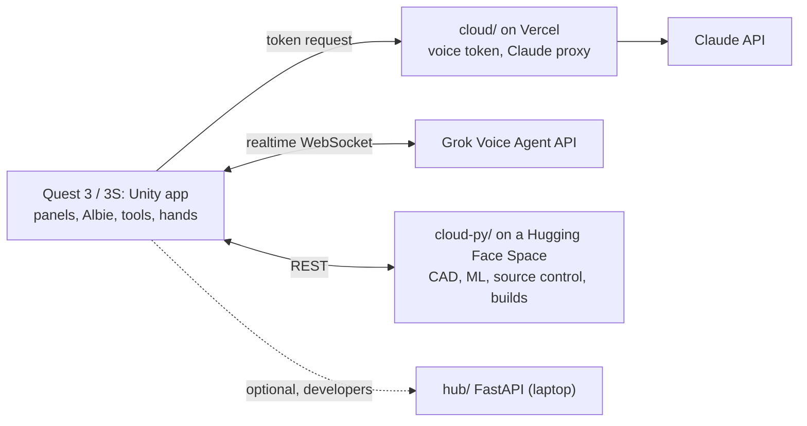

# Albie

Albie is a mixed reality workspace for engineers on Meta Quest 3 and 3S, led by an AI gator who walks on your real desk. You use it with your hands only: no controller is needed at any point. Open the voice with a button or a palm gesture and talk to him; he opens panels, builds things and explains them.

- History: the project started at Gator Hack V (UF AI Days, October 23 to 25, 2026) by a team of five. Work continued through November 18, 2026 for the Meta VR Start Developer Competition. The first commit is October 23, 2026.
- Runs standalone: the Quest APK talks to two small cloud services, `cloud/` (Vercel functions: voice tokens and the Claude proxy) and `cloud-py/` (a Hugging Face Space: CAD, ML training, source control and builds). The laptop hub in `hub/` is optional and only for developers.
- Gator Hack V demo video (3 min): https://youtu.be/28D1QIcsdzI
- AI tools: built with AI coding assistants. At run time Albie uses the Grok Voice Agent API, the Claude Agent SDK and the Claude API. Details in [docs/DISCLOSURE.md](docs/DISCLOSURE.md).
- Device Readiness Check in Meta XR SDK 207 passes ([screenshot](docs/images/device-readiness-check.png)).
- Build the APK: [docs/RELEASE.md](docs/RELEASE.md). Developer setup with the laptop hub: [docs/SETUP.md](docs/SETUP.md). Third-party code, assets and AI tools: [docs/DISCLOSURE.md](docs/DISCLOSURE.md).

## What it does

- **Hands first.** Poke and pinch the panels, teach Albie your own hand gestures and bind them to actions, and open the voice with a palm gesture. The room scan (Mixed Reality Utility Kit) finds your real desk and floor.
- **Talk to him.** Albie's voice is a live speech-to-speech session. Quick jobs (resize a fin, open a file) happen on the spot; longer coding jobs go to a coding agent while he keeps talking with you.
- **CAD with real physics.** Say "make the fins smaller" and the build123d part rebuilds while the rocket's stability updates live. "How high will it go?" runs a RocketPy flight on a real Estes C6 thrust curve.
- **ML.** Start a new project from a public Hugging Face dataset ("start an RNN project on movie reviews"), or pull up a GitHub repo, and watch the run stream live. Ask "what can I do better?" and Albie proposes a change and retrains. The Neural Net Lab lets you poke a small live network with your hands.
- **Artifacts.** "Make me a slalom" lays a course on your real floor; drive it twice with a pinch, say "learn it", and a small policy trained on the headset drives it alone. Anatomy and physics models stand on your table, and a lab notebook records each attempt.
- **Code and messages.** A code panel shows a project's files and a demo account's repos and pull requests; approve and merge need a confirm step. A demo messenger with fictional chats drafts replies that send only after you confirm.
- **The crew and your day.** Albie can hand tasks to specialist agents, and keeps a focus timer and notes as you talk.

## How it works (short)

- **Voice:** the headset holds the live Grok speech-to-speech session itself, with a short-lived token from `cloud/api/voice-token.ts`. Grok calls Albie's tools, which run on the device (`AlbieTools.cs` plus each module's `Resources/AlbieTools/*.json`). The session closes about 35 s after the last word.
- **Cloud:** CAD, ML training, source control and agent builds run per headset on the Hugging Face Space (`cloud-py/app.py`), which reuses the hub's Python modules. Every cloud call carries an app key.
- **Offline:** when the Space is unreachable, CAD and ML tools say so within 10 s, and on-device features (artifacts, desk, gestures, Neural Net Lab) keep working.
- **Optional laptop hub:** `hub/` is one FastAPI process and one WebSocket (`/ws`). Developers use it for Slack, optional iMessage, the git worktree crew and local ML runs. Every Unity module also runs on mock data with the hub off.

## Architecture

- The contracts (REST endpoints and `/ws` events) are in [docs/PROJECT_CONTEXT.md](docs/PROJECT_CONTEXT.md) section 7.
- All Unity networking goes through `ForgeNet` and `ForgeCloud` (`unity/Assets/_Forge/Core/Net/`).

## Tech stack

- Unity 6 (6000.6.7f1), URP, Meta XR All-in-One SDK 207 (Interaction SDK, MR Utility Kit), OpenXR, glTFast
- Cloud: TypeScript functions on Vercel (`cloud/`); Python 3.12 FastAPI in a Docker Hugging Face Space (`cloud-py/`) with build123d, RocketPy, PyTorch (CPU), transformers, Claude Agent SDK
- Optional hub: Python 3.11+, FastAPI, Claude Agent SDK, Anthropic SDK, slack-bolt
- Grok Voice Agent API (speech to speech)
- Albie's body: the Quirky Series alligator (Unity Asset Store, paid). Its files are not in this repo because the Asset Store EULA forbids redistribution; we added the opening mouth, the talk clips and all his behavior

## Repo map

"Forge" was our working name. Code names keep it (`ForgeNet`, `ForgePanel`, `unity/Assets/_Forge/`, `forge-sdk`, the **Forge** menu in Unity).

| Folder | What |
|---|---|
| `unity/` | The Quest app. Modules in `unity/Assets/_Forge/` (Core, Code, ML, CAD, Pet, Messages, Desk, Artifacts, Controllers, Notebook, OS) |
| `cloud/` | Vercel functions: voice token and Claude proxy |
| `cloud-py/` | The Hugging Face Space: CAD, ML, source control and builds per headset |
| `hub/` | The optional laptop hub: `agent/` (Albie, voice), `ml/`, `cad/`, `messaging/`, `desk/`, `code_browser/` |
| `forge-sdk/` | The Python package a training script uses to stream its run to the hub |
| `ml-examples/cifar10/`, `ml-examples/text-classification/` | The CIFAR-10 and AG News examples the ML desk trains |
| `sandbox/` | Builds Albie's sandbox repo |

## How to run

1. Clone the repo. Buy and import the Quirky Series alligator from the Unity Asset Store (not in git, see [docs/SETUP.md](docs/SETUP.md) step 9), then open `unity/` in Unity 6000.6.7f1.
2. Add the cloud app key file and build the APK with **Forge > Build > Release APK**. Requirements and signing: [docs/RELEASE.md](docs/RELEASE.md).
3. Install it with `adb install -r <apk>` or `sh quest-run.sh <apk>`, then launch Albie on the headset. No laptop is needed.
4. In the Unity editor with the hub off, every module runs on mock data (desktop mode: WASD and mouse).
5. Optional, developers: run the laptop hub (`sh dev-setup.sh <env file>`, then `sh run-demo.sh`). Full steps: [docs/SETUP.md](docs/SETUP.md).

Security note: the optional hub and its agent runner have no authentication and listen on the local network. Run them only on a private network or hotspot you control.

## Team

Started at Gator Hack V (UF AI Days 2026) and continued for the Meta VR Start Developer Competition by:

| Name | Department / major |
|---|---|
| Dev Goswami | BS Software Engineering, WGU |
| Adrian Pascual | Computer Science, CISE, College of Engineering |
| Satyabrata Das | Artificial Intelligence Systems, Department of Engineering Education (EED) |
| Hudson Marr | Electrical Engineering, ECE |
| Nandani Rai | MS in Computer Science |

## License

MIT, see [LICENSE](LICENSE). Third-party code, models, fonts and data keep their own licenses (see [docs/DISCLOSURE.md](docs/DISCLOSURE.md)).
