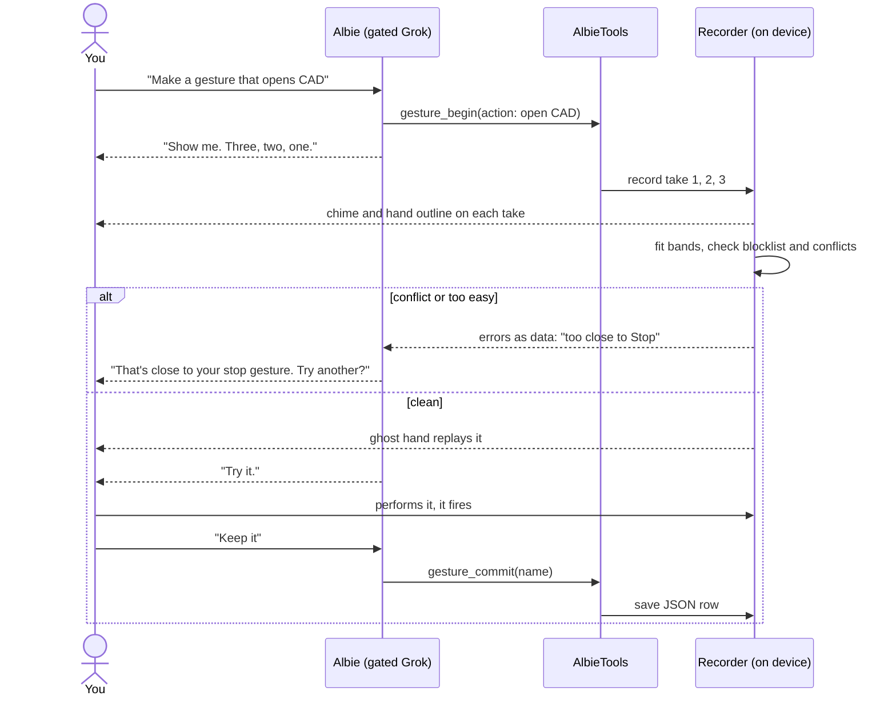

# Hand gestures: how to build them for Albie

> Written 2026-11-03 for Hudson. Deadline: 2026-11-18, 12:00 PT. Research only: no code, packages or contracts were changed.
> Takes over from section 3 of [`CONVERSATION_HANDS_3D_RESEARCH.md`](CONVERSATION_HANDS_3D_RESEARCH.md) where they disagree.
> **Decisions from Hudson:** voice is gated Grok. Hands-free by default. Hand motion must be immaculate. Users make their own gestures by talking to the agent and showing it. Tapping the desk is the main way to trigger things on it.

| Label | Meaning |
|---|---|
| **[Source]** | Read in the Interaction SDK and Core SDK source, version 207.0.1 (local package cache of `~/messaround`, since `unity/Library` isn't in this checkout) |
| **[Repo]** | Read in this repo |
| **[Checked]** | Read on the primary page during synthesis |
| **[V]** | A research agent reports reading the repo or primary page |
| **[S]** | Secondary source |
| **[E]** | My estimate. Every one needs tuning on a headset |
| **[U]** | Unverified |

---

## 1. The answer

**There's no repo to pull this from. Build a small gesture layer on top of Meta's Interaction SDK, and take ideas from the repos.**

We searched GitHub properly this time, and read the code of the main recorders:

- **No licensed, maintained Quest library exists for gestures users record themselves.** No repo targets Unity 6 with Meta SDK 207. The newest Meta-pinned hand showcase is on SDK 77 [V].
- **No shipped system we could verify lets end users record a gesture.** Meta's and Ultraleap's recorders are editor tools, and Unity's has no recording at all [V]. Coverage has gaps (PICO, HTC, Android XR weren't searched). If this works it's a real differentiator, not a copy of something.
- **Almost all open recorders use the same weak method:** fingertip or bone distances against a fixed 5 cm threshold. That breaks across hand sizes and has no margin between similar poses [V, reasoning from their code].
- **No usable open repo for tapping a real surface.** Meta's own research (TouchInsight) proves it's possible on a Quest 3, but we found no released code [Checked, U].

**Build three things:**

1. **The feel layer:** mostly SDK settings and components, a few days' work, and it improves everything.
2. **One gesture engine:** reads ISDK's finger features, matches JSON templates. Roughly 400–600 lines of C# for poses and pose-plus-motion [E].
3. **One tap detector:** ISDK poke on a calibrated desk plane, with a gate that rejects resting and dragging hands.

---

## 2. Immaculate hands: what to change

Today's state comes from the project files [Repo]: `handTrackingFrequency: 0` in `OculusProjectConfig.asset`, which is `LOW`, and no `EnvironmentDepthManager` in `Main.unity`.

| # | Change | Why | Evidence |
|---|---|---|---|
| 1 | **Fix virtual things drawing over your real hand.** Spike Depth API soft occlusion, and a cheaper hand-mesh cutout | Nothing breaks the illusion faster at a desk. Soft occlusion looks better and costs a little more GPU; hard is jagged and unstable | [V] for Depth API on 3 and 3S. The cutout is [U], from memory, needs checking |
| 2 | **Test high-frequency tracking**, then keep it if frame time holds | Default is about 30 Hz. HIGH is 60 Hz, which helps flicks and taps | Setting [Source]. A 2021 Quest 2 report: about 10% less latency, slight jitter in low light [S]. **Cost on 3 and 3S is unmeasured** |
| 3 | **Two hand signals:** a smoothed one to draw, a raw one to detect | Filtering adds lag. Gestures should fire on the freshest data | Pattern is [E]. `HandVisual` can bind to different modifier stages [V] |
| 4 | **Use `HandFilter`** with the SDK's Low, Medium or High smoothing assets | One Euro on wrist and fingers. Built-in defaults: wrist `beta` 5, `minCutoff` 0.5; finger `beta` 1, `minCutoff` 0.5 | [Source] |
| 5 | **Stop the finger at surfaces:** `HandPokeLimiterVisual` plus `SyntheticHand` | Virtual fingers don't sink through a button | [Source] |
| 6 | **Button travel:** `PokeInteractableVisual` | Buttons depress with the finger. An agent reported this must be built from scratch, but it's in the SDK | [Source] |
| 7 | **Glows:** `HandRayPinchGlow`, `HandGrabGlow`, `HandPokeOvershootGlow` | Shows the hand what it's doing | [Source] |
| 8 | **Fade on low confidence**, never snap off | Meta calls hands flashing on and off jarring. Use `IsHighConfidence` and `GetFingerIsHighConfidence` | [V, Source] |
| 9 | **Hysteresis on pinch**, for example on at 0.8, off at 0.7 | Stops flicker. Meta's hover uses the same idea: 15 cm in, 20 cm out | Values are Ultraleap's [S]. Hover [Checked] |
| 10 | **Sound and visual on every action** | Meta says immediate cues are needed because hands have no haptics | [V] |
| 11 | **Scale-on-state buttons:** normal, hover, select, disabled | The Tabletop sample lerps scale at speed 10. Rebuild it, since that repo's licence is Meta's SDK licence | [V] |
| 12 | **Keep hands comfortable:** over 10 cm from the headset, elbows in, avoid one hand covering the other | Meta's own guidance | [V] |
| 13 | **Skip physics hands** | No evidence it's worthwhile at a desk, and it costs time | [E] |

---

## 3. The gesture engine

### 3.1 Recognition: use ISDK's features

The best idea in the repos is to compare **finger features, not bones**. `universal-gestures-unity` builds a 21-number vector from the SDK: 17 finger values plus 4 hand-orientation values [Checked]. It has no licence, so take the idea only, and it allocates every frame, so don't copy its loop.

`FingerFeatureStateProvider.GetFeatureValue(finger, feature)` returns continuous curl, flexion, abduction and opposition at runtime [Source]. Those are angles, so they're closer to independent of hand size than bone distances [V, reasoning].

**This revises the earlier doc.** It proposed building `ShapeRecognizer` at runtime. That is possible [Source], but it reduces each finger to Open, Neutral or Closed. Recording real ranges from real samples is more precise, and doesn't depend on Meta's asset path. **Keep `ShapeRecognizer` and `Sequence` for the gestures we author in the editor.**

### 3.2 Pose matching

Every number here is a starting estimate [E].

**Saving a pose (3 takes, about 0.5 s each):**

- Record the feature vector. Per feature, store mean and spread.
- Band = mean ± the larger of 3× spread and a minimum width.
- **Drop the features that don't matter.** Meta's own recorder is "often too strict" because every finger detail stays on [V]. Keep only features that differ from the rest pose. Thumbs-up doesn't care about ring-finger spread.

**Matching, each tracking frame:**

- Skip low-confidence frames.
- Check the most telling features first and stop at the first miss, the XR Hands approach [V]. This keeps it cheap and allocation-free.
- Require the pose for `hold_s`, with exit bands wider than entry bands to prevent flicker.
- Require the best match to clearly beat the second best. Fire once, then cool down.

**Handedness:** curl and flexion values are comparable across hands, so one template can serve "either hand", or be locked to one [E]. No repo we read handled this correctly.

### 3.3 Moving gestures: two levels

**Level 1 (by Nov 18): a pose plus a motion plus a pose.** "Thumbs up, flick right" is a small state machine on top of the matcher, and it covers most useful gestures. Start-hold-end is how `VisionGesture` works [V], and ISDK's `Sequence` and `JointVelocityActiveState` work the same way [Source]. Recording captures the start pose, the motion direction and peak speed, and the end pose.

**Level 2 (stretch or later): any path, using DTW.**

- 18 numbers per frame: 5 fingertips plus wrist, in palm frame, scaled by hand size.
- 3 takes, resampled to 30 frames, 10% Sakoe-Chiba band, threshold = worst leave-one-out distance × 1.2.
- A 2-second ring buffer checked every 3rd frame, with a rest-pose start, a margin test, two-in-a-row confirmation and a 1-second refractory.
- About 350 lines [E]. Reference: Jackknife is designed for 1–2 samples but its licence is academic-only, so re-implement [V]. `Kuji-Kiri`'s DTW is 144 lines, also unlicensed, so read only [V]. Don't use $P or $Q as-is: they're 2D-stroke recognizers [V].

**Live streams are the hard part.** They have no start or end. The defences that matter are a rest-pose start, a best-vs-second margin, and a `none` class of negative samples. The VKM paper and Jackknife's spliced negatives are the sources to read [V].

### 3.4 Stopping false fires

| Check | When | How |
|---|---|---|
| Blocklist | Saving | Open palm facing the headset plus pinch, on either hand [Checked] |
| Conflicts | Saving | Replay the new takes against all saved gestures, and saved takes against the new one. Warn on any match. The `none`-class idea is MediaPipe's [V]; the warning design is ours because no source shows one |
| Too easy to do by accident | Saving | Keep a rolling buffer of ordinary hand poses from this session as negatives, plus a built-in rest pose. No "stand still for 60 seconds" |
| Context | Live | A gesture bound to the Library only listens when the Library is open. Meta recommends gating on hover or proximity [V] |
| Hold and cooldown | Live | `hold_s`, then a cooldown |
| Irreversible actions | Live | **A custom gesture can only open a confirm card**, never act directly (CLAUDE.md) |

### 3.5 Data format (proposal, not adopted)

Extends the `gestures.json` row in `OPERATING_MODEL.md` 5.3. Agents add gestures with no C# change. New feature kinds would still be a core ticket.

```json
{
  "id": "user.thumbs_up",
  "source": "pose:user",
  "action": { "tool": "ui_open_view", "args": { "view": "cad" } },
  "gate": { "context": "any", "proximityM": 0.6 },
  "fallback": "poke:library.cad",
  "match": {
    "kind": "pose",
    "hand": "either",
    "hold_s": 0.4,
    "cooldown_s": 1.0,
    "features": [
      { "finger": "thumb", "feature": "curl", "min": 150, "max": 195 },
      { "finger": "index", "feature": "curl", "min": 225, "max": 265 },
      { "transform": "WristUp", "min": 0, "max": 40 }
    ]
  },
  "provenance": { "said": "thumbs up opens CAD", "takes": 3, "version": 1 }
}
```

Feature numbers are placeholders. Check `FingerFeatureProperties` for real ranges. Takes are stored as features, not video, which also helps privacy. MediaPipe stores landmarks for the same reason [V].

---

## 4. "Make me a gesture": talk, show, done

No verified prior art pairs an LLM with gesture binding [V, GitHub search partial]. Teaching by demonstration has research support [S: Gesture Coder, GesturAR]. **So the agent talks and binds, and the matcher recognises. The LLM never decides whether a gesture fired, so recognition stays instant and works offline.**



**Proposed tools, all device-side:** `gesture_begin`, `gesture_cancel`, `gesture_commit`, `gesture_list`, `gesture_delete`, and `gesture_test`. Errors return as data, like the other `AlbieTools`. Results go back through the same tool path, so tests can drive them too.

**Three touches that make it feel good:**

- **Ghost hand replay.** "Here's what I saved." `AnimatedGhostHand` in First Hand (MIT, needs porting from v68) is a good base [Checked]. The same ghost teaches the gesture later, when you ask "what gestures do I have?"
- **Live match meter while trying it,** so you can see why it did or didn't fire. Too strict or too loose becomes visible [E].
- **Albie can suggest the action.** "Which one do you use most?" Most of the design is already handled by the tool list, since `gesture_begin` can bind to any `AlbieTools` action.

**Hands-only rule.** The contest needs every voice action to have a hand path. A "New gesture" button in the Library with an action picker covers recording with no voice. Custom gestures also stay optional: everything they trigger has a poke fallback.

**Nothing leaves the headset except the conversation.** The takes stay on the device. Sync through the project repo later, if at all.

---

## 5. Tap the desk

You set something on the desk, tap the desk beside it, and its UI pops up. No pinching or pointing.

**What the research says:** Meta's TouchInsight detects surface touches on a Quest 3 with F1 0.99, 6.3 mm mean error, under 70 ms latency, from hand tracking at 30 Hz [Checked]. That's a trained neural network on 41 frames of hand data, and it isn't available to us. So hand tracking is good enough, but a simple rule will do worse. **Design for that: large targets, not small buttons.** Tap detection is also the part with the highest risk here, so test it first.

### 5.1 How to build it

**Start from ISDK poke, on a calibrated plane.** `PlaneSurface` is an `ISurface` [Source], and `PokeInteractable` fires when the fingertip crosses a surface between frames, which is the rule we want [V]. It also brings `MinThresholdsConfig`, recoil assist, and the poke limiter.

| Parameter | Start at [E] | Why |
|---|---|---|
| Trigger plane | 1.0 cm above the desk | Fires before contact. The desk gives the feel |
| Target | Zone around the object, about 12 cm, **not 4 cm buttons** | Hand tracking is noisy near contact |
| Armed only if | Finger came from over 2.5 cm above, within the last 150 ms | Rejects a hand already resting. `MinThresholds` covers part of this [Source] |
| Speed | At least 0.15 m/s downward through the plane | Rejects a slow drift down |
| Sideways | Under 0.1 m/s during crossing | Rejects an arm dragging across the desk |
| One finger | Only one fingertip crossing in the window | Rejects a hand laid down |
| Confidence | `GetFingerIsHighConfidence` true for that finger | Skips bad frames |
| Release | Back above 2 cm, then 300 ms before it re-arms | No double fires |
| Hover | Override the SDK's 15 cm default to about 2.5 cm | 15 cm [Source, Checked] would mean constant hover at a desk |
| Feedback | Click, plus a ripple on the desk at the touch point | Makes the tap feel physical |

The gate can run on the poke's select event, in a small `DeskTap` component [E]. **Run the test in 5.3 before adding more.** If poke fails it, write a direct detector with the same rule.

### 5.2 Finding the desk

1. **First guess:** MRUK `TABLE` plane, or `GetBestPoseFromRaycast` [V]. Scans don't guarantee a table, and height accuracy is unknown [V, U].
2. **Calibrate with a flat hand.** TouchInsight has the user lay a hand flat on the surface for a few seconds [Checked]. That's simpler than tapping points, and developers report tap-to-calibrate can fail on small height differences [S]. Albie can ask: "Put your hand flat on the desk."
3. **Refine quietly** from where taps actually stop [E, no source].
4. **Save** the plane against a room anchor, and re-check at session start [E].

### 5.3 The test

**On Nov 4–5, on a 3S first:** 50 deliberate taps, then 2 minutes of resting hands, typing on a real keyboard and talking with your hands. **Pass: at least 48 of 50 fire, no false fires** [E]. Log every near miss with its speed and height, so thresholds come from data.

**Fallback if it fails:** real 3D buttons on the desk that the finger presses from above (`WhistleButton` already does this [Repo]). If nothing is reliable, floating panels at desk height. Every tap needs a non-desk route anyway, since not every judge has a usable table.

**Quest 3S risk:** Meta lists a depth sensor for Quest 3 and not 3S [V], and TouchInsight only ran on Quest 3 [Checked]. Hand-tracking accuracy on 3S at contact is unknown.

---

## 6. The cool ones

Delight rankings are opinion. Days are rough estimates. Apps named are prior art, not code to copy. Reviews rarely describe how these fail.

| # | Gesture | How it works | Why | Risk | Days |
|---|---|---|---|---|---|
| 1 | **Palm out: Albie comes to you** | Open pose, palm facing out, held 0.5 s | Hello Dot's pet summon, hand-only [S] | Stay clear of the palm-towards-face system pose | 0.5 |
| 2 | **Poke or pet Albie** | Poke proximity on the gator, `GatorHandPoke` exists [Repo] | Pinch and touch have self-haptic feel [S] | Low | 0.5 |
| 3 | **Flat palm: Albie hops on** | Flat palm, still for 1 s | Instantly reads as a pet | Tracking at low speed, carrying logic | 1 |
| 4 | **Tap the desk: UI pops up** | Section 5 | Your idea, and physical | Accuracy | 2 |
| 5 | **Point, pinch, flick: window comes to you** | Earlier doc's state machine | Alyx's gravity gloves are the proof [S] | Filter lag at 30 Hz | 2 |
| 6 | **Flick it away: dismiss** | Pinch, flick outward | The same machine, reversed | Accidental on conversation hands, so pinch first | 0.5 after #5 |
| 7 | **Thumb swipe: accept or reject** | `OVRMicrogestureEventSource` [Source] | Tiny, private, hands rest on desk | Device-only testing | 0.5 |
| 8 | **Finger gun at a panel** | Pose plus ray | Fun, and easy to teach | False fires at rest. Keep it behind hold | 0.5 |
| 9 | **Make your own** | Section 4 | The one nobody else has | Section 3.4 | 4–5 |
| — | Two-hand frame to capture | Two poses plus distance | Great in a video | Fatigue, occlusion, Meta advises against far reaches [V] | Later |
| — | Snap, clap | | Snap detection unverified; a clap and a desk tap look alike | Skip |

Pick the ones a judge sees in 3 minutes: **palm summon, pet, desk tap, flick, make-your-own.**

---

## 7. Where to pull from

| Source | Licence | Pushed | What to take | How |
|---|---|---|---|---|
| **Interaction SDK 207.0.1** | Meta SDK | In project | `FingerFeatureStateProvider`, `TransformFeatureStateProvider`, `Sequence`, `JointVelocityActiveState`, `PokeInteractable`, `PlaneSurface`, `HandFilter`, glows | **Use directly** |
| **Unity-InteractionSDK-Samples** | Meta SDK licence | 2026-09-24 | Pinned to 207.0.0 [V]. `MRTabletop`: `InteractableStateScaleVisual`, `FingersEquallyCurledActiveState`, `PointableElementSelector` | Rebuild the idea, unless a licence read allows reuse |
| **Unity-MRUtilityKitSample** | MIT | 2026-09-24 | `EnvironmentPanelPlacement.cs`: hand raycast, rejects bad normals, 0.13 s easing | **Port.** For placing things on the desk |
| **Unity-FirstHand** | MIT | 2026-05-28 | `AnimatedGhostHand`, `GloveBehaviour` (wrist pose within 0.1 and 20°), `ActiveStateUIInteractable` | **Port.** On SDK v68, so expect renames. Skip its bundled SDK folders |
| **Unity-MRMotifs** | MIT | 2026-05-28 | Instant Content Placement's grounding shadow, whiteboard microgestures | Read, then port |
| **Unity-NorthStar** | MIT | 2026-01-23 | Hand-first ISDK patterns, grab-pose assets | Read. On SDK 77 |
| **Unity XR Hands** | Unity package | n/a | Band-per-finger, ordered early exit | **Idea only.** Don't add a second hand pipeline |
| **universal-gestures-unity** | None | 2026-06-04 | The ISDK feature vector | **Idea only** |
| **QuestHandRecorder** | None | 2026-07-19 | JSON pose recording and ghost playback | **Idea only** |
| **SimpleGestureRecorder** | MIT | 2024-02-08 | Record, snapshot and combo design | Read. Built on XR Hands |
| **Jackknife, Machete, VKM** | Academic | 2021–24 | Few-sample DTW, spliced negatives, spotting | **Re-implement from the papers** |
| **TouchInsight** | Paper | 2024 | Flat-hand calibration, what's possible | Idea only |
| **MediaPipe Model Maker** | Apache-2.0 | Unmaintained | The `none` class, storing landmarks | Idea only |

**Rejected:**

- **MiVRy:** closed native engine, conflicting licence signals, $65 for QuestHands, Quest and IL2CPP support unstated [V].
- **jorgejgnz recorder:** no licence, 2021, fixed 5 cm, no persistence [V].
- **yolanother recognizer:** MIT, but has a bug where the last passing sample wins instead of the closest, and uses `BinaryFormatter` [V].
- **OpenGestureXR:** webcam and Python server, its own socket breaks our `ForgeNet` rule [V].
- **Barracuda-based classifiers:** they need training data and a deprecated runtime [S]. No training server by Nov 18.
- **PDollar-Unity:** fine code (BSD-3), but 2D strokes [V].
- **Auto Hand, physics hand packs:** paid, and no case at a desk [S].
- **Ultraleap modules:** different hardware [V].
- **Old samples from 2019–2021:** stale.

**Licence caution:** "no licence" means all rights reserved, so read for ideas and write our own. Get a read on the Meta SDK licence before copying sample code [V, S conflict].

---

## 8. Build order

The Thing runtime stays the critical path, and this schedule shouldn't displace it.

| When | Item | Done when |
|---|---|---|
| Nov 4–5 | **Desk tap spike on a 3S.** Decide the frequency setting at the same time | 5.3 passes, or the fallback is chosen |
| Nov 4–5 | Feel pass: items 3–10 in section 2 | A before-and-after video on a headset |
| Nov 5–6 | Occlusion spike | Hands look right in front of panels at 72 fps |
| Nov 5–7 | Gesture engine and router: editor-authored gestures first, poses from JSON | Palm summon and thumb swipe work through the same path as mouse and simulator |
| Nov 7–9 | Recorder and checks: 3 takes, bands, blocklist, conflict replay | A recorded pose works with no C# change |
| Nov 8–10 | Talk flow: gesture tools, ghost replay, try-it, commit | "Make a gesture that opens CAD" works end to end |
| Nov 9–11 | Pet, palm perch, flick | Feel review |
| Nov 11–12 | Pose-plus-motion level, if on track | One recorded motion gesture works |
| **Nov 13** | **Freeze** | Hands-only pass |

**After Nov 18:** recorded arbitrary paths (DTW), two-hand gestures, gesture sync.

**First cuts:** motion recording, then palm perch, then flick. **Keep:** the feel pass, tap or its fallback, and recorded poses.

**XR Simulator can't test this.** Custom poses and microgestures aren't simulated [V]. Plan a **debug replay**: record real hand features on a Quest to a file, then play them through the matcher in EditMode. This makes false-fire tests repeatable, and gives five people one Quest's worth of data (Core owner's call, because it touches shared test tooling).

---

## 9. Your decisions

1. **Bind any `AlbieTools` action to a custom gesture?** Recommend yes, with irreversible ones opening a confirm card.
2. **Contract proposal:** accept the `gestures.json` extension, where gesture geometry becomes data? This changes `OPERATING_MODEL.md` 5.3. It isn't applied yet.
3. **Hand tracking frequency:** a Project Settings change, your call as Core owner. Decide from the Nov 4–5 measurement.
4. **Hands-free consequence:** with hands-free on by default, room speech may reach the voice service, depending on whether local name spotting passes. The privacy notice needs to say so, and the mic-on state must be visible. Worth a line of your attention.

---

## 10. Still unverified

**Only a headset can settle these:**

- Desk tap accuracy with the simple rule, on Quest 3 and especially 3S.
- Frame cost of HIGH frequency and occlusion at 72 fps.
- Whether 3 takes make a reliable pose, and all numbers above.
- `GetFeatureValue` under IL2CPP, and the real numeric ranges.
- Whether Albie's bands hold across two different people's hands.

**Coverage gaps:**

- GitHub's search API rate-limited several agents, and my own `gh` searches returned little. The sweep covered 17 searches and is better than the last one, but it isn't exhaustive.
- Hand feel in shipped apps (Thrasher, Cubism, Hand Physics Lab) is thin. Vision Pro's gesture pages wouldn't load. `Unity-HandPhysicsLab` returned 404.
- Other platforms not searched: PICO, HTC, Android XR, Apple AssistiveTouch.
- Target sizes and ray stabilisation numbers weren't found.
- The hand-mesh cutout for occlusion is from my memory.
- Agent-reported file paths in Meta's samples were spot-checked, not all confirmed.

---

## 11. Main sources

**SDK source (207.0.1):** `FingerFeatureStateProvider.cs`, `FingerFeatureProperties.cs`, `TransformFeatureProperties.cs`, `ShapeRecognizer.cs`, `Sequence.cs`, `JointVelocityActiveState.cs`, `PokeInteractable.cs`, `PokeInteractor.cs`, `PlaneSurface.cs`, `HandPokeLimiterVisual.cs`, `PokeInteractableVisual.cs`, `HandFilterParameterBlock.cs`, `HandRayPinchGlow.cs`, `IHand.cs`, `OVRMicrogestureEventSource.cs`, `OVRProjectConfig.cs`.

**Papers:** [TouchInsight](https://arxiv.org/html/2410.05940v1) · [UploadVR on TouchInsight](https://uploadvr.com/touchinsight-turn-any-surface-into-a-virtual-keyboard) · [Rapid custom gestures, wrist](https://arxiv.org/abs/2203.15239) · [One-shot vision gestures](https://arxiv.org/abs/2402.08420) · [VKM](https://www.eecs.ucf.edu/isuelab/research/vkm/) · [GesturAR](https://par.nsf.gov/servlets/purl/10396709)

**Repos:** [Unity-InteractionSDK-Samples](https://github.com/oculus-samples/Unity-InteractionSDK-Samples) · [Unity-FirstHand](https://github.com/oculus-samples/Unity-FirstHand) · [Unity-MRUtilityKitSample](https://github.com/oculus-samples/Unity-MRUtilityKitSample) · [Unity-MRMotifs](https://github.com/oculus-samples/Unity-MRMotifs) · [Unity-NorthStar](https://github.com/oculus-samples/Unity-NorthStar) · [universal-gestures-unity](https://github.com/uwrealitylabs/universal-gestures-unity) · [QuestHandRecorder](https://github.com/charon616/QuestHandRecorder) · [SimpleGestureRecorder](https://github.com/Phlegmati/SimpleGestureRecorder) · [Jackknife](https://github.com/ISUE/Jackknife) · [Machete](https://github.com/ISUE/Machete) · [VKM](https://github.com/ISUE/VKM) · [Kuji-Kiri](https://github.com/HankunYu/Kuji-Kiri) · [PDollar-Unity](https://github.com/DaVikingCode/PDollar-Unity) · [VisionGesture](https://github.com/AlohaYos/VisionGesture) · [MiVRy](https://github.com/MARUI-PlugIn/MiVRy) · [HandTrackingGestureRecorder](https://github.com/jorgejgnz/HandTrackingGestureRecorder) · [UnityHandGestureRecognizer](https://github.com/yolanother/UnityHandGestureRecognizer) · [OpenGestureXR](https://github.com/raechao93/OpenGestureXR)

**Meta guidance:** [Touch specs](https://developers.meta.com/horizon/design/touch_specs/) · [Hands best practices](https://developers.meta.com/horizon/design/hands-best-practices/) · [Gesture design](https://developers.meta.com/horizon/design/hands-gesture-design/) · [Hand pose detection](https://developers.meta.com/horizon/documentation/unity/unity-isdk-hand-pose-detection/) · [Pose recorder](https://developers.meta.com/vr/documentation/unity/unity-isdk-hand-pose-selector-recorder/) · [Hand visual](https://developers.meta.com/horizon/documentation/unity/unity-isdk-hand-visual/) · [Depth occlusion](https://developers.meta.com/horizon/documentation/unity/unity-depthapi-occlusions/) · [Hand tracking](https://developers.meta.com/horizon/documentation/unity/unity-handtracking/) · [VRC Input.8](https://developers.meta.com/horizon/resources/vrc-quest-input-8/)

**Others:** [XR Hands shapes](https://docs.unity3d.com/Packages/com.unity.xr.hands@1.7/manual/gestures/hand-shapes.html) · [MediaPipe customization](https://developers.google.com/edge/mediapipe/solutions/customization/gesture_recognizer) · [One Euro filter](https://gery.casiez.net/1euro/) · [Hand Physics Lab 60 Hz](https://uploadvr.com/hand-physics-lab-60hz-update/) · [Hello Dot](https://queststoredb.com/game/hello-dot-25825290007070369)
